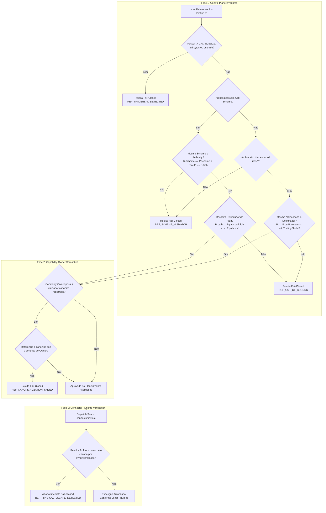

# Contrato de Concessão Explícita de Capabilities a Missions (Operator Capability Grant Trust Contract)

> **Estado:** PROPOSTA PARCIALMENTE RATIFICADA — D03/D06/D08/D15 aprovadas para Slice A e D09 (opção 1)/D14 (opção A) aprovadas para o desenho interno B1 em 2026-11-01. As outras nove decisões e o contrato público permanecem `NEEDS_APPROVAL`. Slice A está implementado na `main` via PR #169; B1 e a concessão operacional de capabilities não estão implementados. Fonte normativa B1: `docs/decisions/2026-11-01-authstore-authority-generations-b1-ratification.md`.
> **Repositório:** `Anakyklos/ouroboros-runtime`
> **Issue:** #166 (P1), epic principal #70 (M1 Local Control Plane)
> **PR:** https://github.com/Anakyklos/ouroboros-runtime/pull/167 (revisão técnica aprovada em `df19ece67496ad96e829cbe9ae83aa13cd998f9f`; ratificação parcial posterior)
> **Base SHA auditado:** `4a0d6d52075bc665568e126124eb24ec8b8b2ed0` (`main`)
> **HEAD auditado anterior:** `6163b59623762d1376e02b1e383ad1e96efe87e9` (PR #167, CI `41263958922` SUCCESS, review 5726098318 REQUEST_CHANGES)
> **Bun (local):** `1.4.2` (CI pin: `1.3.9`)
> **Data:** 2026-11-01
> **Branch:** `docs/166-capability-grant-trust-contract`
> **Classificação de status:** `RATIFICAÇÃO PARCIAL — D03/D06/D08/D15 + D09/D14 aprovadas em escopos distintos; nove decisões NEEDS_APPROVAL`

---

## Legenda de classificação

Toda afirmação neste documento carrega uma das seguintes classificações estritas:

- **PROVADO NO CÓDIGO** — verificável no código-fonte atual da base auditada (`main`).
- **CONTRATO EXISTENTE** — definido por contrato normativo ou documento aprovado presente no repositório.
- **PROPOSTA** — comportamento ou contrato proposto por este documento; não implementado.
- **HIPÓTESE** — possibilidade técnica ou arquitetural não comprovada; requer POC ou evidência empírica.
- **DECISÃO PENDENTE** — escolha de design ou escopo que requer aprovação explícita de Pedro / mantenedor.

---

## 1. Executive decision summary

**Recomendação arquitetural (PROPOSTA):** Adotar a **Alternativa B com integridade física e controle de concorrência determinístico** — um **ledger durável e fisicamente append-only** de eventos imutáveis de concessão e revogação de capabilities no SQLite local do runtime (`SqliteMissionStore`). A autoridade para qualquer ação decorre exclusivamente da **associação atômica** mantida por um grant individual ativo, validada contra uma fonte confiável independente de limites máximos do autorizador.

**Correções centrais incorporadas nesta revisão (PROPOSTA):**

1. **Integridade referencial sob `PRAGMA foreign_keys = OFF` (PROPRIEDADE PROPOSTA A COMPROVAR):** Constata-se que `cli/src/mission/sqlite-mission-store.ts:291` desativa explicitamente as foreign keys do SQLite (`foreign_keys = OFF`). Portanto, confiar isoladamente em cláusulas `FOREIGN KEY ... ON DELETE RESTRICT` não impede a exclusão acidental de uma Mission com grants. A proposta institui um **trigger de proteção diretamente na tabela `missions`** (`prevent_mission_delete_with_grants`) que aborta fisicamente o comando `DELETE FROM missions` via `RAISE(ABORT, ...)`. Esta garantia estrutural é um requisito a comprovar na suíte de testes do Slice A.
2. **Extinção definitiva de autoridade revogada, imutabilidade de `client_id`, proteção contra mutações diretas de escopos, semântica de `INSERT OR REPLACE` e delimitação exata do Trust Boundary:**
   - *Fato factual:* A salvaguarda anterior focava na proteção de `revoked_at` e monotonicidade numérica de `authority_epoch`, mas apresentava duas lacunas: (1) O SQL integral proposto sob `PRAGMA recursive_triggers = OFF` (padrão SQLite) permitia que um comando `INSERT OR REPLACE` excluísse a linha do cliente sem disparar o trigger `BEFORE DELETE`, inserindo o registro na mesma época com `revoked_at = NULL` e ressuscitando grants; (2) O DDL publicado continha a regra restritiva da Opção A dentro de um trigger único, tornando a Opção B inexequível sem deltas explícitos.
   - *Solução relacional mínima e completa:* Unifica-se a proteção da tabela `local_control_clients`:
     1. `prevent_client_unauthorized_update`: aborta qualquer `UPDATE` que (a) tente mutar `client_id` (identidade estritamente imutável); (b) decremente `authority_epoch` ou o rebaixe abaixo de `max_epoch`; (c) reative um cliente revogado (`OLD.revoked_at IS NOT NULL AND NEW.revoked_at IS NULL`) sem avanço estrito e obrigatório de época ($NEW.authority\_epoch > OLD.authority\_epoch$); ou (d) sob a Opção A, altere `scopes_json` (`NEW.scopes_json != OLD.scopes_json`) sem avanço estrito de `authority_epoch` ($NEW.authority\_epoch > OLD.authority\_epoch$).
     2. `enforce_client_authority_epoch_insert_monotonicity`: aborta qualquer `INSERT` onde `NEW.authority_epoch <= max_epoch` para cliente com histórico prévio em `local_control_authority_epochs`, impedindo ressurreição por colisão ou inserção direta.
     3. `prevent_client_delete`: veda deleção física de clientes (desativação exclusivamente lógica).
     4. `prevent_authority_epochs_delete` e `prevent_authority_epochs_update_decrement`: protegem a imutabilidade do high-water mark permanente.
     5. Preservação estrita de rotação de segredo pura em cliente ativo (`revoked_at IS NULL`, mesmo `scopes_json`, `authority_epoch` inalterado).
   - *Distinção rigorosa do Trust Boundary e Semântica de `REPLACE`:* Esclarece-se que os triggers do SQLite operam como **guardas de integridade relacional de invariantes**, e NÃO como mecanismo autônomo de autorização contra qualquer DML arbitrário. Sob `PRAGMA recursive_triggers = OFF`, exclusões implícitas de `REPLACE` não disparam `BEFORE DELETE`. Portanto, a proteção arquitetural conjuga: (a) **Allowlist de Escritores no Store**: proibição categórica de `INSERT OR REPLACE`, exigindo mutações unicamente via `INSERT ... ON CONFLICT(client_id) DO UPDATE`; (b) **Configuração de Conexão**: inicialização mandatória de conexões de escrita com `PRAGMA recursive_triggers = ON;` (ativando o trigger de delete caso um REPLACE ocorra); e (c) **Trust Boundary do Host**: isolamento do arquivo via permissões POSIX (`chmod 0600`) e usuário de serviço dedicado.
   - *Diferenciação normativa entre as alternativas (Opções A, B e C):* O contrato não impõe um DDL único e incompatível:
     - **Opção A:** Alteração de escopos avança forçadamente a época ($E \to E + 1$) via trigger e UPSERT; extinção definitiva e permanente no ledger anti-ressurreição;
     - **Opção B:** Alteração de escopos preserva a época; o trigger de update não condiciona `scopes_json`; suspensão dinâmica fail-closed nos portões de dispatch em runtime (`GRANTOR_SCOPE_REVOKED`); grants anteriores podem voltar a ser válidos se privilégios forem restaurados na mesma época;
     - **Opção C:** Modelo híbrido; avanço forçado de época ativado estritamente pela remoção do escopo-raiz de governança `mission.grant_capabilities`, com detecção estrutural via `json_each` (imune a serializações equivalentes e escapes Unicode) e comportamento fail-closed (`json_valid`), combinado com validação dinâmica contínua nos gates para encolhimento de envelope de limites (`operator-limits.json`).
     A escolha normativa entre A, B e C foi posteriormente ratificada por Pedro como **Opção A**, exclusivamente para B1 interno (ver ADR `2026-11-01-authstore-authority-generations-b1-ratification.md`).
3. **Consistência eventual cross-DB sem garantias temporais inventadas (AuthStore vs. MissionStore):**
   - *Fato factual:* A CLI administrativa (`cli/src/commands/admin-cli.ts:73-99`) executa como processo efêmero direto sobre `local-control-auth.db`. O daemon opera em outro processo gerenciando `missions.db` (`cli/src/daemon/main.ts`). Não há mecanismo de invalidação ativa (watcher, push IPC) entre os processos.
   - *Semântica corrigida e eliminação de cifras decorativas:* Remove-se terminantemente qualquer alegação de que a janela seja "estritamente limitada a 500 ms" ou qualquer promessa de SLA temporal não comprovável. Diferenciam-se com rigor: (1) idade da autorização no despacho; (2) atraso arbitrário até a próxima leitura do AuthStore pelo daemon; (3) tempo de emissão de cancelamento; e (4) irreversibilidade física de efeitos externos já transmitidos ao conector.
   - *Garantia normativa:* Semântica estritamente **eventual sem SLA temporal** no baseline (Opção 3), assegurando comportamento **fail-closed no próximo gate validado** (Gate 3 ou Gate 4 de qualquer passo subsequente), com cancelamento assíncrono estritamente *best-effort*. Eliminação total da janela de corrida e zero efeitos externos só existem sob coordenação real: Opção 1 (Daemon RPC) ou Opção 2 (Stores Unificados).
4. **Governança de downgrade sem perda de evidência, realidade do v1 e snapshot WAL unificado:**
   - *Fato factual:* O binário legado v1 atualmente em `main` (`cli/src/mission/sqlite-mission-store.ts:287-350`) **não lê nem verifica `PRAGMA user_version` nem adquire `flock`**. Implementar `flock` no v2 apenas coordena processos cooperativos v2+.
   - *Separação entre proteção de binários novos e salvaguardas operacionais para o v1:*
     - Binários v2 validam `user_version`, coordenam-se via `flock` cooperativo e entram em `READ_ONLY_LOCKOUT` diante de tentativa de downgrade pós-execução durável (Cenário B).
     - A proteção contra execução indevida de binários legados v1 sobre dados v2 exige **fencing operacional estrito** e/ou **isolamento físico de caminhos de arquivos** (ex.: `missions.v2.db` ou `$OUROBOROS_DATA_DIR/v2/`).
   - *Snapshot coerente e unificado sob SQLite WAL:* Eliminação do trecho duplicado/órfão de backup. A política de snapshot requer **quiescência operacional prévia** do daemon, seguida por `PRAGMA wal_checkpoint(TRUNCATE)` coordenado nos três stores (`missions.db`, `local-control-auth.db` e `daemon.db`) antes da cópia física. Proibição categórica de restauração destrutiva de backup antigo após processamento de trabalho no v2 (Cenário B).
5. **Remoção de limites de recursos decorativos (Adoção formal da Alternativa A):** Os campos `resourceLimits` (`maxInvocations`, `maxDurationMs`, `budgetUnits`) foram expressamente **removidos do contrato v1 proposto** e adiados para evolução futura, evitando *security theater*. A governança de recursos no v1 permanece delegada à política de orçamento da Mission já existente (`budget_policy`).
6. **Matriz de aceite completa e reconciliada com a Issue #166:** Reconciliação integral da seção 12 com todos os requisitos normativos da issue #166 (401/403, entitlement de escopo, capability inválida, wildcards/prefixos malformados, expiração, conflitos de idempotência, isolamento cross-grantor, rollback de observers, limites de 64KB/64 itens, redaction de segredos, concorrência CLI/daemon sem promessas impossíveis, persistência sob deleção adversária e teste E2E com daemon real sobre transporte aprovado em loopback e SQLite), todos rigorosamente classificados como testes futuros projetados.
7. **Eliminação de autorização combinatória não demonstrada (Produto Cartesiano Intra-Grant) e Entitlement Correlacionado (P1):** Constata-se que o uso de três listas planas (`capabilityIds[]`, `allowedEffectClasses[]`, `allowedRefPrefixes[]`) dentro de um mesmo grant permitia inadvertidamente um produto cartesiano intra-grant, onde uma capability de leitura podia ser combinada indevidamente com prefixos confidenciais autorizados apenas para outra capability. A proposta avalia formalmente três alternativas mínimas: (A) Grant Unitário Correlacionado (1 capability por grant com efeitos e prefixos vinculados); (B) Grant como Coleção de Bindings Correlacionados; (C) Produto Cartesiano Explícito sob Autorização do Emissor. Apresentam-se os trade-offs e recomenda-se a Alternativa A (menor complexidade, schema relacional direto no SQLite, least privilege estrito) ou Alternativa B (agrupamento por `grantId`), submetendo a escolha formal à deliberação de Pedro (§14 Decisão 15).
8. **Uniformização da operação RPC e remoção de dependência mandatória de UDS (P2):** O diagrama de fluxo autoritativo foi alinhado à nomenclatura normativa proposta `mission.grant_capabilities` (eliminando a divergência com `local_control.grant_capabilities`). Removeu-se qualquer dependência mandatória de transporte UDS do contrato #166, reiterando que o controle local opera sob o transporte aprovado em `docs/decisions/2026-10-08-local-control-authz.md` (HTTP JSON-RPC / WebSocket em loopback); UDS permanece puramente como proposta de otimização futura sob decisão e slice independentes.
9. **Isolamento estrito de material de autenticação e versionamento não secreto de credenciais (P1-B):**
   - *Fato factual:* Na base de código atual de `main` (`shared/local-control-auth-contract.ts` e `cli/src/daemon/local-control-auth.ts:29,48,135-155`), `LocalControlAuthenticatedClient.credentialVersion` é do tipo `string` e mapeia diretamente `row.token_hash` (o hash SHA-256 do token bearer). Esse hash é ativamente utilizado na revalidação constante de clientes via `isClientStillAuthorized()` e na validação de sessões de navegador e conexões WebSocket via `authorizeTokenForVersion()`.
   - *Separação estrita de contratos:* Não se deve alterar silenciosamente `credentialVersion` de `string` para `number` na camada de autenticação, sob risco de quebrar a vinculação e a invalidação imediata de sessões de navegador e WebSockets na rotação de segredos. A proposta separa expressamente:
     1. O contrato legado/ativo de autenticação no transporte (`credentialVersion: string`), que permanece como validador opaco do segredo no AuthStore; e
     2. A proveniência não secreta de autoridade para o ledger no MissionStore (`grantorCredentialGeneration: number` ou `credential_generation INTEGER NOT NULL DEFAULT 1` no AuthStore), que é um contador sequencial inteiro monotônico servido pelo servidor.
   - *Eliminação de vazamento de segredos para o MissionStore:* O ledger de grants e revogações no MissionStore (`missions.db`) grava exclusivamente o ordinal de geração inteiro não secreto (`grantor_credential_generation INTEGER NOT NULL` e `revoked_by_credential_generation INTEGER NOT NULL`). Zero hashes ou derivados de segredo transitam ou persistem no MissionStore. Qualquer unificação futura do contrato de autenticação deve ser tratada como migração versionada coordenada com testes E2E para tokens e sessões, sem ser implementada nesta PR documental.
10. **Segurança de referências e prefixos, compatibilidade com `refs/*` e respeito a Ownership (P1-A):**
    - *Falácia de `startsWith()` e delimitação de fronteira:* Demonstra-se deterministicamente a insuficiência de `r.startsWith(p)` simples: permite travessia de diretório via `../` e `%2e%2e`, confusão de prefixo irmão (ex.: `refs/lifeos-secret/` casando indevidamente com prefixo `refs/lifeos/`) e divergência de esquema/autoridade.
    - *Compatibilidade com o baseline existente (`refs/*`):* No código atual de `main` (`cli/src/mission/contracts.ts` e `cli/src/context/fixtures.ts`), referências válidas de contexto operam sob namespaces relativos como `refs/lifeos/`, `refs/tecer/` e `refs/ouroboros/`, sem esquema de URI RFC 3986 nem autoridade. A proposta NÃO impõe formato URI absoluto de forma indiscriminada.
    - *Princípio de Capability Ownership:* Não existe um canonicalizador universal de recursos. Cada *capability owner* é exclusivamente responsável por definir a sintaxe, tipagem e canonicalização de seu domínio. Mecanismos como `TypedReference` ou `contract.referenceSchema` representam evoluções tipadas futuras (v2) e não requisitos já implementados no baseline.
    - *Contrato verificável em camadas:* O control plane aplica pré-validação sintática fail-closed universal (rejeição de `../`, `%2e%2e`, bytes nulos e exigência de delimitadores de segmento para conter prefixos irmãos tanto em URIs quanto em `refs/*`), rejeitando ambiguidades fail-closed. Para namespaces sem validador canônico do owner, o grant opera sob correspondência estrita de prefixo delimitado, sem permitir expansão de autoridade. No momento do dispatch (Fase 3), o conector físico da capability valida a contenção real contra symlinks ou aliases externos (`REF_PHYSICAL_ESCAPE_DETECTED`).

**Direção de implementação futura em slices isolados (PROPOSTA):**
- **Slice A** — Persistência do ledger append-only (triggers de proteção, isolamento de exclusão sob `foreign_keys = OFF`) e validação de grants por tupla atômica.
- **Slice B** — Endpoints autenticados de concessão e revogação no Local Control Plane, incluindo migração do schema do AuthStore com monotonicidade estrita de `authority_epoch`, imutabilidade de `client_id` e extinção obrigatória de autoridade em reativações (triggers `prevent_client_delete`, `prevent_client_unauthorized_update`, `enforce_client_authority_epoch_insert_monotonicity`, `prevent_authority_epochs_delete`, `prevent_authority_epochs_update_decrement`, tabela `local_control_authority_epochs`), guardas de overflow e isolamento cross-grantor.
- **Slice C** — Planejamento consultivo e aceitação de planos sob revalidação autoritativa atômica.
- **Slice D** — Portões de dispatch, linearização de reserva de submissão no Gate 4, compatibilização versionada de `CapabilityInvocationDelivery`, recovery durável no SQLite para `uncertain` + `reconciliation.pending`, procedimento operacional de upgrade/downgrade com diferenciação dos Cenários A e B, política de backup WAL consistente com quiescência de processo sobre os três stores (`missions.db`, `local-control-auth.db` e `daemon.db`), isolamento de arquivos e prevenção de replay de efeitos confirmados.


**Invariantes centrais preservadas (CONTRATO EXISTENTE):**
1. `MissionIntent != Mission`; a Mission nasce dentro do Ouroboros.
2. Modelos de IA e planners são estritamente consultivos (*advisory*); código compilado e políticas determinísticas autorizam efeitos.
3. Um escopo de autenticação **não pode, sozinho**, conceder qualquer capability (decisão aprovada em `docs/decisions/2026-10-08-local-control-authz.md`).
4. `daemon.admin` e `mission.create` **não** concedem capabilities nem ampliam limites implicitamente.
5. `Capability Grant != Step Approval != Plan Acceptance != Dispatch Authorization`.

**Decisões:** D03/D06/D08/D15 ratificadas por Pedro em 2026-11-01; as demais continuam pendentes conforme §14.
**Estado final:** `NEEDS_APPROVAL`. Nenhuma implementação de código realizada.

---

## 2. Baseline factual auditado

### 2.1 Referência Git e auditoria de HEAD

- **Base SHA auditado:** `4a0d6d52075bc665568e126124eb24ec8b8b2ed0` (`main`).
- **HEAD auditado anterior:** `21a8d29be5c447ab5111175b43d13780e744e249` (PR #167, CI `41262096104` SUCCESS, review 5725952603 REQUEST_CHANGES).
- **Branch de trabalho:** `docs/166-capability-grant-trust-contract`.
- **Arquivos modificados:** Exclusivamente `docs/analysis/operator-capability-grant-trust-contract-2026-10-29.md`.

### 2.2 Lacuna reproduzida no runtime atual (PROVADO NO CÓDIGO)

Na base atual de `main`, a admissão pública de uma `MissionIntent` instancia Missions com escopo de capabilities estritamente vazio:

```typescript
// cli/src/daemon/local-control-admission.ts:25-29
const EMPTY_SCOPE: AllowedCapabilityScope = {
  capabilityIds: [],
  allowedEffectClasses: [],
  allowedRefPrefixes: [],
};
// cli/src/daemon/local-control-admission.ts:153
allowedCapabilityScope: EMPTY_SCOPE,
```

Toda Mission criada pelo operador via `mission.admit` nasce em estado `CREATED` com `EMPTY_SCOPE`. Sem uma operação de concessão explícita, nenhum passo de plano pode ser validado (`PlanPolicyValidator` rejeita com `CAPABILITY_NOT_AUTHORIZED` ou `EFFECT_NOT_AUTHORIZED`) e nenhuma invocação pode ser despachada.

Adicionalmente, não existe na API pública do daemon (JSON-RPC em loopback ou transporte de controle local) nenhuma operação para conceder, listar ou revogar capabilities para uma Mission (PROVADO NO CÓDIGO via inspeção em `shared/local-control-*-contract.ts` e `cli/src/daemon/local-control-auth.ts`).

### 2.3 Arquivos, linhas e comportamento atual auditados

| Arquivo | Linhas | Fato auditado no código |
|---|---|---|
| `cli/src/mission/contracts.ts` | 126-136 | `AllowedCapabilityScope` define três listas planas: `capabilityIds`, `allowedEffectClasses`, `allowedRefPrefixes`. |
| `cli/src/context/fixtures.ts` | 40-75 | `makeContextMission` e `makeContextDescriptor` utilizam referências de contexto relativas sob namespaces (`refs/lifeos/`, `refs/tecer/`, `refs/ouroboros/`) como baseline válido, sem esquema RFC 3986 absoluto nem autoridade. |
| `cli/src/mission/contracts.ts` | 140-165 | `ApprovalRequirement` vincula `approvalId` a um `scopeDescriptor` imutável com `effectFingerprint`. |
| `cli/src/mission/contracts.ts` | 400-425 | `CapabilityInvocationDelivery` define estados duráveis atuais: `"not_submitted" \| "submitted" \| "acknowledged" \| "running" \| "failed" \| "uncertain"`. Não contempla `"submitting"`. |
| `shared/local-control-auth-contract.ts` | 18-24 | `LocalControlAuthenticatedClient` expõe `{ clientId, credentialVersion: string, scopes, expiresAt? }`. Em `main` (`cli/src/daemon/local-control-auth.ts:29,48,135-160`), `credentialVersion` retorna literalmente o hash SHA-256 do token (`row.token_hash`), utilizado em comparações em tempo constante (`constantTimeHexEqual`) em `isClientStillAuthorized` e `authorizeTokenForVersion` para revalidação ativa de bearer tokens, sessões de navegador e conexões WebSocket. Caso persistido no MissionStore, vazaria segredos. |
| `cli/src/mission/policy.ts` | 100-220, 275-310 | `PlanPolicyValidator` avalia capability, classes de efeito e prefixos de refs como filtros desacoplados. Em `validateInputRefs` (linhas 286, 290), utiliza `inputRef.startsWith(p)` sem verificação de delimitadores de fronteira nem validação de traversals (`../`, `%2e%2e`). |
| `cli/src/mission/mission-engine.ts` | 85-86 | `MissionEngine.ids` gera identidades usando `crypto.randomUUID()` (UUID RFC 4122 v4 com hífens). |
| `cli/src/mission/mission-engine.ts` | 489-530 | `proposePlan()` valida policy **fora e antes** de `store.withTransaction`. |
| `cli/src/mission/mission-engine.ts` | 562-630 | `acceptPlan()` move revisão para `accepted` **sem revalidar policy** contra o escopo atual da Mission. |
| `cli/src/mission/mission-engine.ts` | 726-890 | `dispatchStep()` valida policy **fora e antes** de `claimInvocation`. |
| `cli/src/mission/mission-engine.ts` | 2349-2360 | `isHandoffDeliveryUpdateAllowed` autoriza transições: `not_submitted -> *`, `submitted -> acknowledged|running`, e `* -> uncertain`. |
| `cli/src/capabilities/dispatch-seam.ts` | 410-435 | Executa `markInvocationHandoff(..., { deliveryState: "submitted" })` antes de chamar `connector.invoke(request)`. |
| `cli/src/daemon/local-control-auth.ts` | 20-55, 94-115 | `LocalControlCredentialStore` opera em banco separado (`$XDG_CONFIG_HOME/ouroboros/local-control/`). `provision()` usa `ON CONFLICT(client_id) DO UPDATE ... revoked_at = NULL, created_at = excluded.created_at`. `created_at` é regravado via `Date.now()` na rotação e no reprovisionamento. |
| `cli/src/daemon/local-control-auth.ts` | 130-145 | `authorizeToken` valida hash do token e retorna `{ clientId, scopes }`, sem ler nem emitir época de autoridade. |
| `cli/src/mission/sqlite-mission-store.ts` | 291 | `SqliteMissionStore.initialize()` executa explicitamente `PRAGMA foreign_keys = OFF`. |
| `cli/src/mission/sqlite-mission-store.ts` | 630-635 | Na inicialização, executa recovery: `UPDATE mission_invocations SET delivery = '{"state":"uncertain"}' WHERE delivery = '{"state":"not_submitted"}' AND (dispatched_at IS NOT NULL OR status IN ('running', 'dispatched'))`. |
| `cli/src/mission/sqlite-mission-store.ts` | 1294-1296 | `deleteMission()` executa `DELETE FROM missions WHERE mission_id = ?`. Sob `foreign_keys = OFF`, FKs declaradas não são aplicadas pelo motor. |
| `cli/src/mission/sqlite-mission-store.ts` | 1565-1645 | Queries de `listDueInvocations` e `listRecoverableInvocations` filtram `json_extract(delivery, '$.state')` com predicados estritos baseados no conjunto de estados do v1. |
| `cli/src/mission/sqlite-mission-store.ts` | 1855-1865 | `rowToInvocation` faz parse de `row.delivery` esperando o formato tipado do v1. |
| `cli/src/mission/sqlite-mission-store.ts` | 1918-1945 | `withTransaction()` provê exclusão mútua local via `transactionQueue` e transação `BEGIN/COMMIT/ROLLBACK` no SQLite do runtime. |

---

## 3. Invariantes existentes

**CONTRATO EXISTENTE:**

- `MISSION_CONTRACT_VERSION = 1` (`cli/src/mission/contracts.ts`).
- O planner (LLM ou heurística) não tem autoridade para conceder, solicitar ou alterar escopo de capabilities (`PlanCandidate` não contém campo de autorização).
- `PlanPolicyValidator.validate()` é uma função pura e determinística em relação aos parâmetros fornecidos.
- Uma aprovação de passo (`ApprovalRequirement`) concedida para um efeito específico (comprovada por `effectFingerprint`) não pode ser reutilizada por outro passo com efeito divergente (`APPROVAL_SCOPE_MISMATCH`).
- Autenticação local em `local-control-auth.ts` valida credenciais via tokens HMAC/Bearer e revogação local (`LocalControlCredentialStore`). A presença de credencial confere acesso à rota RPC, mas **não** confere autoridade sobre capabilities do sistema host.
- A atomicidade do SQLite garante integridade ACID estritamente para o arquivo de banco de dados local.

**PROVADO NO CÓDIGO:**

- Toda Mission admitida por cliente externo possui escopo vazio (`EMPTY_SCOPE`).
- Apenas `recordApproval()` no `MissionEngine` pode transicionar um `ApprovalRequirement` de `granted: false` para `granted: true`.
- Identidades de Mission (`missionId`) no runtime são UUIDs v4 com hífens gerados por `crypto.randomUUID()`.
- O banco de dados de Missions opera com `PRAGMA foreign_keys = OFF`.

---

## 4. Alternativas comparadas

### 4.1 Alternativa A — Atualizar diretamente o escopo da Mission mediante operação autenticada

**Descrição (PROPOSTA de análise):** Uma nova chamada RPC autenticada executa um `UPDATE missions SET allowed_capability_scope = ...` diretamente na linha da Mission.

| Critério | Avaliação |
|---|---|
| Segurança e least privilege | **Fraca** — Concessões e revogações se misturam em um JSON único; impossível auditar quem concedeu o quê e por quê. |
| Simplicidade | **Alta** — Reutiliza a coluna existente na tabela `missions`. |
| Consistência transacional | **Média** — Uma transação SQLite simples, mas sem rastro de eventos. |
| Auditoria e provenance | **Nula** — Não preserva histórico de emissores, hashes de intenção ou motivo de revogação. |
| Revogação granular | **Inviável** — Revogar uma capability exige calcular diffs manuais arriscados sobre listas agregadas. |
| Risco de ampliação de autoridade | **Crítico** — Favorece o produto cartesiano e perda de proveniência de referências. |

**Veredito (PROPOSTA):** Rejeitada.

### 4.2 Alternativa B (Recomendada e Blindada) — Ledger durável append-only de concessões e revogações com escopo efetivo associado

**Descrição (PROPOSTA):** O daemon mantém duas estruturas relacionais append-only no SQLite: `mission_capability_grants` (para eventos de concessão) e `mission_capability_revocations` (para eventos de revogação). Proíbe-se qualquer mutação destrutiva ou exclusão em cascata, garantindo a integridade via trigger direto em `missions`. Cada grant vincula rigidamente a tupla `(capabilityId, effectClass, allowedRefPrefixes)` ao emissor e à sua época de autoridade (`grantorAuthorityEpoch`). A autorização decorre da validação da tupla em um grant ativo no ledger.

| Critério | Avaliação |
|---|---|
| Segurança e least privilege | **Excelente** — Elimina produto cartesiano; autorização fail-closed; validação contra limites do autorizador. |
| Simplicidade | **Alta** — Sem campos de limites decorativos no v1; padrão append-only consolidado. |
| Consistência transacional | **Excelente** — Eventos de ledger e transições da Mission residem na mesma transação atômica SQLite. |
| Auditoria e provenance | **Máxima** — Histórico imutável de emissão, geração de credencial e revogações explícitas; protegido por trigger de bloqueio e triggers append-only. |
| Revogação granular | **Excelente** — Revogação direcionada por `grantId`, idempotente, fail-closed para novas operações; sem ressuscitação pós-reprovisionamento. |
| Linearização de concorrência | **Formalizada** — Ponto de linearização na transação durável para `submitting`; isolamento de efeitos externos sem replay de `uncertain`. |
| Isolamento de replay | **Estrito** — Replay condicionado estritamente à identidade do emissor original (`grantorClientId`). |

**Veredito (PROPOSTA):** **Recomendada**.

### 4.3 Alternativa C — Autoridade de policy externa ou registro independente de autorizações

**Descrição (PROPOSTA de análise):** Delegação da decisão de autorização para um daemon externo (ex.: OPA, Spire ou serviço HTTP de governança).

| Critério | Avaliação |
|---|---|
| Segurança e least privilege | Alta em tese, mas adiciona novo vetor de rede e novo boundary de confiança não auditado. |
| Complexidade operacional | **Inaceitável para M1** — Requer dependência de rede, latência externa, processo adicional e sincronização cross-process. |
| Consistência transacional | **Fraca** — Quebra a atomicidade SQLite; impossível coordenar 2PC sem complexidade desmedida. |

**Veredito (PROPOSTA):** Rejeitada para M1.

---

## 5. Arquitetura recomendada (Alternativa B blindada)

### 5.1 Visão geral do fluxo autoritativo

```text
Operador Autenticado (token com scope 'mission.grant_capabilities')
        │
        ▼
RPC mission.grant_capabilities (payload estrito, sem autoridade auto-declarada)
        │
        ▼
CapabilityGrantService (daemon-side)
        │
        ├─► 1. Autenticação e Entitlement Prévios (precedem leitura e escrita)
        ├─► 2. Captura da Época de Autoridade do Emissor (authorityEpoch do AuthStore)
        ├─► 3. Validação contra envelope correlacionado de limites máximos (operator policy)
        ├─► 4. Verificação de Replay Seguro (rejeita se grantId já existe sob outro grantor)
        ├─► 5. Validação da associação correlacionada (capabilityId ∈ limites, effectClass ∈ contract, refs ∈ limites da respectiva capability)
        ├─► 6. Cálculo do fingerprint canônico (sha256 determinístico)
        │
        ▼
Transação SQLite Atômica no MissionStore (withTransaction):
        ├─► INSERT INTO mission_capability_grants (...) [registro fisicamente imutável com authorityEpoch]
        ├─► Atualiza updatedAt da Mission
        └─► COMMIT (dispara publicação de mutações aos observadores)
```

### 5.2 Preservação estrita da tupla de grant e eliminação de autorização combinatória (P1)

> [!IMPORTANT]
> **Lacuna Formal Identificada na Formulação Anterior (Produto Cartesiano Intra-Grant):**
> Embora o contrato rejeitasse categoricamente o cruzamento de atributos entre *grants distintos* (§5.3.1), a utilização de três listas planas independentes (`capabilityIds[]`, `allowedEffectClasses[]`, `allowedRefPrefixes[]`) dentro de um *mesmo grant* $G$ permitia inadvertidamente um **produto cartesiano intra-grant** ($C \times E \times R$). Se um único grant contivesse duas capabilities com propósitos e níveis de privilégio distintos, o predicado anterior autorizava qualquer combinação combinatória entre elas, violando frontalmente o princípio de *least privilege*.

Para assegurar que nenhuma capability exerça autoridade sobre referências ou classes de efeito para as quais não foi especificamente autorizada, avaliam-se três alternativas mínimas de modelo de dados e avaliação:

#### 5.2.1 Avaliação das Alternativas Mínimas para Associação Correlacionada

1. **Alternativa A — Grant como Tupla Unitária Correlacionada (Menor Complexidade):**
   - *Estrutura:* Cada registro de grant no ledger representa estritamente **uma combinação indivisível** de uma única capability com suas classes de efeito e prefixos de referência vinculados:
     $$\text{Grant} = \langle \text{grantId}, \text{missionId}, \text{grantorClientId}, \text{grantorAuthorityEpoch}, \mathbf{capabilityId}, \mathbf{allowedEffectClasses}, \mathbf{allowedRefPrefixes}, \dots \rangle$$
   - *Comportamento:* Se uma missão necessitar de acesso a leitura de logs e execução de banco de dados, o operador emite **dois grants unitários distintos** ($G_1$ para `fs.read_file` e $G_2$ para `db.execute_ledger_transaction`).
   - *Trade-offs:*
     - *Vantagens:* Menor complexidade estrutural e de implementação; schema SQLite limpo com coluna relacional direta (`capability_id TEXT NOT NULL`) indexável sem necessidade de parsing de arrays JSON para a identificação da capability; ciclo de vida e revogação granulares (pode-se revogar o grant de banco sem afetar o de logs); eliminação matemática absoluta de produto cartesiano intra-grant.
     - *Desvantagens:* Para missões complexas que demandam múltiplas capabilities, exige a emissão de múltiplos grants (múltiplas requisições RPC ou endpoint de emissão em lote).

2. **Alternativa B — Grant como Coleção de Bindings Correlacionados:**
   - *Estrutura:* Cada grant preserva um `grantId` agregador, porém substitui as três listas planas por uma **coleção de bindings explicitamente correlacionados**:
     $$\text{Grant} = \langle \text{grantId}, \text{missionId}, \text{grantorClientId}, \dots, \mathbf{bindings}: [ \langle \text{capabilityId}_i, \text{allowedEffectClasses}_i, \text{allowedRefPrefixes}_i \rangle ] \rangle$$
   - *Comportamento:* O operador emite um único grant contendo múltiplos bindings. Cada binding associa uma capability específica apenas aos efeitos e prefixos permitidos para ela.
   - *Trade-offs:*
     - *Vantagens:* Conveniência operacional e atomicidade: emissão e revogação de um pacote coeso de autorizações sob um único identificador (`grantId`). Elimina o produto cartesiano intra-grant, pois a avaliação de cada passo exige correspondência dentro de um mesmo binding.
     - *Desvantagens:* Maior complexidade de schema (requer serialização e validação de array de objetos JSON no SQLite: `bindings TEXT NOT NULL`); validação iterativa no motor; revogação em bloco (revogar o `grantId` extingue todos os bindings contidos no grant).

3. **Alternativa C — Listas Planas com Autorização Explícita de Produto Cartesiano:**
   - *Estrutura:* Mantêm-se as três listas planas (`capabilityIds[]`, `allowedEffectClasses[]`, `allowedRefPrefixes[]`), admitindo formalmente que a autorização concedida abrange todo o produto cartesiano $C \times E \times R$.
   - *Requisito Estrito:* Exige que a política do emissor e a concessão declarem expressamente `allowCartesianProduct: true`, e que o envelope de limites do emissor autorize o produto cartesiano completo.
   - *Trade-offs:*
     - *Vantagens:* Nenhuma do ponto de vista de segurança; payload ligeiramente menor em transmissões simplórias.
     - *Desvantagens:* **Rejeitada do ponto de vista de segurança.** Viola diretamente o princípio de *least privilege*; introduz sobre-autorização silenciosa e amplia indevidamente a superfície de ataque caso um operador combine ferramentas utilitárias com dados sensíveis.

**D15 ratificada em 2026-11-01:** Pedro selecionou a **Alternativa A** por oferecer a **menor complexidade técnica e relacional** (schema direto em SQL, sem objetos JSON aninhados) preservando rigorosamente *least privilege*. Caso a ergonomia de empacotamento em um único `grantId` seja considerada mandatória pela governança, a **Alternativa B** é a opção correlacionada válida. A Alternativa C é expressamente desaconselhada.

> [!IMPORTANT]
> **Decisão D15 RATIFICADA por Pedro em 2026-11-01 (Alternativa A — §14):**
> **D15 ratificada em 2026-11-01:** Pedro escolheu o Grant Unitário Correlacionado (Alternativa A) para o v1. As Alternativas B e C permanecem documentadas apenas como opções avaliadas, não aprovadas. A definição e implementação do schema RPC seguem condicionadas às decisões de autoridade pendentes.

#### 5.2.2 Predicado Formal de Autorização Correlacionada

Sob o modelo correlacionado (válido tanto para a Alternativa A quanto para a Alternativa B):

Um passo de plano $P$ com requisito de capability $C$, classe de efeito $E$ e conjunto de referências de entrada $R = \{r_1, r_2, \dots, r_k\}$ só é autorizado se existir **um mesmo binding correlacionado ativo** $b$ em um grant ativo $G$ (onde sob a Alternativa A o próprio grant $G$ atua como o binding $b$) tal que:
1. $b.\text{capabilityId} == C$
2. $E \in b.\text{allowedEffectClasses}$
3. $\forall r \in R, \exists p \in b.\text{allowedRefPrefixes} \text{ tal que } \operatorname{refMatchesPrefix}(r, p) \text{ é verdadeiro sob o contrato de canonicalização e contenção de recurso (§5.5)}$
4. $G$ não está expirado nem revogado no momento da verificação.
5. O emissor $G.\text{grantorClientId}$ permanece ativo no AuthStore e sua época de autoridade corrente coincide com $G.\text{grantorAuthorityEpoch}$.

### 5.3 Cenários adversariais comprovados

#### 5.3.1 Cenário Adversarial Cross-Grant (Produto Cartesiano A × B entre Grants Distintos)

1. **Grant A emitido pelo Operador de Suporte:**
   - `capabilityId`: `fs.read_file`
   - `allowedEffectClasses`: `[READ]`
   - `allowedRefPrefixes`: `["storage://public/logs/"]`
2. **Grant B emitido pelo Operador Financeiro:**
   - `capabilityId`: `db.execute_ledger_transaction`
   - `allowedEffectClasses`: `[WRITE, EXECUTION]`
   - `allowedRefPrefixes`: `["db://financial/production/"]`

**Cenário vulnerável sob listas globais unificadas na Mission (REJEITADO):**
Se o sistema unisse as listas na Mission:
- `capabilityIds` = `["fs.read_file", "db.execute_ledger_transaction"]`
- `allowedEffectClasses` = `[READ, WRITE, EXECUTION]`
- `allowedRefPrefixes` = `["storage://public/logs/", "db://financial/production/"]`

Um passo proposto com `capabilityRequirement: fs.read_file`, `effectClass: READ` e `inputRefs: ["db://financial/production/credentials.key"]` passaria sob listas desacopladas porque cada atributo encontra correspondência em alguma lista.

**Resultado no modelo correlacionado (PROPOSTA):**
O validador checa contra cada grant isolado:
- No Grant A: a ref `db://...` falha no prefixo `storage://...`.
- No Grant B: a capability `fs.read_file` não pertence ao grant.
- Nenhum grant cobre a tupla conjuntamente $\rightarrow$ **Bloqueado deterministicamente com `CAPABILITY_REF_OUT_OF_GRANT_BOUNDS`**.

#### 5.3.2 Cenário Adversarial Intra-Grant (Produto Cartesiano dentro do mesmo Grant — Reprodução P1)

1. **Configuração de Limites do Emissor:**
   - O operador possui permissão para ler logs públicos: `(fs.read_file, [READ], storage://public/logs/)`.
   - O operador também possui permissão para registrar transações no banco financeiro: `(db.execute_ledger, [WRITE], db://financial/production/)`.
2. **Vulnerabilidade sob Listas Planas Desacopladas (REJEITADO):**
   - Se o operador emitir um único grant com três listas planas:
     - `capabilityIds = ["fs.read_file", "db.execute_ledger"]`
     - `allowedEffectClasses = ["READ", "WRITE"]`
     - `allowedRefPrefixes = ["storage://public/logs/", "db://financial/production/"]`
   - Um passo de plano solicita:
     - `capabilityRequirement: "fs.read_file"`
     - `effectClass: "READ"`
     - `inputRefs: ["db://financial/production/credentials.key"]`
   - *Resultado vulnerável comprovado:* O validador anterior aceitava o passo porque `fs.read_file` estava na lista de capabilities, `READ` na de efeitos, e `db://...` casava com o prefixo. A capability utilitária de leitura obtinha acesso indevido a dados confidenciais do banco financeiro!
3. **Resolução sob o Modelo Correlacionado (PROPOSTA):**
   - Sob a Alternativa A (grants unitários) ou Alternativa B (bindings correlacionados), o passo é avaliado contra cada tupla associada:
     - Binding 1 (`fs.read_file`): falha porque a referência `db://financial/production/...` não inicia com o prefixo autorizado `storage://public/logs/`.
     - Binding 2 (`db.execute_ledger`): falha porque a capability requerida (`fs.read_file`) não corresponde a `db.execute_ledger`.
   - Nenhum binding correlacionado satisfaz a conjunção $\implies$ **Rejeitado deterministicamente com `CAPABILITY_REF_OUT_OF_GRANT_BOUNDS`**.

### 5.4 Fonte confiável e independente de limites máximos do grantor (Entitlement Envelope Correlacionado)

**PROPOSTA + DECISÃO PENDENTE:** Um cliente autenticado não pode conceder autorizações que excedam seus próprios privilégios máximos provisionados.

Para evitar que o produto cartesiano seja explorado na admissão de grants (ampliação de entitlement), **o envelope de limites do emissor também deve ser estruturado de forma correlacionada**:

- **Envelope do Emissor Correlacionado:**
  $$\text{Limit}.\text{allowedBindings} = [ \langle \text{capabilityId}_j, \text{maxEffectClasses}_j, \text{maxRefPrefixes}_j \rangle ]$$

- **Regra Mandatória de Admissão no `CapabilityGrantService`:**
  Cada binding $b_g$ presente no grant submetido deve ser estritamente coberto por pelo menos um binding autorizado $b_l$ no envelope do emissor:
  $$\forall b_g \in G, \exists b_l \in \text{Limit}.\text{allowedBindings} \text{ tal que:}$$
  $$b_g.\text{capabilityId} == b_l.\text{capabilityId} \land b_g.\text{allowedEffectClasses} \subseteq b_l.\text{maxEffectClasses} \land b_g.\text{allowedRefPrefixes} \subseteq b_l.\text{maxRefPrefixes}$$

Qualquer tentativa de um operador emitir um grant associando uma capability $C_A$ a prefixos autorizados apenas para $C_B$ é sumariamente rejeitada na admissão com **`CAPABILITY_EXCEEDS_GRANTOR_LIMITS`**, impedindo a ampliação combinatória de autoridade.

**Comportamento dinâmico e delimitação factual da fronteira cross-DB (Encolhimento de Entitlement):**
Caso a governança reduza os limites máximos de um operador (seja via alteração em `$OUROBOROS_DATA_DIR/security/operator-limits.json` ou via update no registro de `local_control_clients`), grants emitidos no passado sob limites mais amplos **não podem continuar autorizando ações que extrapolem os novos limites reduzidos**.

Nos portões de avaliação e dispatch (Gate 3 e Gate 4), o motor revalida cada binding do grant contra os bindings correlacionados atualmente vigentes do grantor:
- Se qualquer binding de $G$ violar os limites atuais do emissor, a autorização falha de forma fail-closed com o código estruturado **`GRANTOR_ENTITLEMENT_SHRUNK`**.

> [!WARNING]
> **Fronteira Factual Cross-DB e Janela de Corrida Inter-Processos:**
> O AuthStore (`local-control-auth.db`) e o MissionStore (`missions.db`) residem em arquivos de banco SQLite distintos manipulados por processos separados (CLI administrativa externa vs. Daemon de background) sem transação distribuída 2PC.
> Por essa razão, **não é possível prometer no baseline que a redução de privilégios seja detectada antes do commit da reserva em 100% dos cenários concorrentes**.
> Considera-se a seguinte sequência adversarial incontornável no baseline:
> 1. Daemon valida privilégios e limites no AuthStore (leitura bem-sucedida).
> 2. CLI externa reduz privilégios ou limites do operador e comita no AuthStore.
> 3. Daemon abre transação e comita a reserva de submissão (`submitting`) no MissionStore (`missions.db`).
> 4. Conector recebe a chamada externa (efeito despachado em voo).
>
> Sem um mecanismo de coordenação que serialize os processos antes do passo 3, a chamada cruza irreversivelmente para o conector. Não se promete "zero efeitos externos" no baseline. O runtime apenas garante que:
> - Passos subsequentes serão bloqueados fail-closed (`GRANTOR_ENTITLEMENT_SHRUNK` ou `GRANTOR_SCOPE_REVOKED`);
> - Um cancelamento assíncrono best-effort é sinalizado ao conector.
>
> A eliminação estrita dessa janela (garantindo zero efeitos externos) depende da decisão normativa de Pedro (§14 Decisão 12): Opção 1 (Daemon RPC centralizando mutações) ou Opção 2 (Unificação relacional em banco SQLite único).

---

### 5.5 Segurança de referências e prefixos: superação de `startsWith()`, compatibilidade com `refs/*` e ownership (P1-A)

Na base auditada de `main` (`cli/src/mission/policy.ts:286,290`), a validação de referências apoia-se em `inputRef.startsWith(p)`. Esta abordagem puramente sintática é inadequada e gera vulnerabilidades de sobre-autorização, escape de recursos e confusão de limites.

Ao mesmo tempo, uma auditoria rigorosa de `cli/src/mission/contracts.ts` e `cli/src/context/fixtures.ts` comprova que o Ouroboros opera com **duas categorias legítimas de referências**:
1. **Referências Internas Namespaced (`refs/*`):** referências contextuais relativas como `refs/lifeos/journal/2026-08`, `refs/tecer/notes/active` e `refs/ouroboros/context/manifest`. Elas identificam recursos de contexto por namespace de módulo (`refs/<owner>/...`) e **não possuem nem requerem esquema de URI RFC 3986 nem autoridade**.
2. **Referências com Esquema de URI:** referências externas ou de armazenamento físico que declaram explicitamente um esquema (ex.: `storage://bucket/key`, `db://cluster/database`, `file:///workspace/project/`).

A proposta **NÃO impõe parsing indiscriminado de URI RFC 3986 absoluto** sobre referências namespaced internas, pois isso quebraria os fixtures existentes de contexto e os contratos aprovados do runtime. Em vez disso, estabelece um contrato verificável em camadas baseado no tipo de referência e no princípio de *Capability Ownership*.

#### 5.5.1 Falácia de `startsWith()` e Matriz de Cenários Determinísticos

A inspeção detalhada e a reprodução determinística isolada comprovam os cenários fundamentais de referência:

| Cenário Reproduzido | Exemplo de Referência ($R$) | Prefixo Permitido ($P$) | Resultado sob `startsWith()` | Comportamento Normativo Corrigido |
|---|---|---|:---:|:---:|
| **1. Traversal em namespace interno (`../`)** | `refs/lifeos/../tecer/private` | `refs/lifeos/` | **ACEITO (Vulnerável)** | **REJEITADO fail-closed** com `REF_TRAVERSAL_DETECTED`. |
| **2. Traversal codificado (`%2e%2e`)** | `refs/lifeos/%2e%2e/data` | `refs/lifeos/` | **ACEITO (Vulnerável)** | **REJEITADO fail-closed** com `REF_TRAVERSAL_DETECTED`. |
| **3. Prefixo irmão sem delimitador (`refs/*`)** | `refs/lifeos-confidential/data` | `refs/lifeos` | **ACEITO (Vulnerável)** | **REJEITADO** com `REF_OUT_OF_BOUNDS` (exige fronteira de `/`). |
| **4. Traversal sintático em URI (`../`)** | `file:///workspace/project/../../etc/shadow` | `file:///workspace/project/` | **ACEITO (Vulnerável)** | **REJEITADO fail-closed** com `REF_TRAVERSAL_DETECTED`. |
| **5. Prefixo irmão sem delimitador em URI** | `file:///workspace/project-secret/keys.env` | `file:///workspace/project` | **ACEITO (Vulnerável)** | **REJEITADO** com `REF_OUT_OF_BOUNDS` (exige `/`). |
| **6. Mismatch de Scheme / Authority** | `workspace:///project/file.txt`<br>`http://api.domain.com/v1/data` | `file:///project/`<br>`https://api.domain.com/v1/` | **REJEITADO / ACEITO (Depende da string)** | **REJEITADO fail-closed** com `REF_SCHEME_MISMATCH` ou `REF_AUTHORITY_MISMATCH`. |
| **7. Referência Legítima Namespaced (`refs/*`)** | `refs/lifeos/journal/2026-08`<br>`refs/tecer/notes/active` | `refs/lifeos/`<br>`refs/tecer/` | **ACEITO** | **ACEITO:** compatibilidade total com fixtures e contratos do baseline. |
| **8. Referência Legítima Hierárquica em URI** | `file:///workspace/project/src/main.ts` | `file:///workspace/project/` | **ACEITO** | **ACEITO** com verificação de contenção e fronteira estrita. |

#### 5.5.2 Inexistência de Canonicalizador Universal e Respeito a Ownership

A proposta reconhece formalmente que **não existe um parser universal de caminhos e URIs seguro para todos os domínios de capability**.
- Capabilities heterogêneas operam sobre modelos de recursos ontologicamente distintos: namespaces de contexto interno (`refs/<owner>/...`), caminhos POSIX/Windows (`file:///`), namespaces relacionais SQL (`db://...`), buckets de objetos (`storage://...`), ou URLs de rede (`https://...`).
- Tentar implementar um normalizador universal monolítico no control plane introduz riscos graves de **parser differentials**: divergências interpretativas entre o control plane e o conector físico da capability abrem brechas de bypass de autorização.
- **Princípio de Capability Ownership:** Cada *capability owner* (o módulo que registra a capability no `CapabilityCatalog` e implementa seu conector) é soberano sobre a sintaxe, semântica, tipagem e canonicalização de suas referências.
- **Distinção entre Baseline e Evolução Futura:**
  - No código atual da `main`, `AllowedCapabilityScope.allowedRefPrefixes` e `CapabilityContract.allowedInputRefPrefixes` são simplesmente `string[]`. Não existem interfaces `TypedReference` ou propriedades `contract.referenceSchema` implementadas.
  - A introdução de `TypedReference` ou esquemas canônicos por contrato é especificada nesta proposta como uma **evolução tipada/versionada (v2)**, e **NUNCA presumida como funcionalidade existente**.
  - **Regra fail-closed para o baseline:** Para qualquer namespace que não possua validador canônico registrado pelo seu capability owner, o control plane aplica o contrato de contenção sintática estrita com delimitador de segmento (`refMatchesPrefix(r, p)`). O grant não pode ampliar autoridade para além do prefixo estrito e seguro.

#### 5.5.3 Contrato Verificável de Correspondência em Três Fases

Para garantir contenção estrita sem violar os contratos existentes nem o ownership de cada capability, o modelo adota validação defensiva em três fases:



1. **Fase 1 — Invariantes Sintáticas Universais Fail-Closed no Control Plane:**
   O control plane aplica filtros defensivos imediatos sobre qualquer string de referência $R$ e prefixo $P$:
   - **Rejeição absoluta de sequências de travessia:** `../`, `..\`, `%2e%2e`, `%2E%2E`, `%252e%252e` (double encoding), separadores codificados (`%2f`, `%2F`, `%5c`, `%5C`), caracteres nulos (`\0`, `%00`) e caracteres de controle (`\r`, `\n`). Rejeitado com `REF_TRAVERSAL_DETECTED`.
   - **Rejeição de credenciais embutidas:** `user:pass@host` é sumariamente rejeitado.
   - **Compatibilidade por Categoria de Referência:**
     - *Caso A (Referências com Esquema URI):* Se tanto $R$ quanto $P$ contiverem esquemas (`scheme://`), ambos devem possuir esquemas idênticos (case-insensitive) e autoridades idênticas (`REF_SCHEME_MISMATCH` ou `REF_AUTHORITY_MISMATCH`). O caminho deve respeitar a fronteira de delimitador: $R.\text{path} == P.\text{path} \lor R.\text{path}.\text{startsWith}(\operatorname{withTrailingSlash}(P.\text{path}))$.
     - *Caso B (Referências Internas Namespaced `refs/*`):* Se nem $R$ nem $P$ possuírem esquema URI, ambos são validados como identificadores relativos namespaced. A correspondência exige respeito estrito à fronteira de segmento:
       $$R == P \quad\lor\quad R.\text{startsWith}(\operatorname{withTrailingSlash}(P))$$
       onde $\operatorname{withTrailingSlash}(P) = P.\text{endsWith}('/') \mathbin{?} P : P + '/'$. Isso garante que `refs/lifeos/journal/2026-08` pertença a `refs/lifeos/`, mas `refs/lifeos-confidential/data` seja **categoricamente rejeitado com `REF_OUT_OF_BOUNDS`**.
     - *Caso C (Mistura de Categorias):* Uma referência URI testada contra um prefixo namespaced (ou vice-versa) falha imediatamente com `REF_SCHEME_MISMATCH`.
2. **Fase 2 — Semântica e Canonicalização pelo Capability Owner:**
   - Para mídias ou domínios onde o capability owner fornece validador ou normalizador canônico (evolução tipada v2), o control plane delega a checagem semântica ao owner. Se o owner declarar que a referência é ambígua, redundante ou não canônica, a validação rejeita fail-closed com `REF_CANONICALIZATION_FAILED`.
   - Na ausência de validador específico no baseline atual, prevalece a contenção estrita com delimitador da Fase 1, sem acoplamento do Mission Core a parsers de terceiros.
3. **Fase 3 — Verificação Física no Dispatch pelo Conector:**
   - No momento da execução física do efeito externo (`dispatchStep`), o conector responsável pelo recurso (ex.: conector de filesystem, conector LifeOS, conector de banco) dereferencia o alvo concreto (resolvendo symlinks via `realpath` ou mapeando identificadores lógicos) e confirma que o recurso resolvido permanece dentro dos limites autorizados. Qualquer tentativa de escape físico é abortada com `REF_PHYSICAL_ESCAPE_DETECTED`.

---

## 6. Modelo de autoridade e composição determinística

### 6.1 Identidade, autoridade e ciclo de vida do emissor (grantor)

A proposta estabelece a separação estrita e inequívoca entre as dimensões do emissor no Local Control Plane:

1. **Identidade do Operador (`grantorClientId`):** Identificador estável do cliente administrativo (ex.: `operator-admin-1`, validado sintaticamente por `validateClientId`).
2. **Geração da Credencial / Proveniência Não Secreta (`grantorCredentialGeneration`):** Contador inteiro monotônico não secreto gerenciado no servidor (`credential_generation INTEGER NOT NULL DEFAULT 1` na tabela `local_control_clients` do AuthStore, admitido como `grantor_credential_generation` ou `grantor_credential_version` em DDL). Representa a geração ordinal da credencial bearer física do operador. É estritamente desvinculado de `LocalControlAuthenticatedClient.credentialVersion: string` (que permanece inalterado em `main` como `row.token_hash` para revalidação constante de sessões). O segredo e seus hashes NUNCA cruzam a fronteira para o MissionStore.
3. **Escopos Provisionados do Operador (`scopes_json` / `grantorScopes`):** Conjunto normativo de escopos atribuídos ao cliente no AuthStore (ex.: `["mission.create", "mission.grant_capabilities", "mission.read"]`).
4. **Envelope de Entitlement do Operador (`grantorLimits`):** Limites máximos de capabilities, classes de efeito e prefixos que o operador está autorizado a delegar (§5.4).
5. **Geração / Época de Autoridade (`grantorAuthorityEpoch`):** Identificador inteiro estritamente monotônico mantido no AuthStore (`authority_epoch INTEGER NOT NULL DEFAULT 1`). Este valor **NÃO é timestamp de relógio de parede** (`Date.now()`); é um contador sequencial persistido que governa o ciclo de autoridade de delegação do operador.

#### 6.1.1 Distinção formal: Rotação de Segredo vs. Alteração de Autoridade

No código atual de `main` (`cli/src/daemon/local-control-auth.ts:94-115`), `provision(clientId, scopes, expiresAt)` executa a mesma instrução SQL tanto para trocar o segredo quanto para alterar escopos. A proposta introduz distinção conceitual e operacional estrita entre essas operações:

| Operação | O que muda no AuthStore | Impacto em `scopes_json` e Limites | Impacto em `authority_epoch` | Efeito sobre Grants Preexistentes Válidos |
|---|---|---|:---:|---|
| **(1) Rotação de Segredo Pura (`token_rotation_only`)** | Novo `token_hash`, `credential_generation + 1` | **Idênticos** (sem alteração de escopos nem limites) | **Inalterado** (`authority_epoch` mantido) | **Preservados.** Os grants vigentes continuam perfeitamente ativos e autorizam dispatches legítimos. |
| **(2) Redução / Modificação de Escopos (`privilege_modification`)** | Novo `scopes_json` (ex.: retirada de `mission.grant_capabilities` ou outros escopos) | **Reduzidos / Alterados** | **Invalidante** (ver modelos abaixo) | **Desautorizados.** Grants prévios deixam de autorizar efeitos que extrapolem os novos privilégios. |
| **(3) Redução de Entitlement Envelope (`limits_shrink`)** | Atualização dos limites máximos do operador | Limites máximos de capabilities/prefixos encolhidos | Avaliado dinamicamente nos gates | **Restritos.** Grants prévios que excedam os novos limites falham com `GRANTOR_ENTITLEMENT_SHRUNK`. |
| **(4) Revogação Explícita de Operador (`revoke`)** | `revoked_at = :timestamp` | Operador desativado | Geração extinta | **Invalidados.** Todos os grants do emissor falham com `AUTHORITY_REVOKED`. |
| **(5) Reprovisionamento Pós-Revogação** | Novo token, `revoked_at = NULL` | Novos escopos provisionados | **Incrementado obrigatoriamente** ($E_{new} = E_{old} + 1$) | **Extinção Definitiva.** Grants de $E_{old}$ falham perpetuamente com `AUTHORITY_SUPERSEDED`. |

#### 6.1.4 Isolamento Criptográfico: AuthStore vs. MissionStore, Preservação do Contrato de Sessão e Proveniência sem Segredos (P1-B)

A auditoria da base de código em `main` revela que `LocalControlAuthenticatedClient.credentialVersion` (`shared/local-control-auth-contract.ts:20`) retorna literalmente o hash SHA-256 da credencial física (`cli/src/daemon/local-control-auth.ts:29,48`: `rowToClient()` mapeia `credentialVersion: row.token_hash`).

Essa representação cumpre uma função crítica de segurança no transporte existente:
- Em `isClientStillAuthorized()`, o runtime executa `constantTimeHexEqual(row.token_hash, client.credentialVersion)`.
- Em `authorizeTokenForVersion()`, sessões de navegador (`BrowserSession`) e streams WebSocket validam ativamente `constantTimeHexEqual(row.token_hash, credentialVersion)`.
- **Invalidação imediata:** Ao rotacionar um segredo físico ou revogar um operador, `row.token_hash` muda ou `revoked_at` é marcado, invalidando de forma instantânea todos os bearer tokens prévios, cookies de sessão de navegador e streams WebSocket em tempo real.

Substituir silenciosamente `credentialVersion` de `string` para `number` na camada de autenticação quebraria esse contrato em execução e arriscaria desconectar a invalidação de sessões de navegador do segredo ativo.

Portanto, a proposta estabelece a separação rigorosa em dois contratos complementares:

1. **Preservação do Contrato de Autenticação e Sessão no AuthStore:**
   - O contrato em `shared/local-control-auth-contract.ts` e a verificação em tempo constante de `LocalControlAuthenticatedClient.credentialVersion: string` são **preservados intactos** para autenticação bearer, sessões de navegador e conexões WebSocket.
   - O material confidencial `token_hash` permanece estritamente privado do `LocalControlCredentialStore` em `local-control-auth.db` e **JAMAIS é exportado para o MissionStore**.

2. **Geração de Credencial Não Secreta para Proveniência no Ledger (`grantorCredentialGeneration`):**
   - O AuthStore passa a gerenciar no servidor a coluna `credential_generation INTEGER NOT NULL DEFAULT 1` na tabela `local_control_clients`.
   - A cada rotação legítima de credencial (`rotate`), o AuthStore atualiza `token_hash` (invalidando sessões e tokens antigos) e incrementa monotonicamente `credential_generation = credential_generation + 1`.
   - Para fins de governança, o contexto autenticado disponibiliza o contador inteiro ordinal `credentialGeneration: number`.

3. **Ledger do MissionStore Gravando Exclusivamente Inteiros Não Secretos:**
   - As tabelas `mission_capability_grants` e `mission_capability_revocations` no MissionStore armazenam colunas inteiras:
     - `grantor_credential_generation INTEGER NOT NULL` (ou alias `grantor_credential_version INTEGER NOT NULL`)
     - `revoked_by_credential_generation INTEGER NOT NULL` (ou alias `revoked_by_credential_version INTEGER NOT NULL`)
   - O ledger grava unicamente a geração da credencial (ex.: 1, 2, 3...) para fins de auditoria forense e rastreabilidade temporal de proveniência.
   - Zero hashes ou derivados de segredo transitam ou persistem em `missions.db`.

4. **Governança de Migração Futura da Camada de Autenticação:**
   - Caso se deseje no futuro unificar formalmente o tipo de `credentialVersion` no contrato de autenticação (`shared/local-control-auth-contract.ts`), essa alteração deverá ser conduzida como uma **migração coordenada e versionada do subsistema de autenticação**, e não como parte do contrato de grants.
   - Qualquer migração futura deverá ser suportada por testes E2E contemplando: (a) rejeição de token bearer antigo após rotação; (b) invalidação imediata de sessão de navegador prévia; (c) desconexão e rejeição de reconexão de WebSockets antigos; e (d) persistência e recuperação segura do estado após restart do daemon.

#### 6.1.2 Comportamento de grants existentes sob redução de escopo ou perda de entitlement

> [!IMPORTANT]
> **Invariante de Não-Sobrevivência de Autoridade:**
> Nenhuma autorização pode continuar válida apenas porque o identificador de época (`authority_epoch`) permaneceu igual. Uma redução nos privilégios do operador emissor não pode permitir que terceiros continuem exercendo autoridade que o próprio emissor já não possui.

Para garantir essa propriedade sem ambiguidades, submetem-se à decisão normativa de Pedro (§14 Decisão 14) três modelos arquiteturais com garantias e ciclos de vida precisamente diferenciados:

- **Modelo Opção A — Extinção Permanente por Avanço de `authority_epoch` no AuthStore:**
  - *Garantia Estrutural Independente da Disciplina do Chamador:* O avanço de época **NÃO depende exclusivamente da boa vontade ou disciplina do chamador de `provision()`**. Além da cláusula `ON CONFLICT` de `provision()`, o modelo institui no nível do motor do SQLite, dentro do trigger `prevent_client_unauthorized_update`, a regra mandatória:
    $$\text{NEW}.\text{scopes\_json} \ne \text{OLD}.\text{scopes\_json} \land \text{NEW}.\text{authority\_epoch} \le \text{OLD}.\text{authority\_epoch} \implies \text{RAISE}(\text{ABORT})$$
    Qualquer comando DML direto (ex.: `UPDATE local_control_clients SET scopes_json = ...`) que tente modificar escopos sem avançar a época é sumariamente abortado pelo SQLite. Toda alteração de escopo exige obrigatoriamente $E_{\text{new}} = E_{\text{old}} + 1$.
  - *Extinção Definitiva e Ciclo de Vida de Remoção e Restauração de Escopos:*
    1. *Geração inicial ($E=2$):* Operador emite grant $G_2$ enquanto possui `mission.grant_capabilities`.
    2. *Redução de escopo ($E=2 \to E=3$):* Ao remover `mission.grant_capabilities`, a escrita no AuthStore comita com avanço atômico para `authority_epoch = 3`. O grant $G_2$ torna-se imediata e permanentemente extinto (`AUTHORITY_SUPERSEDED`), pois $2 \ne 3$.
    3. *Restauração posterior de escopo ($E=3 \to E=4$):* Caso a governança reatribua posteriormente `mission.grant_capabilities` ao mesmo operador, essa nova mutação em `scopes_json` exige novo avanço para `authority_epoch = 4`.
    4. *Garantia anti-ressurreição:* Tentativas de reaproveitar o grant antigo $G_2$ continuam falhando categoricamente com `AUTHORITY_SUPERSEDED` ($2 < 4$). **$G_2$ JAMAIS ressuscita, mesmo após a restauração integral dos escopos.** Para autorizar novas missões, o operador deve emitir um grant novo $G_4$ sob a geração corrente 4.
- **Modelo Opção B — Suspensão Dinâmica em Runtime nos Portões de Dispatch (Gate 3 e Gate 4):**
  - *Mecanismo:* O trigger relacional de motor não condiciona `scopes_json` ao avanço de época, permitindo que mutações de escopo mantenham a mesma época de autoridade. A autoridade de delegação é verificada continuamente em runtime nos portões de planejamento e despacho:
    $$\text{isGrantActive}(G) \iff (G.\text{grantorAuthorityEpoch} == \text{client}.\text{authority\_epoch}) \land (\text{client}.\text{revoked\_at} == \text{null}) \land (\text{"mission.grant\_capabilities"} \in \text{client}.\text{scopes}) \land (G \subseteq \text{currentLimits}(\text{client}))$$
    Se o operador emissor perdeu o escopo `mission.grant_capabilities`, a autorização falha de forma fail-closed no Gate 3 e Gate 4 com o erro estruturado **`GRANTOR_SCOPE_REVOKED`**. Se os limites provisionados foram reduzidos, dispatches excedentes falham com **`GRANTOR_ENTITLEMENT_SHRUNK`**.
  - *Limitação Arquitetural Essencial (Ausência de Extinção Permanente):* **A Opção B NÃO confere extinção permanente aos grants no ledger.** Trata-se de uma **suspensão dinâmica (bloqueio transitório)**. Se o escopo `mission.grant_capabilities` for posteriormente devolvido ao operador e a sua época de autoridade não tiver sido avançada, os grants emitidos na mesma época ($G_2$) **voltam a satisfazer a conjunção de `isGrantActive` e voltam a autorizar efeitos**. Se a política de governança exigir que a perda de privilégio extinga definitivamente qualquer autorização pretérita, a Opção A (ou revogação explícita do cliente via `revoke()`) é mandatória.
- **Modelo Opção C — Modelo Híbrido com Condições Explicitamente Definidas:**
  - *Mecanismo:* Combina mecanismos de persistência e runtime com critérios estritos:
    1. *Extinção definitiva para o escopo-raiz de governança:* A remoção de `mission.grant_capabilities` é tratada como perda estrutural de autoridade delegatória, exigindo avanço mandatório de época ($E_{\text{new}} = E_{\text{old}} + 1$) via trigger de update específico e cláusula UPSERT com validação estrutural via `json_each` (imune a variações textuais como escapes Unicode `\u0063`) e salvaguarda fail-closed (`json_valid`), extinguindo permanentemente todos os grants passados com `AUTHORITY_SUPERSEDED`.
    2. *Suspensão dinâmica para envelopes granulares de capabilities e limites:* Mutações secundárias de escopos e encolhimentos no envelope de limites (`operator-limits.json`, §5.4) preservam a época de autoridade e são validados continuamente em runtime nos portões (Gate 3 e Gate 4), falhando com `GRANTOR_ENTITLEMENT_SHRUNK`.

> [!NOTE]
> **Delimitação Exata do Trust Boundary, Semântica de `REPLACE` e Escritores do Banco:**
> É imperativo distinguir com precisão conceitual e técnica:
> 1. **Limitação Inerente de Triggers SQLite diante de `INSERT OR REPLACE`:** No SQLite, a cláusula de resolução de conflitos `REPLACE` resolve colisões de chave primária através de uma exclusão implícita da linha pré-existente seguida de uma inserção. Quando `PRAGMA recursive_triggers = OFF` (padrão histórico do SQLite), **o SQLite NÃO executa triggers `BEFORE DELETE` na exclusão implícita do REPLACE**. Assim, um trigger `BEFORE DELETE` isolado não intercepta `INSERT OR REPLACE` sob conexões desconfiguradas. Promover gatilhos a uma barreira de autorização absoluta contra comandos DML arbitrários de scripts externos é falso no SQLite.
> 2. **Controle Arquitetural de Escritores (Writer Statement Allowlist):** Para assegurar a integridade sem depender de pressupostos inviáveis do SQLite, a arquitetura delimita:
>    - **Allowlist Estrita no Store:** O `LocalControlCredentialStore` proíbe expressamente instruções `INSERT OR REPLACE` ou cláusulas `ON CONFLICT REPLACE`. Mutações utilizam exclusivamente a construção atômica parametrizada `INSERT ... ON CONFLICT(client_id) DO UPDATE` (que opera como UPDATE puro sobre o registro existente, disparando os triggers de validação de UPDATE).
>    - **Configuração Mandatória de Conexão:** Todas as conexões de escrita instanciadas pelo `LocalControlCredentialStore` ou CLI executam explicitamente `PRAGMA recursive_triggers = ON;` no handshake de abertura. Sob essa configuração, qualquer eventual tentativa de `REPLACE` dispara `prevent_client_delete` e é abortada.
>    - **Salvaguarda no Trigger de Inserção:** O trigger `enforce_client_authority_epoch_insert_monotonicity` rejeita inserções com $NEW.authority\_epoch \le max\_epoch$ caso o cliente já possua histórico registrado em `local_control_authority_epochs`.
> 3. **Trust Boundary do Host vs. Integridade Relacional:** Triggers executam *em processo* dentro da biblioteca do SQLite e não realizam autenticação ou RBAC de atores do sistema operacional. O controle contra atores que possam abrir o arquivo `.db` fora da API do daemon ou executar DDL arbitrária (`DROP TRIGGER`) reside no **Trust Boundary do Host**: permissões POSIX (`chmod 0600`), usuário de serviço dedicado, e canalização exclusiva de mutações administrativas via API autenticada (`daemon.admin`).

**Preservação de grants legítimos em rotação de segredo pura:**
Quando a operação administrativa for estritamente uma troca de credencial bearer (`token_rotation_only`), onde `scopes_json` permanece estritamente idêntico e os limites do emissor não foram alterados:
- `authority_epoch` é mantido rigorosamente inalterado.
- Os grants legítimos continuam plenamente operantes no MissionStore.
- O operador não precisa reemitir grants para missões em andamento apenas por ter rotacionado seu token de acesso.

#### 6.1.3 Condições de concorrência, persistência e recuperação

1. **Persistência durável no SQLite WAL e política de sincronização:**
   As alterações de escopo, rotações e revogações no `local-control-auth.db` são executadas sob transação SQLite em modo WAL.
   - Sob `PRAGMA synchronous = NORMAL` (padrão recomendado em modo WAL), o SQLite não executa `fsync` a cada commit de transação (a sincronização para o disco físico ocorre apenas durante checkpoints do WAL). Nesse modo, as transações são duráveis contra crashes do processo da aplicação, mas um desligamento abrupto do sistema operacional ou perda física de energia do host pode reverter transações comitadas após o último checkpoint.
   - Sob `PRAGMA synchronous = FULL`, o SQLite emite `fsync` síncrono a cada commit de transação no WAL, assegurando durabilidade estrita contra falhas de host antes de confirmar a operação ao operador, à custa de latência de I/O.
   A definição entre `NORMAL` e `FULL` é tratada como política de durabilidade configurável (§14) e não deve ser documentalmente apresentada como fsync garantido por transação sob `NORMAL`.
2. **Concorrência entre alteração de autoridade e reserva de submissão (Fronteira Cross-DB):**
   A coordenação de envio no MissionStore (`missions.db`) ocorre no Gate 4 (`store.withTransaction()`).
   Contudo, como o AuthStore (`local-control-auth.db`) reside em outro arquivo de banco manipulado por processo independente (CLI administrativa), não existe transação ACID distribuída:
   - Se a alteração de privilégios for comitada no AuthStore e observada antes da leitura do Gate 4, a revalidação detecta a redução e aborta a reserva durável fail-closed (`GRANTOR_SCOPE_REVOKED` ou `GRANTOR_ENTITLEMENT_SHRUNK`).
   - **Janela de Corrida Cross-DB (Interleaving J):** Caso o Daemon valide os privilégios no AuthStore, a CLI externa comite a redução no AuthStore, e o Daemon comite a reserva no MissionStore antes de atualizar sua visão do AuthStore, a chamada externa já é despachada ao conector. No baseline (sem RPC unificado ou banco único), **não há garantia de zero chamadas externas** nessa interleaving. O runtime apenas sinaliza cancelamento assíncrono (best-effort) e bloqueia passos posteriores. A eliminação total dessa janela depende da escolha normativa de Pedro (§14 Decisão 12: Opção 1 via Daemon RPC ou Opção 2 via Stores Unificados).
3. **Recuperação pós-restart:** Ao reiniciar o daemon ou o processo da CLI, o AuthStore reconstrói o estado autoritativo lendo as colunas `authority_epoch`, `scopes_json` e `revoked_at` diretamente das páginas do banco. Nenhum estado volátil em memória pode atuar como autoridade após o boot.

### 6.2 Escopo de cada concessão (tupla associada autoritativa correlacionada)

Conforme avaliado em §5.2, a representação unitária (Alternativa A) foi ratificada por Pedro em 2026-11-01 (D15). A representação agregada (Alternativa B) abaixo é preservada apenas para documentar a alternativa **não adotada**; não implementá-la sem nova decisão normativa:

```typescript
// --- Associação Correlacionada Indissociável (Binding) ---
export interface CapabilityBindingRecord {
  readonly capabilityId: string;
  readonly allowedEffectClasses: readonly EffectClass[];
  readonly allowedRefPrefixes: readonly string[];
}

// --- Variante Alternativa A: Grant Unitário Correlacionado (Recomendação Técnica de Menor Complexidade) ---
// Cada grant vincula estritamente UMA capability às suas classes e prefixos autorizados.
export interface UnitaryCapabilityGrantRecord {
  readonly grantId: string;
  readonly missionId: string;
  readonly grantorClientId: string;
  readonly grantorCredentialGeneration: number; // Inteiro monotônico não secreto do AuthStore (geração de credencial, nunca token_hash)
  readonly grantorCredentialVersion?: number;    // Alias de compatibilidade tipado como number
  readonly grantorAuthorityEpoch: number;        // Contador monotônico durável no AuthStore
  readonly capabilityId: string;
  readonly allowedEffectClasses: readonly EffectClass[];
  readonly allowedRefPrefixes: readonly string[];
  readonly issuedAt: string;        // ISO 8601 UTC
  readonly expiresAt?: string;       // ISO 8601 UTC ou undefined (sem expiração temporal)
  readonly contractVersion: number;  // CAPABILITY_GRANT_CONTRACT_VERSION
  readonly fingerprint: string;      // sha256 canônico
  readonly createdAt: string;
}

// --- Variante Alternativa B: Grant Agregado de Bindings Correlacionados ---
// Cada grant pode conter múltiplos bindings, mas cada binding preserva estrita correlação interna.
export interface AggregatedCapabilityGrantRecord {
  readonly grantId: string;
  readonly missionId: string;
  readonly grantorClientId: string;
  readonly grantorCredentialGeneration: number; // Inteiro monotônico não secreto do AuthStore (geração de credencial, nunca token_hash)
  readonly grantorCredentialVersion?: number;    // Alias de compatibilidade tipado como number
  readonly grantorAuthorityEpoch: number;        // Contador monotônico durável no AuthStore
  readonly bindings: readonly CapabilityBindingRecord[];
  readonly issuedAt: string;        // ISO 8601 UTC
  readonly expiresAt?: string;       // ISO 8601 UTC ou undefined (sem expiração temporal)
  readonly contractVersion: number;  // CAPABILITY_GRANT_CONTRACT_VERSION
  readonly fingerprint: string;      // sha256 canônico
  readonly createdAt: string;
}

// --- Registro Imutável de Revogação de Grant ---
export interface CapabilityRevocationRecord {
  readonly revocationId: string;
  readonly missionId: string;
  readonly targetGrantId: string;
  readonly revokedByClientId: string;
  readonly revokedByCredentialGeneration: number; // Inteiro monotônico não secreto do AuthStore (geração, nunca token_hash)
  readonly revokedByCredentialVersion?: number;    // Alias de compatibilidade tipado como number
  readonly reason: string;
  readonly revokedAt: string;        // ISO 8601 UTC
  readonly fingerprint: string;      // sha256 canônico
  readonly createdAt: string;
}
```

> [!NOTE]
> **Decisão de Simplificação e Segurança (Alternativa A adotada):**
> Os campos `resourceLimits` (`maxInvocations`, `maxDurationMs`, `budgetUnits`) foram expressamente **removidos do contrato v1 proposto** e formalmente adiados para uma revisão futura (v2). A inclusão de campos de limite decorativos sem implementação durável de reserva, recuperação pós-crash e contadores atômicos criaria uma falsa sensação de segurança (*security theater*). O controle de orçamento e recursos permanece sob a governança existente da Mission (`budget_policy` em `missions`).

### 6.3 Regra determinística de composição e anti-escalada

1. **União de tuplas, não de campos:** Ter múltiplos grants ativos para uma mesma Mission significa que o executor pode executar ações cobertas pelo Grant A OU pelo Grant B de forma disjunta.
2. **Redução e Revogação:** A autorização cessa para uma tupla assim que for registrado um evento de revogação para o respectivo `grantId`.
3. **Isolamento de autoridade:** Concessões adicionadas por operadores distintos operam de forma isolada e nunca criam permissões cruzadas.

---

## 7. Contrato tipado proposto (PROPOSTA)

### 7.1 Identificadores e constantes normativas

```typescript
export const CAPABILITY_GRANT_PROTOCOL_VERSION = 1 as const;
export const CAPABILITY_GRANT_CONTRACT_VERSION = 1 as const;

export const CAPABILITY_GRANT_OPERATIONS = {
  GRANT: "mission.grant_capabilities",
  REVOKE: "mission.revoke_capability_grant",
  LIST: "mission.list_capability_grants",
} as const;
```

### 7.2 Request/Response de Concessão (`mission.grant_capabilities`)

```typescript
// --- Variante Alternativa A (Grant Unitário Correlacionado - Menor Complexidade) ---
export interface UnitaryCapabilityGrantRequest {
  readonly protocolVersion: typeof CAPABILITY_GRANT_PROTOCOL_VERSION;
  readonly operation: typeof CAPABILITY_GRANT_OPERATIONS.GRANT;
  readonly missionId: string; // UUID v4 gerado pelo runtime (com hífens)
  readonly grantId: string;   // Identificador de idempotência escopado ao emissor
  readonly capabilityId: string;
  readonly allowedEffectClasses: readonly EffectClass[];
  readonly allowedRefPrefixes: readonly string[];
  readonly expiresAt?: string; // ISO 8601 opcional
}

// --- Variante Alternativa B (Grant Agregado de Bindings Correlacionados) ---
export interface AggregatedCapabilityGrantRequest {
  readonly protocolVersion: typeof CAPABILITY_GRANT_PROTOCOL_VERSION;
  readonly operation: typeof CAPABILITY_GRANT_OPERATIONS.GRANT;
  readonly missionId: string;
  readonly grantId: string;
  readonly bindings: readonly {
    readonly capabilityId: string;
    readonly allowedEffectClasses: readonly EffectClass[];
    readonly allowedRefPrefixes: readonly string[];
  }[];
  readonly expiresAt?: string;
}

export type CapabilityGrantResponse =
  | {
      readonly ok: true;
      readonly protocolVersion: typeof CAPABILITY_GRANT_PROTOCOL_VERSION;
      readonly operation: typeof CAPABILITY_GRANT_OPERATIONS.GRANT;
      readonly data: UnitaryCapabilityGrantProjection | AggregatedCapabilityGrantProjection;
    }
  | {
      readonly ok: false;
      readonly protocolVersion: typeof CAPABILITY_GRANT_PROTOCOL_VERSION;
      readonly operation: typeof CAPABILITY_GRANT_OPERATIONS.GRANT;
      readonly code: CapabilityGrantErrorCode;
      readonly message: string;
    };
```

### 7.3 Request/Response de Revogação (`mission.revoke_capability_grant`)

```typescript
export interface CapabilityGrantRevokeRequest {
  readonly protocolVersion: typeof CAPABILITY_GRANT_PROTOCOL_VERSION;
  readonly operation: typeof CAPABILITY_GRANT_OPERATIONS.REVOKE;
  readonly missionId: string;
  readonly grantId: string;       // ID do grant a revogar
  readonly revocationId: string;  // Chave de idempotência da revogação
  readonly reason: string;        // Justificativa obrigatória (sanitizada)
}

export type CapabilityGrantRevokeResponse =
  | {
      readonly ok: true;
      readonly protocolVersion: typeof CAPABILITY_GRANT_PROTOCOL_VERSION;
      readonly operation: typeof CAPABILITY_GRANT_OPERATIONS.REVOKE;
      readonly data: {
        readonly missionId: string;
        readonly grantId: string;
        readonly revocationId: string;
        readonly revokedAt: string;
      };
    }
  | {
      readonly ok: false;
      readonly protocolVersion: typeof CAPABILITY_GRANT_PROTOCOL_VERSION;
      readonly operation: typeof CAPABILITY_GRANT_OPERATIONS.REVOKE;
      readonly code: CapabilityGrantErrorCode;
      readonly message: string;
    };
```

### 7.4 Operação de Consulta (`mission.list_capability_grants`)

```typescript
export interface CapabilityGrantListRequest {
  readonly protocolVersion: typeof CAPABILITY_GRANT_PROTOCOL_VERSION;
  readonly operation: typeof CAPABILITY_GRANT_OPERATIONS.LIST;
  readonly missionId: string;
  readonly includeRevoked?: boolean;
}

export interface CapabilityGrantListResponse {
  readonly ok: true;
  readonly protocolVersion: typeof CAPABILITY_GRANT_PROTOCOL_VERSION;
  readonly operation: typeof CAPABILITY_GRANT_OPERATIONS.LIST;
  readonly data: {
    readonly missionId: string;
    readonly grants: readonly (UnitaryCapabilityGrantProjection | AggregatedCapabilityGrantProjection)[];
  };
}
```

### 7.5 Projeções públicas e sanitizadas

```typescript
// Projeção para Alternativa A (Grant Unitário Correlacionado)
export interface UnitaryCapabilityGrantProjection {
  readonly grantId: string;
  readonly missionId: string;
  readonly capabilityId: string;
  readonly allowedEffectClasses: readonly EffectClass[];
  readonly allowedRefPrefixes: readonly string[];
  readonly issuedAt: string;
  readonly expiresAt?: string;
  readonly isRevoked: boolean;
  readonly revokedAt?: string;
  readonly revocationReason?: string;
}

// Projeção para Alternativa B (Grant Agregado de Bindings Correlacionados)
export interface AggregatedCapabilityGrantProjection {
  readonly grantId: string;
  readonly missionId: string;
  readonly bindings: readonly CapabilityBindingRecord[];
  readonly issuedAt: string;
  readonly expiresAt?: string;
  readonly isRevoked: boolean;
  readonly revokedAt?: string;
  readonly revocationReason?: string;
}
```

### 7.6 Códigos de erro determinísticos

```text
INVALID_REQUEST
PROTOCOL_VERSION_REQUIRED
PROTOCOL_VERSION_UNSUPPORTED
INVALID_ID
INVALID_PAYLOAD
MISSION_NOT_FOUND
MISSION_TERMINAL
CAPABILITY_UNKNOWN
CAPABILITY_NOT_GRANTABLE
CAPABILITY_EXCEEDS_GRANTOR_LIMITS
EFFECT_CLASS_MISMATCH
REF_PREFIX_NOT_ALLOWED
REF_TRAVERSAL_DETECTED          // Referência contém ../, %2e%2e ou sequências de escape
REF_OUT_OF_BOUNDS               // Referência fora da hierarquia delimitada do prefixo
REF_SCHEME_MISMATCH             // Esquema da referência difere do prefixo
REF_AUTHORITY_MISMATCH          // Autoridade/host da referência difere do prefixo
REF_CANONICALIZATION_FAILED     // Referência ambígua ou rejeitada pelo capability owner
REF_PHYSICAL_ESCAPE_DETECTED    // Symlink ou alias físico escapa do recurso concedido
GRANT_CONFLICT                  // Mesmo grantId e mesmo emissor, mas payload divergente
GRANT_IDENTITY_CONFLICT         // grantId já pertence a OUTRO emissor (cross-grantor violation)
REVOCATION_CONFLICT             // Mesmo revocationId e mesmo emissor, mas motivo divergente
REVOCATION_IDENTITY_CONFLICT    // revocationId já pertence a OUTRO emissor
REVOCATION_NOT_AUTHORIZED       // Emissor não tem autoridade para revogar este grant
GRANT_NOT_FOUND
GRANT_ALREADY_REVOKED
AUTHORITY_REVOKED               // Emissor do grant foi revogado
AUTHORITY_SUPERSEDED           // Grant pertence a época de autoridade extinta/reprovisionada
AUTHORITY_UNAVAILABLE           // Auth store indisponível / inacessível (fail-closed)
CAPABILITY_REF_OUT_OF_GRANT_BOUNDS
REVOKED_BEFORE_SUBMISSION       // Revogação comitou antes da reserva de submissão
```

### 7.7 Validação sintática de identidades e limites de payload estruturado

Para garantir total compatibilidade com os identificadores efetivamente produzidos pelo runtime via `crypto.randomUUID()` em `cli/src/mission/mission-engine.ts:85-86`:

- **Validação de `missionId`:** Deve aceitar estritamente o formato de UUID RFC 4122 v4 com hífens gerado pelo runtime (padrão regex `/^[0-9a-fA-F]{8}-[0-9a-fA-F]{4}-[1-5][0-9a-fA-F]{3}-[89abAB][0-9a-fA-F]{3}-[0-9a-fA-F]{12}$/`) ou identificadores seguros delimitados compostos por `[0-9a-zA-Z_-]` com comprimento entre 1 e 128 caracteres. São expressamente rejeitados caracteres de controle, espaços, barras, null-bytes ou sequências de escape.
- **Validação de `grantId` e `revocationId`:** Identificadores estáveis compostos por `[0-9a-zA-Z_-]` com comprimento entre 1 e 128 caracteres (compatíveis tanto com UUIDs quanto com slugs fornecidos por clientes).
- **Limites de payload estruturado (eliminando array obsoleto `capabilityIds[]`):**
  - *Sob Alternativa A (Grant Unitário Correlacionado):* `capabilityId` escalar $\le 128$ caracteres; `allowedEffectClasses` $\le 16$ itens; `allowedRefPrefixes` $\le 64$ itens (cada prefixo $\le 256$ caracteres).
  - *Sob Alternativa B (Grant Agregado de Bindings Correlacionados):* array `bindings` $\le 64$ itens, onde cada item contém `capabilityId` $\le 128$ caracteres, `allowedEffectClasses` $\le 16$ itens e `allowedRefPrefixes` $\le 64$ itens (cada prefixo $\le 256$ caracteres).
  - *Limites gerais:* `reason` de revogação $\le 1024$ caracteres; tamanho total do payload JSON $\le 65.536$ bytes ($64\text{ KB}$). Rejeição sumária com HTTP 413 / `INVALID_PAYLOAD` se extrapolados.

---

## 8. Persistência, ledger auditável, idempotência e recovery

### 8.1 Schema do ledger append-only e integridade sob `foreign_keys = OFF`

No runtime atual, `cli/src/mission/sqlite-mission-store.ts:291` executa `PRAGMA foreign_keys = OFF`. Sob essa configuração nativa, qualquer declaração `FOREIGN KEY ... ON DELETE RESTRICT` é silenciosamente ignorada pelo SQLite no comando `DELETE FROM missions`.

Para sanar esta lacuna factual de integridade sem quebrar o banco atual nem presumir migrações não aprovadas:

1. **Garantia Física por Trigger na Tabela `missions`:** Cria-se o trigger `prevent_mission_delete_with_grants` diretamente na tabela `missions`. Esse trigger é ativado pelo SQLite **mesmo com `foreign_keys = OFF`**, abortando qualquer exclusão direta caso existam concessões históricas para a Mission.
2. **Triggers Append-Only nas Tabelas de Grants e Revocações:** Impossibilitam qualquer `UPDATE` ou `DELETE` direto nas tabelas do ledger.
3. **DDL Proposto:**

```sql
-- 1. Registro imutável de eventos de concessão (Grant Ledger)
-- Variante Alternativa A (Grant Unitário Correlacionado — Recomendação Técnica de Menor Complexidade):
CREATE TABLE IF NOT EXISTS mission_capability_grants (
  grant_id TEXT NOT NULL,
  mission_id TEXT NOT NULL,
  grantor_client_id TEXT NOT NULL,
  grantor_credential_version INTEGER NOT NULL, -- Versão inteira monotônica não secreta da credencial (AuthStore.credential_version, nunca token_hash)
  grantor_authority_epoch INTEGER NOT NULL,  -- Contador sequencial monotônico de geração no AuthStore
  capability_id TEXT NOT NULL,               -- Identificador único e indivisível da capability autorizada
  allowed_effect_classes TEXT NOT NULL,      -- JSON array de strings (classes vinculadas exclusivamente a esta capability)
  allowed_ref_prefixes TEXT NOT NULL,        -- JSON array de strings (prefixos vinculados exclusivamente a esta capability)
  issued_at TEXT NOT NULL,
  expires_at TEXT,
  contract_version INTEGER NOT NULL,
  fingerprint TEXT NOT NULL,                 -- sha256 canônico do payload
  created_at TEXT NOT NULL,
  PRIMARY KEY (mission_id, grant_id)
);

-- Variante Alternativa B (Grant Agregado de Bindings Correlacionados — Opção de Empacotamento em Lote):
-- CREATE TABLE IF NOT EXISTS mission_capability_grants (
--   grant_id TEXT NOT NULL,
--   mission_id TEXT NOT NULL,
--   grantor_client_id TEXT NOT NULL,
--   grantor_credential_version INTEGER NOT NULL, -- Versão inteira monotônica não secreta da credencial (nunca token_hash)
--   grantor_authority_epoch INTEGER NOT NULL,
--   bindings TEXT NOT NULL,                    -- JSON array de { capabilityId, allowedEffectClasses, allowedRefPrefixes }
--   issued_at TEXT NOT NULL,
--   expires_at TEXT,
--   contract_version INTEGER NOT NULL,
--   fingerprint TEXT NOT NULL,
--   created_at TEXT NOT NULL,
--   PRIMARY KEY (mission_id, grant_id)
-- );

-- 2. Registro imutável de eventos de revogação (Revocation Ledger)
CREATE TABLE IF NOT EXISTS mission_capability_revocations (
  revocation_id TEXT NOT NULL,
  mission_id TEXT NOT NULL,
  target_grant_id TEXT NOT NULL,
  revoked_by_client_id TEXT NOT NULL,
  revoked_by_credential_version INTEGER NOT NULL, -- Versão inteira monotônica não secreta da credencial revogadora
  reason TEXT NOT NULL,
  revoked_at TEXT NOT NULL,
  fingerprint TEXT NOT NULL,                 -- sha256 canônico do evento de revogação
  created_at TEXT NOT NULL,
  PRIMARY KEY (mission_id, revocation_id)
);

CREATE INDEX IF NOT EXISTS idx_grants_mission_created
  ON mission_capability_grants(mission_id, created_at);

CREATE INDEX IF NOT EXISTS idx_revocations_target
  ON mission_capability_revocations(mission_id, target_grant_id);

-- 3. Triggers para garantir integridade física independente de PRAGMA foreign_keys
CREATE TRIGGER IF NOT EXISTS prevent_mission_delete_with_grants
BEFORE DELETE ON missions
BEGIN
  SELECT RAISE(ABORT, 'cannot delete mission: active or historical capability grants exist in ledger')
  WHERE EXISTS (
    SELECT 1 FROM mission_capability_grants WHERE mission_id = OLD.mission_id
  );
END;

CREATE TRIGGER IF NOT EXISTS prevent_grant_update BEFORE UPDATE ON mission_capability_grants
BEGIN
  SELECT RAISE(ABORT, 'mission_capability_grants is strictly append-only: updates are forbidden');
END;

CREATE TRIGGER IF NOT EXISTS prevent_grant_delete BEFORE DELETE ON mission_capability_grants
BEGIN
  SELECT RAISE(ABORT, 'mission_capability_grants is strictly append-only: deletions are forbidden');
END;

CREATE TRIGGER IF NOT EXISTS prevent_revocation_update BEFORE UPDATE ON mission_capability_revocations
BEGIN
  SELECT RAISE(ABORT, 'mission_capability_revocations is strictly append-only: updates are forbidden');
END;

CREATE TRIGGER IF NOT EXISTS prevent_revocation_delete BEFORE DELETE ON mission_capability_revocations
BEGIN
  SELECT RAISE(ABORT, 'mission_capability_revocations is strictly append-only: deletions are forbidden');
END;
```

**Requisitos e limites de comprovação para Habilitação Futura de `PRAGMA foreign_keys = ON`:**
Caso uma evolução arquitetural futura decida ativar `foreign_keys = ON`:
- Deve ser precedida por uma auditoria completa via `PRAGMA foreign_key_check` em todos os bancos de dados de produção existentes.
- Deve incluir uma migração transacional que saneie registros órfãos pré-existentes.
- Deve comprovar, em suíte de testes SQLite sob WAL mode, que a ativação não gera deadlocks com as transações da fila `transactionQueue`.
- **PROPRIEDADE DE SEGURANÇA PROPOSTA A COMPROVAR:** O modelo proposto estabelece como requisito arquitetural que a integridade física seja preservada tanto sob `PRAGMA foreign_keys = OFF` (via trigger `prevent_mission_delete_with_grants` diretamente na tabela `missions`) quanto sob `foreign_keys = ON` (via restrições relacionais nativas). Essa propriedade não está implementada nem verificada no runtime atual; trata-se de um requisito a ser formalmente comprovado na suíte de testes do Slice A antes de qualquer homologação em produção.

### 8.2 Identidade estável e ordenação determinística

- `grant_id`: Chave primária estável fornecida na emissão ou derivada de forma unívoca, garantindo idempotência e referência imutável.
- `revocation_id`: Identificador estável do evento de revogação.
- **Ordenação determinística:** Os eventos são ordenados sequencialmente por `created_at` (ISO 8601 UTC) com critério de desempate por `rowid`/chave primária no SQLite.

### 8.3 Idempotência vinculada estritamente à identidade do emissor original

O runtime rejeita categoricamente que um cliente B reutilize o identificador de grant emitido por um cliente A:

1. **Precedência de Autenticação e Entitlement:** Antes de realizar qualquer leitura ou verificação no ledger de grants, o daemon valida a autenticidade da credencial do chamador e a presença do escopo `mission.grant_capabilities`. Chamadas anônimas ou desautorizadas falham imediatamente com HTTP 401/403 sem consultar o banco.
2. **Replay pelo Emissor Original (`currentClientId === existingGrant.grantorClientId`):**
   - Se o payload/fingerprint for idêntico e pertencer à época de autoridade ativa: Retorna sucesso com os dados da concessão existente (`HTTP 200 / ok: true`), sem gerar nova inserção no ledger (idempotência perfeita).
   - Se o payload divergir: Rejeita com `GRANT_CONFLICT` (mesmo emissor tentando redefinir uma concessão existente).
   - Se a época de autoridade do emissor já avançou ou foi revogada: Rejeita com `AUTHORITY_SUPERSEDED` ou `AUTHORITY_REVOKED`.
3. **Tentativa de Replay por Outro Cliente (`currentClientId !== existingGrant.grantorClientId`):**
   - Se o cliente B submeter uma solicitação com um `grantId` já registrado pelo cliente A: O daemon rejeita sumariamente com **`GRANT_IDENTITY_CONFLICT`**.
   - **Garantia anti-vazamento:** A resposta de erro não divulga os dados, capacidades ou fingerprint do grant pertencente ao cliente A.

### 8.4 Modelo de épocas de autoridade: Prevenção contra ressuscitação de grants e ciclo de vida do operador

#### 8.4.1 O problema no código atual e incompatibilidade da formulação anterior

No código atual do `LocalControlCredentialStore` (`cli/src/daemon/local-control-auth.ts:94-115`), o método `provision(clientId, scopes, expiresAt)` é a **única rota** utilizada tanto para o provisionamento inicial quanto para rotação de credenciais e reprovisionamento pós-revogação:

```typescript
// cli/src/daemon/local-control-auth.ts:104-114
this.db.query(`
  INSERT INTO local_control_clients (client_id, token_hash, scopes_json, expires_at, revoked_at, created_at)
  VALUES (?, ?, ?, ?, NULL, ?)
  ON CONFLICT(client_id) DO UPDATE SET
    token_hash = excluded.token_hash,
    scopes_json = excluded.scopes_json,
    expires_at = excluded.expires_at,
    revoked_at = NULL,
    created_at = excluded.created_at
`).run(clientId, tokenHash, JSON.stringify(normalizedScopes), expiresAt, Date.now());
```

A formulação inicial da PR #167 associava a época diretamente a `client.created_at`, o que gerava falhas estruturais (rotações legítimas invalidavam autoridade, e `Date.now()` não é monotônico nem exclusivo).

Por sua vez, a revisão anterior propôs adicionar `authority_epoch INTEGER NOT NULL DEFAULT 1` e atualizar com `authority_epoch = excluded.authority_epoch`. **Essa formulação introduzia um defeito crítico de regressão de autoridade**:
- Se a instrução `INSERT` omitir `authority_epoch` (ou passar o default `1`), a pseudotabela `excluded` do SQLite avaliará `excluded.authority_epoch` como **`1`**.
- Consequentemente, para um operador que já atingiu `authority_epoch = 7` e foi revogado (`revoked_at = 123`), executar `INSERT ... ON CONFLICT DO UPDATE SET authority_epoch = excluded.authority_epoch, revoked_at = NULL` faria o valor de `authority_epoch` **reverter para 1** em vez de avançar para 8!
- Essa regressão ressuscitaria perigosamente todos os grants emitidos por aquele `clientId` durante o seu ciclo inicial $E=1$, violando frontalmente a garantia de monotonicidade e extinção definitiva.

#### 8.4.2 Modelo proposto: Geração de autoridade monotônica persistente no AuthStore

Para resolver integralmente essa inconsistência sem recorrer a timestamps de relógio e com estrita correção relacional no SQLite:

1. **Separação tridimensional explícita:**
   - **Identidade do Operador (`clientId`):** Identificador estável do ator (imutável).
   - **Geração da Credencial (`credential_generation` / `credential_version`):** Contador inteiro monotônico não secreto gerenciado no servidor (`credential_generation INTEGER NOT NULL DEFAULT 1`). Incrementado a cada rotação legítima sem afetar o ciclo de autoridade. O segredo físico bearer é verificado internamente no AuthStore via `token_hash TEXT NOT NULL` (e vinculado a `LocalControlAuthenticatedClient.credentialVersion: string` para revalidação em tempo constante de sessões de navegador e WebSockets), permanecendo estritamente privado no AuthStore e jamais sendo exportado para o MissionStore.
   - **Geração de Autoridade (`authority_epoch`):** Contador sequencial inteiro estritamente monotônico persistido no schema da tabela `local_control_clients` do AuthStore, governado por transações locais e salvaguarda permanente.
2. **Esquema relacional, trigger de motor e expressão SQL atômica:**
   A persistência no AuthStore (`local-control-auth.db`) institui um mecanismo integrado composto por DDL de colunas, trigger de proibição de deleção física, tabela durável de high-water mark e comando transacional de inserção/atualização:

   ```sql
   -- DDL de Migração no AuthStore (local-control-auth.db)
   ALTER TABLE local_control_clients ADD COLUMN authority_epoch INTEGER NOT NULL DEFAULT 1;
   ALTER TABLE local_control_clients ADD COLUMN credential_generation INTEGER NOT NULL DEFAULT 1;

   -- Tabela durável de salvaguarda e high-water mark permanente (retenção perpétua)
   CREATE TABLE IF NOT EXISTS local_control_authority_epochs (
     client_id TEXT PRIMARY KEY,
     max_epoch INTEGER NOT NULL
   );

   -- Triggers mandatários universais no SQLite (comuns a todas as opções)
   CREATE TRIGGER IF NOT EXISTS prevent_client_delete
   BEFORE DELETE ON local_control_clients
   BEGIN
     SELECT RAISE(ABORT, 'physical deletion of local_control_clients is forbidden: clients must be deactivated via revoke()');
   END;

   CREATE TRIGGER IF NOT EXISTS enforce_client_authority_epoch_insert_monotonicity
   BEFORE INSERT ON local_control_clients
   BEGIN
     SELECT CASE
       WHEN json_valid(NEW.scopes_json) = 0 THEN
         RAISE(ABORT, 'scopes_json must be valid JSON: fail-closed on malformed payload')
       WHEN EXISTS (SELECT 1 FROM local_control_authority_epochs WHERE client_id = NEW.client_id)
            AND NEW.authority_epoch <= (SELECT max_epoch FROM local_control_authority_epochs WHERE client_id = NEW.client_id) THEN
         RAISE(ABORT, 'inserting or replacing client requires strictly incrementing authority_epoch above historical max_epoch')
       WHEN NEW.authority_epoch < COALESCE((SELECT max_epoch FROM local_control_authority_epochs WHERE client_id = NEW.client_id), 0) THEN
         RAISE(ABORT, 'authority_epoch cannot be inserted below historical max_epoch recorded in local_control_authority_epochs')
     END;
   END;

   -- Triggers mandatários no SQLite que protegem a tabela permanente de high-water mark
   CREATE TRIGGER IF NOT EXISTS prevent_authority_epochs_delete
   BEFORE DELETE ON local_control_authority_epochs
   BEGIN
     SELECT RAISE(ABORT, 'physical deletion of local_control_authority_epochs is forbidden: historical high-water mark is immutable');
   END;

   CREATE TRIGGER IF NOT EXISTS prevent_authority_epochs_update_decrement
   BEFORE UPDATE ON local_control_authority_epochs
   BEGIN
     SELECT CASE
       WHEN NEW.max_epoch < OLD.max_epoch THEN
         RAISE(ABORT, 'decrementing max_epoch in local_control_authority_epochs is strictly forbidden')
     END;
   END;

   -- Triggers que sincronizam automaticamente o high-water mark permanente em mutações legítimas
   CREATE TRIGGER IF NOT EXISTS sync_authority_epoch_to_max_on_update
   AFTER UPDATE OF authority_epoch ON local_control_clients
   BEGIN
     INSERT INTO local_control_authority_epochs (client_id, max_epoch)
     VALUES (NEW.client_id, NEW.authority_epoch)
     ON CONFLICT(client_id) DO UPDATE SET
       max_epoch = MAX(local_control_authority_epochs.max_epoch, excluded.max_epoch);
   END;

   CREATE TRIGGER IF NOT EXISTS sync_authority_epoch_to_max_on_insert
   AFTER INSERT ON local_control_clients
   BEGIN
     INSERT INTO local_control_authority_epochs (client_id, max_epoch)
     VALUES (NEW.client_id, NEW.authority_epoch)
     ON CONFLICT(client_id) DO UPDATE SET
       max_epoch = MAX(local_control_authority_epochs.max_epoch, excluded.max_epoch);
   END;
   ```

3. **Semântica de `INSERT OR REPLACE`, `PRAGMA recursive_triggers` e Delimitação da Fronteira de Confiança (Trust Boundary):**
   - *Análise Técnica e Reprodução no SQLite:*
     No SQLite, uma instrução `INSERT OR REPLACE` (ou `INSERT ... ON CONFLICT REPLACE`) trata uma colisão de chave primária executando primeiro uma exclusão física implícita do registro conflitante e, em seguida, inserindo o novo registro fornecido.
     1. **Sob `PRAGMA recursive_triggers = OFF` (padrão histórico do SQLite):** A exclusão física implícita realizada pelo algoritmo `REPLACE` **NÃO dispara** triggers `BEFORE DELETE` ou `AFTER DELETE`. Portanto, sob conexões não configuradas, o trigger `prevent_client_delete` é ignorado pelo motor. Se o trigger de inserção verificasse apenas `NEW.authority_epoch < max_epoch` (desigualdade estrita), uma substituição contendo a mesma época ($E=7$) e `revoked_at = NULL` passaria com sucesso ($7 < 7$ é falso), reativando o cliente na época 7 e ressuscitando os grants da geração 7.
     2. **Sob `PRAGMA recursive_triggers = ON`:** A exclusão implícita do `REPLACE` executa triggers recursivamente e é imediatamente interceptada por `prevent_client_delete`, abortando a operação com `physical deletion of local_control_clients is forbidden`.
     3. **Salvaguarda no Trigger de Inserção:** O trigger `enforce_client_authority_epoch_insert_monotonicity` refinado valida `NEW.authority_epoch <= max_epoch` para qualquer cliente existente em `local_control_authority_epochs`. Portanto, mesmo sob `PRAGMA recursive_triggers = OFF`, a tentativa de inserção/substituição na mesma época ou inferior é abortada antes do commit.
   - *Limitação Reconhecida do SQLite e Redução de Alegações:*
     Gatilhos do SQLite executam *in-process* na biblioteca de cada conexão e sua ativação diante de conflitos depende de pragmas da sessão (`recursive_triggers`). Portanto, **o contrato não promove gatilhos SQL a uma barreira de autorização absoluta contra comandos DML arbitrários** caso processos não autorizados possam abrir conexões diretas com pragmas arbitrários.
   - *Proteção Arquitetural Coordenada (Trust Boundary):*
     A segurança contra ressurreição e corrupção de autoridade baseia-se na coordenação estrita de quatro camadas:
     1. **Allowlist de Escritores no Store (Writer Statement Allowlist):** O subsistema `LocalControlCredentialStore` proíbe expressamente instruções `INSERT OR REPLACE` e cláusulas `ON CONFLICT REPLACE`. Mutações de provisionamento e rotação utilizam unicamente a construção atômica parametrizada `INSERT ... ON CONFLICT(client_id) DO UPDATE`. No SQLite, a cláusula `DO UPDATE` opera como uma atualização in-place sem exclusão implícita, disparando consistentemente os triggers de `BEFORE UPDATE` em qualquer configuração.
     2. **Configuração Mandatória de Conexões de Escrita:** Qualquer conexão de banco instanciada pelo runtime ou CLI administrativa executa explicitamente `PRAGMA recursive_triggers = ON;` no handshake de abertura.
     3. **Triggers Relacionais como Defense-in-Depth:** Os triggers relacionais atuam como guardas de consistência estrutural para impedir bugs de aplicação e mutações malformadas dentro das conexões gerenciadas.
     4. **Trust Boundary do Host:** A contenção contra adulteração do arquivo `.db`, execução de DDL (`DROP TRIGGER`) ou DML arbitrário via shells externos pertence ao isolamento do sistema operacional: permissões POSIX restritas (`chmod 0600`), usuário dedicado do daemon e canalização exclusiva de operações pela API autenticada (`daemon.admin`).

4. **Diferenciação Normativa das Alternativas: Opção A, Opção B e Opção C:**
   Para garantir que o documento não apresente um DDL único incompatível com parte das alternativas, definem-se abaixo as variantes específicas de triggers, operações de provisionamento (UPSERT) e predicados de validação:

   #### Variante Opção A — Extinção Permanente por Avanço de Época no AuthStore
   - *Trigger `prevent_client_unauthorized_update` (Opção A):*
     ```sql
     CREATE TRIGGER IF NOT EXISTS prevent_client_unauthorized_update
     BEFORE UPDATE ON local_control_clients
     BEGIN
       SELECT CASE
         WHEN json_valid(NEW.scopes_json) = 0 THEN
           RAISE(ABORT, 'scopes_json must be valid JSON: fail-closed on malformed payload')
         WHEN NEW.client_id != OLD.client_id THEN
           RAISE(ABORT, 'updating client_id is forbidden: identity is strictly immutable')
         WHEN NEW.authority_epoch < OLD.authority_epoch THEN
           RAISE(ABORT, 'decrementing authority_epoch on local_control_clients is strictly forbidden')
         WHEN NEW.authority_epoch < COALESCE((SELECT max_epoch FROM local_control_authority_epochs WHERE client_id = OLD.client_id), 0) THEN
           RAISE(ABORT, 'authority_epoch cannot be updated below historical max_epoch recorded in local_control_authority_epochs')
         WHEN OLD.revoked_at IS NOT NULL AND NEW.revoked_at IS NULL AND NEW.authority_epoch <= OLD.authority_epoch THEN
           RAISE(ABORT, 'reactivating a revoked client requires strictly incrementing authority_epoch to extinguish past grants')
         -- Cláusula exclusiva da Opção A: mutação de escopos exige estrito incremento de autoridade
         WHEN NEW.scopes_json != OLD.scopes_json AND NEW.authority_epoch <= OLD.authority_epoch THEN
           RAISE(ABORT, 'modifying client scopes requires strictly incrementing authority_epoch to invalidate previous generation grants (Option A)')
       END;
     END;
     ```
   - *Comando Atômico de Provisionamento / UPSERT (Opção A):*
     ```sql
     INSERT INTO local_control_clients (
       client_id, token_hash, scopes_json, expires_at, revoked_at, created_at, credential_version, authority_epoch
     )
     VALUES (
       :client_id, :token_hash, :scopes_json, :expires_at, NULL, :created_at, 1,
       COALESCE((SELECT max_epoch + 1 FROM local_control_authority_epochs WHERE client_id = :client_id), 1)
     )
     ON CONFLICT(client_id) DO UPDATE SET
       token_hash = excluded.token_hash,
       scopes_json = excluded.scopes_json,
       expires_at = excluded.expires_at,
       authority_epoch = CASE
         -- (1) Reprovisionamento pós-revogação: incremento atômico obrigatório
         WHEN local_control_clients.revoked_at IS NOT NULL THEN local_control_clients.authority_epoch + 1
         -- (2) Opção A: alteração/redução de escopos avança atomicamente a época
         WHEN local_control_clients.scopes_json != excluded.scopes_json THEN local_control_clients.authority_epoch + 1
         -- (3) Rotação de segredo pura (mesmo scopes_json): preserva época
         ELSE local_control_clients.authority_epoch
       END,
       credential_version = local_control_clients.credential_version + 1,
       revoked_at = NULL,
       created_at = excluded.created_at;

     INSERT INTO local_control_authority_epochs (client_id, max_epoch)
     VALUES (:client_id, (SELECT authority_epoch FROM local_control_clients WHERE client_id = :client_id))
     ON CONFLICT(client_id) DO UPDATE SET
       max_epoch = MAX(local_control_authority_epochs.max_epoch, excluded.max_epoch);
     ```
   - *Predicado de Runtime e Ciclo de Vida (Opção A):*
     $$\text{isGrantActive}(G) \iff (G.\text{grantorAuthorityEpoch} == \text{client}.\text{authority\_epoch}) \land (\text{client}.\text{revoked\_at} == \text{null})$$
     Mutações em `scopes_json` avançam duravelmente $E_{\text{new}} = E_{\text{old}} + 1$. Todos os grants emitidos em $E_{\text{old}}$ tornam-se imediata e permanentemente extintos com `AUTHORITY_SUPERSEDED`. Mesmo se a governança reatribuir posteriormente os escopos ao mesmo cliente, um novo incremento ($E+2$) é exigido, garantindo anti-ressurreição definitiva.

   #### Variante Opção B — Suspensão Dinâmica em Runtime com Época Preservada
   - *Trigger `prevent_client_unauthorized_update` (Opção B):*
     ```sql
     CREATE TRIGGER IF NOT EXISTS prevent_client_unauthorized_update
     BEFORE UPDATE ON local_control_clients
     BEGIN
       SELECT CASE
         WHEN json_valid(NEW.scopes_json) = 0 THEN
           RAISE(ABORT, 'scopes_json must be valid JSON: fail-closed on malformed payload')
         WHEN NEW.client_id != OLD.client_id THEN
           RAISE(ABORT, 'updating client_id is forbidden: identity is strictly immutable')
         WHEN NEW.authority_epoch < OLD.authority_epoch THEN
           RAISE(ABORT, 'decrementing authority_epoch on local_control_clients is strictly forbidden')
         WHEN NEW.authority_epoch < COALESCE((SELECT max_epoch FROM local_control_authority_epochs WHERE client_id = OLD.client_id), 0) THEN
           RAISE(ABORT, 'authority_epoch cannot be updated below historical max_epoch recorded in local_control_authority_epochs')
         WHEN OLD.revoked_at IS NOT NULL AND NEW.revoked_at IS NULL AND NEW.authority_epoch <= OLD.authority_epoch THEN
           RAISE(ABORT, 'reactivating a revoked client requires strictly incrementing authority_epoch to extinguish past grants')
         -- Opção B: NÃO condiciona mutações de scopes_json ao avanço de época.
         -- Atualizações diretas ou via UPSERT em scopes_json preservando authority_epoch são permitidas pelo SQLite.
       END;
     END;
     ```
   - *Comando Atômico de Provisionamento / UPSERT (Opção B):*
     ```sql
     INSERT INTO local_control_clients (
       client_id, token_hash, scopes_json, expires_at, revoked_at, created_at, credential_version, authority_epoch
     )
     VALUES (
       :client_id, :token_hash, :scopes_json, :expires_at, NULL, :created_at, 1,
       COALESCE((SELECT max_epoch + 1 FROM local_control_authority_epochs WHERE client_id = :client_id), 1)
     )
     ON CONFLICT(client_id) DO UPDATE SET
       token_hash = excluded.token_hash,
       scopes_json = excluded.scopes_json,
       expires_at = excluded.expires_at,
       authority_epoch = CASE
         -- (1) Reprovisionamento pós-revogação: incremento atômico obrigatório
         WHEN local_control_clients.revoked_at IS NOT NULL THEN local_control_clients.authority_epoch + 1
         -- (2) Opção B: alteração de escopos preserva a época de autoridade vigente
         ELSE local_control_clients.authority_epoch
       END,
       credential_version = local_control_clients.credential_version + 1,
       revoked_at = NULL,
       created_at = excluded.created_at;

     INSERT INTO local_control_authority_epochs (client_id, max_epoch)
     VALUES (:client_id, (SELECT authority_epoch FROM local_control_clients WHERE client_id = :client_id))
     ON CONFLICT(client_id) DO UPDATE SET
       max_epoch = MAX(local_control_authority_epochs.max_epoch, excluded.max_epoch);
     ```
   - *Predicado de Runtime e Ciclo de Vida (Opção B):*
     $$\text{isGrantActive}(G) \iff (G.\text{grantorAuthorityEpoch} == \text{client}.\text{authority\_epoch}) \land (\text{client}.\text{revoked\_at} == \text{null}) \land (\text{"mission.grant\_capabilities"} \in \text{client}.\text{scopes}) \land (G \subseteq \text{currentLimits}(\text{client}))$$
     A época de autoridade não é alterada na mutação de escopos. Se o emissor perder `mission.grant_capabilities`, a autorização falha dinamicamente no Gate 3 e Gate 4 com `GRANTOR_SCOPE_REVOKED`. **Ausência de extinção definitiva:** caso a governança posteriormente devolva `mission.grant_capabilities` ao cliente e a sua época não tenha sido avançada, os grants emitidos na mesma época voltam a satisfazer a conjunção de `isGrantActive` e **voltam a autorizar efeitos**.

   #### Variante Opção C — Modelo Híbrido com Condições Explicitamente Definidas
   - *Trigger `prevent_client_unauthorized_update` (Opção C):*
     ```sql
     CREATE TRIGGER IF NOT EXISTS prevent_client_unauthorized_update
     BEFORE UPDATE ON local_control_clients
     BEGIN
       SELECT CASE
         WHEN json_valid(NEW.scopes_json) = 0 THEN
           RAISE(ABORT, 'scopes_json must be valid JSON: fail-closed on malformed payload')
         WHEN NEW.client_id != OLD.client_id THEN
           RAISE(ABORT, 'updating client_id is forbidden: identity is strictly immutable')
         WHEN NEW.authority_epoch < OLD.authority_epoch THEN
           RAISE(ABORT, 'decrementing authority_epoch on local_control_clients is strictly forbidden')
         WHEN NEW.authority_epoch < COALESCE((SELECT max_epoch FROM local_control_authority_epochs WHERE client_id = OLD.client_id), 0) THEN
           RAISE(ABORT, 'authority_epoch cannot be updated below historical max_epoch recorded in local_control_authority_epochs')
         WHEN OLD.revoked_at IS NOT NULL AND NEW.revoked_at IS NULL AND NEW.authority_epoch <= OLD.authority_epoch THEN
           RAISE(ABORT, 'reactivating a revoked client requires strictly incrementing authority_epoch to extinguish past grants')
         -- Cláusula exclusiva da Opção C: remoção explícita do escopo-raiz exige avanço de época
         -- Validação estrutural via json_each (imune a variações textuais, espaços e escapes Unicode):
         WHEN json_valid(OLD.scopes_json) = 1
              AND EXISTS (
                SELECT 1 FROM json_each(OLD.scopes_json)
                WHERE type = 'text' AND value = 'mission.grant_capabilities'
              )
              AND NOT EXISTS (
                SELECT 1 FROM json_each(NEW.scopes_json)
                WHERE type = 'text' AND value = 'mission.grant_capabilities'
              )
              AND NEW.authority_epoch <= OLD.authority_epoch THEN
           RAISE(ABORT, 'removing mission.grant_capabilities requires strictly incrementing authority_epoch (Option C)')
       END;
     END;
     ```
   - *Comando Atômico de Provisionamento / UPSERT (Opção C):*
     ```sql
     INSERT INTO local_control_clients (
       client_id, token_hash, scopes_json, expires_at, revoked_at, created_at, credential_version, authority_epoch
     )
     VALUES (
       :client_id, :token_hash, :scopes_json, :expires_at, NULL, :created_at, 1,
       COALESCE((SELECT max_epoch + 1 FROM local_control_authority_epochs WHERE client_id = :client_id), 1)
     )
     ON CONFLICT(client_id) DO UPDATE SET
       token_hash = excluded.token_hash,
       scopes_json = excluded.scopes_json,
       expires_at = excluded.expires_at,
       authority_epoch = CASE
         -- (1) Reprovisionamento pós-revogação: incremento atômico obrigatório
         WHEN local_control_clients.revoked_at IS NOT NULL THEN local_control_clients.authority_epoch + 1
         -- (2) Opção C: remoção estrutural do escopo-raiz mission.grant_capabilities via json_each
         WHEN json_valid(local_control_clients.scopes_json) = 1
              AND EXISTS (
                SELECT 1 FROM json_each(local_control_clients.scopes_json)
                WHERE type = 'text' AND value = 'mission.grant_capabilities'
              )
              AND (
                json_valid(excluded.scopes_json) = 0
                OR NOT EXISTS (
                  SELECT 1 FROM json_each(excluded.scopes_json)
                  WHERE type = 'text' AND value = 'mission.grant_capabilities'
                )
              ) THEN local_control_clients.authority_epoch + 1
         -- (3) Modificações secundárias ou rotação de segredo pura mantendo o escopo-raiz: preserva época
         ELSE local_control_clients.authority_epoch
       END,
       credential_version = local_control_clients.credential_version + 1,
       revoked_at = NULL,
       created_at = excluded.created_at;

     INSERT INTO local_control_authority_epochs (client_id, max_epoch)
     VALUES (:client_id, (SELECT authority_epoch FROM local_control_clients WHERE client_id = :client_id))
     ON CONFLICT(client_id) DO UPDATE SET
       max_epoch = MAX(local_control_authority_epochs.max_epoch, excluded.max_epoch);
     ```
   - *Predicado de Runtime e Ciclo de Vida (Opção C):*
     $$\text{isGrantActive}(G) \iff (G.\text{grantorAuthorityEpoch} == \text{client}.\text{authority\_epoch}) \land (\text{client}.\text{revoked\_at} == \text{null}) \land (\text{"mission.grant\_capabilities"} \in \text{client}.\text{scopes}) \land (G \subseteq \text{currentLimits}(\text{client}))$$
     A perda do escopo-raiz extingue permanentemente os grants emitidos com `AUTHORITY_SUPERSEDED` no ledger ($G.\text{grantorAuthorityEpoch} < \text{client}.\text{authority\_epoch}$). Encolhimentos granulares de envelopes de limites (`operator-limits.json`) e modificações de escopos operacionais não delegatórios são validados dinamicamente em runtime com `GRANTOR_ENTITLEMENT_SHRUNK`.

   **Diferenciação operacional das transições fundamentais:**
   - **Provisionamento inicial (novo cliente nunca antes visto):**
     O sub-select `SELECT max_epoch + 1 FROM local_control_authority_epochs WHERE client_id = :client_id` retorna `NULL`. A função `COALESCE(NULL, 1)` avalia deterministicamente para `1`. O cliente é inserido com `authority_epoch = 1`, `credential_version = 1`, `revoked_at = NULL`. Imediatamente a seguir, `local_control_authority_epochs` grava `max_epoch = 1`.
   - **Rotação de segredo pura (`token_rotation_only` — `revoked_at IS NULL`, mesmo `scopes_json`):**
     O operador está ativo e rotaciona exclusivamente a credencial bearer física. Na cláusula `ON CONFLICT`, `revoked_at IS NOT NULL` é falso e `scopes_json` não foi modificado. Logo, **`authority_epoch` permanece estritamente inalterado** (`local_control_clients.authority_epoch`). O contador `credential_version` avança para sinalizar a troca da chave física. A tabela de época máxima permanece inalterada. **Todos os grants emitidos na geração corrente continuam perfeitamente válidos e operantes.**
   - **Redução ou modificação de escopos (`privilege_modification` — ex.: perda de `mission.grant_capabilities`):**
     O operador sofre alteração nos escopos atribuídos. Sob o Modelo Opção A (§14), a expressão SQL incrementa atomicamente $E_{new} = E_{old} + 1$, extinguindo todos os grants anteriores com `AUTHORITY_SUPERSEDED`. Sob o Modelo Opção B (§14), os gates de dispatch validam dinamicamente a posse contínua de `mission.grant_capabilities` e rejeitam execuções com `GRANTOR_SCOPE_REVOKED`. Sob o Modelo Opção C (§14), a remoção de `mission.grant_capabilities` incrementa atomicamente a época, enquanto alterações secundárias preservam a época.
   - **Redução de limites de entitlement (`limits_shrink`):**
     Caso a governança reduza a lista de capabilities ou classes de efeito permitidas ao operador em `operator-limits.json` (§5.4), os portões de avaliação e dispatch bloqueiam fail-closed qualquer passo cujo grant exceda os novos limites com `GRANTOR_ENTITLEMENT_SHRUNK`.
   - **Revogação explícita do operador:**
     A revogação de identidade é executada via:
     `UPDATE local_control_clients SET revoked_at = :now WHERE client_id = :client_id;`
     O operador é marcado como revogado, cessando imediatamente a validade de seus grants para novas ações.
   - **Reprovisionamento pós-revogação (`revoked_at IS NOT NULL`):**
     O operador foi revogado no passado. Na cláusula `ON CONFLICT`, o predicado `revoked_at IS NOT NULL` é verdadeiro. A expressão executa o incremento atômico durável:
     $$\text{authority\_epoch}_{\text{new}} = \text{local\_control\_clients}.\text{authority\_epoch} + 1$$
     O registro é reativado com `revoked_at = NULL`. A sincronização de `local_control_authority_epochs` atualiza `max_epoch` para o novo valor ($E_{\text{new}} = E_{\text{old}} + 1$).
5. **Barreiras arquiteturais de integridade e Trust Boundary:**
   - **Barreira 1A (Proteção Relacional contra Mutações Não Autorizadas em `local_control_clients`):** O trigger `prevent_client_unauthorized_update` (nas variantes de Opção A, B ou C descritas no item 4) impede no nível de motor do SQLite:
     1. Qualquer alteração de identidade (`NEW.client_id != OLD.client_id`), garantindo a imutabilidade estrita do identificador do operador;
     2. Qualquer comando `UPDATE` que reduza `authority_epoch` (`NEW.authority_epoch < OLD.authority_epoch` ou `NEW.authority_epoch < max_epoch`);
     3. **Extinção obrigatória de autoridade na reativação:** Qualquer transição de cliente revogado para ativo (`OLD.revoked_at IS NOT NULL AND NEW.revoked_at IS NULL`) que não incremente estritamente a geração de autoridade (`NEW.authority_epoch <= OLD.authority_epoch`). Uma tentativa adversária direta de executar `UPDATE local_control_clients SET revoked_at = NULL WHERE client_id = 'alice'` falha imediatamente por trigger relacional, impedindo terminantemente que grants emitidos na geração anterior voltem a satisfazer o predicado de autorização;
     4. Ao mesmo tempo, preserva de forma limpa e não redundante a rotação legítima de credencial em cliente ativo (`OLD.revoked_at IS NULL`, onde `authority_epoch` permanece inalterado e a trava de reativação não é disparada);
     5. **Proteção de integridade contra mutações de escopo sem avanço de autoridade:** Sob a Opção A, qualquer alteração direta em `scopes_json` (`NEW.scopes_json != OLD.scopes_json`) que não incremente estritamente a geração de autoridade é abortada; sob a Opção C, a exigência restringe-se à remoção de `mission.grant_capabilities`; sob a Opção B, a alteração é permitida pelo trigger e a contenção opera dinamicamente nos gates em runtime.
   - **Barreira 1B (Proteção contra Inserção e Substituição com Época Inferior ou Igual ao High-Water Mark):** O trigger `enforce_client_authority_epoch_insert_monotonicity` aborta qualquer comando `INSERT` direto ou tentativa de `INSERT OR REPLACE` que tente registrar um cliente com `authority_epoch <= max_epoch` para clientes com histórico prévio em `local_control_authority_epochs`.
   - **Barreira 1C (Trigger de Vedação a Exclusão Física):** O trigger `prevent_client_delete` veda qualquer `DELETE FROM local_control_clients`, garantindo que desativações sejam sempre lógicas (`revoked_at`). Sob `PRAGMA recursive_triggers = ON;`, o trigger intercepta também a exclusão implícita do algoritmo `REPLACE`.
   - **Barreira 2 (Triggers de Imutabilidade em `local_control_authority_epochs`):** Os triggers `prevent_authority_epochs_delete` e `prevent_authority_epochs_update_decrement` abortam qualquer exclusão física ou regressão numérica em `max_epoch`.
   - **Barreira 3 (High-Water Mark Monotônico no `INSERT`):** Se em um cenário extremo de desastre operacional a linha de um cliente for fisicamente apagada de `local_control_clients`, a recriação subsequente do cliente via `INSERT` executa:
     `COALESCE((SELECT max_epoch + 1 FROM local_control_authority_epochs WHERE client_id = 'alice'), 1)`
     Como a tabela de salvaguarda preserva $7$, a consulta retorna $7 + 1 = 8$. O registro é recriado diretamente na época 8. **Fica categoricamente eliminado o cenário `epoch 7 → DELETE → INSERT → epoch 1`.**
   - **Delimitações estritas do Trust Boundary do SQLite e Allowlist de Escritores:**
     - *Distinção fundamental entre Integridade Relacional e Autorização de Escrita:* É imperativo separar conceitualmente:
       1. **Integridade Estrutural de Invariantes (O que os triggers garantem):** Os triggers relacionais no SQLite garantem invariantes de dados contra comandos DML malformados, scripts administrativos que ignorem convenções, dependências defeituosas ou comandos diretos dentro da conexão gerenciada. Sob a Opção A, o trigger impede que `scopes_json` seja atualizado sem avanço de época, garantindo a integridade dos dados sem depender da disciplina de quem emite a instrução SQL.
       2. **Autorização para Escrever no Banco de Dados (O que os triggers NÃO fazem):** Triggers executam *em processo* dentro da biblioteca do SQLite e são cegos a identidades de usuários do sistema operacional ou roles de rede. O SQLite não provê RBAC nativo nem autenticação de atores para comandos DDL. Um invasor com acesso local ao sistema operacional que possa executar DDL arbitrária (`DROP TRIGGER`) ou manipular o arquivo binário do banco via filesystem não é contido por código SQL embutido.
     - *O que a arquitetura garante dentro do motor:* Os triggers e restrições relacionais impedem eficazmente qualquer regressão ou mutação destrutiva acidental ou abusiva via instruções DML padrão (`INSERT`, `UPDATE`, `DELETE`) executadas pelo runtime, pela CLI, por dependências ou por scripts conectados à sessão de banco de dados. Qualquer tentativa direta de rebaixar a época de um cliente via `UPDATE local_control_clients SET authority_epoch = 1`, de reativar um cliente revogado sem avançar a época via `UPDATE local_control_clients SET revoked_at = NULL` ou de modificar escopos sem avançar a época sob a Opção A falha imediatamente por trigger relacional.
     - *Controle de Escritores e Pragmas de Conexão:* A proteção contra bypass de deleção implícita por `INSERT OR REPLACE` sob `PRAGMA recursive_triggers = OFF` é assegurada pela **allowlist estrita do store** (que proíbe sintaxe `REPLACE`, exigindo `INSERT ... ON CONFLICT(client_id) DO UPDATE`), pela configuração mandatória de conexão (`PRAGMA recursive_triggers = ON;`) e pela salvaguarda `enforce_client_authority_epoch_insert_monotonicity`.
     - *O que exige governança administrativa e proteção de host:* A contenção contra adulteração do arquivo de banco ou execução de DDL reside fora do SQLite: permissões estritas de sistema de arquivos do Linux (DAC com `chmod 0600` / MAC via AppArmor/SELinux), isolamento do banco sob usuário de serviço dedicado, backups duráveis imutáveis (WORM) e auditoria forense no nível do host. Adicionalmente, mutações administrativas de autoridade devem ser canalizadas exclusivamente através da API do daemon autenticada com tokens portadores de escopos de controle administrativo (`daemon.admin`).
6. **Prevenção de overflow de inteiros:**
   Tanto no runtime TypeScript quanto no SQLite, inteiros seguros são delimitados por `Number.MAX_SAFE_INTEGER` ($9.007.199.254.740.991$, $2^{53} - 1$).
   Antes de autorizar um avanço de época, o AuthStore valida:
   `if (currentEpoch >= Number.MAX_SAFE_INTEGER) throw new Error("AUTHORITY_EPOCH_OVERFLOW");`
   Se atingido o limite máximo seguro, a operação de reprovisionamento é abortada de forma fail-closed com erro estruturado **`AUTHORITY_EPOCH_OVERFLOW`**, impedindo qualquer wrap-around ou perda de monotonicidade.
7. **Comportamento após restart e migração:**
   - **Migração:** Ao migrar bancos existentes sem as novas colunas, o SQLite preenche `authority_epoch = 1` e `credential_version = 1` para todos os clientes legados, e uma migração idempotente popula `local_control_authority_epochs` com `max_epoch = 1`.
   - **Restart:** As tabelas do `LocalControlCredentialStore` residem no SQLite WAL com política de durabilidade configurável (`NORMAL` ou `FULL`). Ao reiniciar o daemon ou o sistema operacional, as épocas de autoridade, escopos e estados de revogação permanecem exatamente como comitados no disco. Nenhum estado volátil de autoridade reside exclusivamente em memória RAM.
8. **Regra de Invalidação Permanente (`AUTHORITY_SUPERSEDED`):**
   Na redução determinística de grants para autorizar um passo ou handoff, o runtime verifica:
   $$\text{isGrantActive} \iff (G.\text{grantorAuthorityEpoch} == \text{client}.\text{authority\_epoch}) \land (\text{client}.\text{revoked\_at} == \text{null})$$
   Grants emitidos sob $E_{\text{old}}$ falham na igualdade ($E_{\text{old}} < E_{\text{new}}$) e tornam-se permanentemente extintos com código **`AUTHORITY_SUPERSEDED`**. Eles **NUNCA mais voltam a autorizar efeitos**.
9. **Matriz de cenários adversariais com múltiplas gerações:**
   - **Cenário A — Rotação de segredo pura:** Emitir grant no epoch 1; rotacionar token do operador (novo segredo gerado, mesmo `scopes_json`, `authority_epoch` mantido em 1, `revoked_at` permanece `null`); grant continua perfeitamente válido e autoriza dispatches legítimos.
   - **Cenário B — Revogação e reprovisionamento simples:** Emitir grant no epoch 1; revogar operador (`revoked_at` preenchido); reprovisionar o mesmo `clientId` (novo `authority_epoch = 2`). Tentativa de usar o grant do epoch 1 falha com `AUTHORITY_SUPERSEDED`; o grant histórico nunca mais ressuscita.
   - **Cenário C — Múltiplas gerações consecutivas ($E=7 \to \text{revoke} \to \text{reprovision} \to E=8$):**
     Operador emite grants no epoch 1; passa por sucessivos ciclos de revoke e reprovisionamento até alcançar `authority_epoch = 7`.
     Emite grant $G_7$ no epoch 7.
     Executa `revoke(clientId)`. O cliente passa a `revoked_at != NULL`.
     Executa `provision(clientId, ...)` para reprovisionar.
     A expressão atômica do SQLite avalia `local_control_clients.authority_epoch + 1 = 7 + 1 = 8`.
     O registro atualiza para `authority_epoch = 8`, `revoked_at = NULL`.
     A tabela `local_control_authority_epochs` atualiza `max_epoch = 8`.
     Tentativas de utilizar grants das gerações $E=1, 2, \dots, 7$ falham com `AUTHORITY_SUPERSEDED`.
     Nenhuma colisão com o valor padrão `DEFAULT 1` ocorre.
   - **Cenário C0 (Adversarial) — Tentativa de atualização DML direta no cliente ($E=7 \to \text{UPDATE client epoch 1} \to \text{abortado}):**
     Operador `alice` atingiu `authority_epoch = 7` (e `local_control_authority_epochs.max_epoch = 7`).
     Um invasor, script ou bug de aplicação tenta rebaixar o cliente diretamente executando:
     `UPDATE local_control_clients SET authority_epoch = 1 WHERE client_id = 'alice';`
     O trigger `prevent_client_unauthorized_update` dispara BEFORE UPDATE, avalia `NEW.authority_epoch (1) < OLD.authority_epoch (7)` e aborta imediatamente com `RAISE(ABORT)`.
     O registro permanece intacto em `authority_epoch = 7`.
     Tentativas subsequentes de usar grants emitidos na época 1 continuam falhando com `AUTHORITY_SUPERSEDED`.
     Caso um atacante tente inserir diretamente via `INSERT INTO local_control_clients (client_id, authority_epoch, ...) VALUES ('alice', 1, ...)`, o trigger `enforce_client_authority_epoch_insert_monotonicity` consulta `local_control_authority_epochs` e aborta imediatamente a inserção.
   - **Cenário C1 (Adversarial) — Tentativa de reativação sem avanço de autoridade ($E=7 \to \text{revoke} \to \text{UPDATE revoked\_at = NULL} \to \text{abortado}):**
     Operador `alice` possui `authority_epoch = 7`, `revoked_at = NULL`.
     Emite grant $G_7$ na geração 7.
     A administração executa `revoke(alice)` marcando `revoked_at != NULL`. O grant $G_7$ torna-se inativo no predicado `isGrantActive` pois o cliente está revogado.
     Um invasor ou script tenta des-revogar `alice` sem avançar a geração executando diretamente:
     `UPDATE local_control_clients SET revoked_at = NULL WHERE client_id = 'alice';`
     O trigger `prevent_client_unauthorized_update` dispara BEFORE UPDATE em `local_control_clients`, avalia o predicado de integridade:
     `OLD.revoked_at IS NOT NULL AND NEW.revoked_at IS NULL AND NEW.authority_epoch <= OLD.authority_epoch`
     Como a época permaneceu 7 ($7 \le 7$), o trigger aborta imediatamente com `RAISE(ABORT, 'reactivating a revoked client requires strictly incrementing authority_epoch to extinguish past grants')`.
     O comando UPDATE falha no SQLite; a escrita é rejeitada; o cliente permanece com `revoked_at != NULL`; zero grants emitidos na geração 7 voltam a satisfazer o predicado de autorização.
     A reativação legítima de `alice` exige obrigatoriamente reprovisionamento com incremento atômico ($E_{\text{new}} = 7 + 1 = 8$), momento em que todos os grants pretéritos da geração 7 são permanentemente extintos como `AUTHORITY_SUPERSEDED`.
   - **Cenário C2 (Adversarial) — Tentativa de mutação de identidade do operador (`client_id`):**
     Tentativa direta de executar `UPDATE local_control_clients SET client_id = 'bob' WHERE client_id = 'alice'` é sumariamente abortada pelo trigger `prevent_client_unauthorized_update` (`NEW.client_id != OLD.client_id`), preservando a imutabilidade estrita do ator.
   - **Cenário C3 (Adversarial) — Tentativa de UPDATE direto de `scopes_json` sem avanço de época sob as Alternativas A, B e C ($E=7 \to \text{UPDATE scopes\_json}$):**
     Operador `alice` possui `authority_epoch = 7` com escopos `["mission.read", "mission.grant_capabilities"]`.
     Emite grant $G_7$ sob a época 7.
     Um script administrativo ou invasor tenta retirar `mission.grant_capabilities` executando um `UPDATE` direto sem avançar a época:
     `UPDATE local_control_clients SET scopes_json = '["mission.read"]' WHERE client_id = 'alice';`
     - *Sob a Opção A:* O trigger `prevent_client_unauthorized_update` dispara BEFORE UPDATE em `local_control_clients`, detecta `NEW.scopes_json != OLD.scopes_json` e `NEW.authority_epoch <= OLD.authority_epoch` ($7 \le 7$) e aborta sumariamente a transação com `RAISE(ABORT, 'modifying client scopes requires strictly incrementing authority_epoch to invalidate previous generation grants (Option A)')`. O comando falha no SQLite; a escrita é rejeitada; o estado permanece intacto. A modificação legítima de escopos sob a Opção A exige obrigatoriamente fornecer `authority_epoch = authority_epoch + 1` (via `provision` ou update parametrizado), avançando duravelmente para a época 8 e extinguindo definitivamente todos os grants da época 7.
     - *Sob a Opção B:* O trigger relacional não impõe trava a `scopes_json`, e o comando `UPDATE` comita normalmente no SQLite mantendo `authority_epoch = 7`. Contudo, dispatches subsequentes que utilizem $G_7$ são avaliados dinamicamente em runtime no Gate 3 e Gate 4; ao constatar que `mission.grant_capabilities` não está mais presente em `client.scopes`, a autorização falha de forma fail-closed com o erro estruturado `GRANTOR_SCOPE_REVOKED`.
     - *Sob a Opção C:* O trigger relacional detecta estruturalmente via `json_each` a retirada do escopo-raiz `mission.grant_capabilities` mantendo `authority_epoch <= OLD.authority_epoch` e aborta a instrução com `RAISE(ABORT, 'removing mission.grant_capabilities requires strictly incrementing authority_epoch (Option C)')`. Se a alteração for em outro escopo secundário (ex.: remoção de `mission.read`) mantendo `mission.grant_capabilities`, o trigger comuta normalmente e a validação é delegada aos portões de runtime. Tentativas de passar JSON malformado (`invalid json`) são sumariamente abortadas pelo trigger (`json_valid`).
   - **Cenário C4 (Ciclo de Vida) — Redução de escopo, restauração posterior e tentativa de reuso de grant antigo (Opção A vs. Opção B):**
     1. *Estado Inicial ($E=2$):* Operador emite grant $G_2$ enquanto possui `["mission.read", "mission.grant_capabilities"]`. O grant autoriza passos no Gate 4.
     2. *Redução de Escopo:* O administrador retira `mission.grant_capabilities`, mantendo apenas `["mission.read"]`.
        - *Sob Opção A:* O banco comita a alteração de escopos avançando obrigatoriamente a época para $E=3$. O grant $G_2$ é imediatamente e permanentemente extinto (`AUTHORITY_SUPERSEDED`), pois $G_2.\text{grantorAuthorityEpoch} = 2 \ne 3$.
        - *Sob Opção B:* O banco comita a alteração de escopos mantendo $E=2$. No runtime, dispatches com o grant $G_2$ são dinamicamente bloqueados no Gate 4 com `GRANTOR_SCOPE_REVOKED`.
     3. *Restauração Posterior de Escopo:* O administrador reatribui `mission.grant_capabilities` ao mesmo operador:
        - *Sob Opção A (Extinção Permanente Anti-Ressurreição):* A nova modificação de `scopes_json` exige novo avanço de época para $E=4$. Tentativas de reutilizar o grant histórico $G_2$ continuam falhando categoricamente com `AUTHORITY_SUPERSEDED` ($2 < 4$). **$G_2$ JAMAIS ressuscita, mesmo após a restauração integral dos privilégios.** Para autorizar novas missões, o operador deve emitir um novo grant $G_4$ sob a geração 4.
        - *Sob Opção B (Suspensão Dinâmica em Runtime):* Como a época de autoridade não avançou ($E=2$), ao restaurar o escopo no registro do cliente, a conjunção de `isGrantActive` volta a ser satisfeita no Gate 4 e o grant pretérito $G_2$ **volta a autorizar dispatches**. A Opção B atua como bloqueio transitório, não como extinção irrevogável.
   - **Cenário C5 (Adversarial) — Reprodução de `INSERT OR REPLACE` e tentativa de ressurreição sob `PRAGMA recursive_triggers = OFF` e `ON`:**
     Passo a passo adversarial comprovado no motor SQLite:
     1. *Estado Inicial:* Operador `alice` ativo na época 7 (`authority_epoch = 7`, `max_epoch = 7`, `revoked_at = NULL`).
     2. *Emissão de Grant:* Emissão do grant $G_7$ sob a época 7.
     3. *Revogação:* Administração revoga `alice` executando `UPDATE local_control_clients SET revoked_at = 55 WHERE client_id = 'alice'`. O predicado `isGrantActive` passa a avaliar como `false` pois o emissor está revogado.
     4. *Tentativa de Ressurreição via REPLACE:* Atacante ou script descalibrado emite:
        ```sql
        INSERT OR REPLACE INTO local_control_clients
          (client_id, token_hash, scopes_json, expires_at, revoked_at, created_at, credential_version, authority_epoch)
        VALUES
          ('alice', 'newtoken', '["mission.grant_capabilities"]', 1000, NULL, 150, 2, 7);
        ```
     5. *Comportamento sob `PRAGMA recursive_triggers = OFF`:*
        No SQLite padrão, o algoritmo REPLACE resolve a colisão de chave primária através de uma exclusão implícita sem disparar o trigger `BEFORE DELETE` (`prevent_client_delete` não é chamado). Contudo, o trigger `enforce_client_authority_epoch_insert_monotonicity` (BEFORE INSERT) consulta `local_control_authority_epochs` e constata que `alice` já existe com `max_epoch = 7`. Como $NEW.authority\_epoch (7) \le max\_epoch (7)$, o trigger aborta sumariamente a instrução com `RAISE(ABORT, 'inserting or replacing client requires strictly incrementing authority_epoch above historical max_epoch')`. A escrita é cancelada; `alice` permanece revogada. Além disso, a allowlist de escritores do `LocalControlCredentialStore` veda comandos com sintaxe `REPLACE`.
     6. *Comportamento sob `PRAGMA recursive_triggers = ON`:*
        Com triggers recursivos habilitados na conexão, a exclusão implícita do REPLACE aciona o trigger `prevent_client_delete`, abortando imediatamente a instrução com `physical deletion of local_control_clients is forbidden: clients must be deactivated via revoke()`.
     7. *Verificação de Validade de $G_7$:* Em ambas as configurações, $G_7$ permanece inativo no predicado de autorização (`isGrantActive = false`), comprovando a robustez anti-ressurreição dentro do Trust Boundary definido.
   - **Cenário C6 (Adversarial / Opção C) — Reprodução de Encoding Unicode, Remoção do Escopo-Raiz e Anti-Ressurreição:**
     Passo a passo adversarial comprovado no motor SQLite demonstrando que comparações textuais (`LIKE`) falham diante de JSONs equivalentes, enquanto a verificação estrutural via `json_each` garante a integridade:
     1. *Estado Inicial ($E=7$):* Cliente `operator-a` ativo na época 7 com o escopo-raiz serializado com escape Unicode `\u0063`:
        `INSERT INTO local_control_clients (client_id, token_hash, scopes_json, authority_epoch, created_at) VALUES ('operator-a', 'hash1', '["mission.grant_\u0063apabilities"]', 7, 1000);`
        A verificação estrutural via `json_each` interpreta semanticamente o valor como `'mission.grant_capabilities'`, confirmando que o operador é emissor válido.
     2. *Emissão de Grant:* Emissão do grant $G_7$ pelo `operator-a` na época 7 (`grantorAuthorityEpoch = 7`). O predicado `isGrantActive(G7)` avalia como `true`.
     3. *Tentativa de Remoção sem Avanço de Época:* Atacante ou script tenta remover o escopo-raiz executando:
        `UPDATE local_control_clients SET scopes_json = '["mission.read"]' WHERE client_id = 'operator-a';`
        mantendo a época 7. Enquanto um trigger ingênuo com `LIKE` falharia em reconhecer que `OLD.scopes_json` continha o escopo (pois `'["mission.grant_\u0063apabilities"]' LIKE '%"mission.grant_capabilities"%'` avalia para 0), o trigger estrutural da Opção C avalia `json_each(OLD.scopes_json)` (= 1) e `json_each(NEW.scopes_json)` (= 0). Como $NEW.authority\_epoch (7) \le OLD.authority\_epoch (7)$, o trigger **aborta sumariamente** a transação com `RAISE(ABORT, 'removing mission.grant_capabilities requires strictly incrementing authority_epoch (Option C)')`. A escrita é rejeitada; o estado permanece intacto.
     4. *Remoção Legítima com Incremento de Época:* A administração executa o UPSERT Variante C fornecendo `scopes_json = '["mission.read"]'`. A cláusula CASE do UPSERT detecta estruturalmente a remoção do escopo-raiz via `json_each` e avança deterministicamente para `authority_epoch = 8`. O grant $G_7$ torna-se imediatamente inativo no ledger (`isGrantActive = false` devido a $G_7.\text{grantorAuthorityEpoch} (7) \ne \text{client}.\text{authority\_epoch} (8)$).
     5. *Restauração Posterior de Escopo:* Posteriormente, a governança executa novo UPSERT restaurando o escopo `["mission.grant_capabilities", "mission.read"]` para `operator-a`. O cliente permanece na época 8 (ou superior).
     6. *Tentativa de Utilização de $G_7$ e Extinção Definitiva:* Tentativa de utilizar $G_7$ após a restauração dos privilégios. Como $G_7$ foi emitido sob a época 7 e o cliente está na época 8, $G_7$ falha categoricamente com `AUTHORITY_SUPERSEDED` ($7 \ne 8$). **$G_7$ permanece permanentemente extinto**, comprovando a garantia de anti-ressurreição definitiva da Opção C contra serializações JSON equivalentes.
   - **Cenário D — Mesmo milissegundo:** Executar revoke e reprovisionamento no mesmo milissegundo exato; o contador monotônico durável incrementa numericamente de forma determinística ($E_2 = 2 > E_1 = 1$), eliminando qualquer dependência ou colisão temporal de relógio de parede (`Date.now()`).
   - **Cenário E — Replay histórico:** Atacante tenta reenviar ou reutilizar o identificador `grantId` emitido no epoch 1 após o emissor ter sido reprovisionado no epoch 8; rejeitado com `AUTHORITY_SUPERSEDED`.
   - **Cenário F — Deleção física adversária ($E=7 \to \text{DELETE} \to \text{INSERT} \to E=8$):**
     Tentativa de executar `DELETE FROM local_control_clients WHERE client_id = 'alice'` é abortada pelo trigger `prevent_client_delete`.
     Em teste simulado com drop do trigger e expurgo da linha: a recriação posterior via `INSERT` consulta `local_control_authority_epochs`, computando $E_{\text{new}} = 7 + 1 = 8$. O novo registro assume época 8 e nunca 1.
   - **Cenário G — Prevenção de overflow:** Tentativa de reprovisionar cliente com `authority_epoch == Number.MAX_SAFE_INTEGER`; operação rejeitada imediatamente com `AUTHORITY_EPOCH_OVERFLOW`.
   - **Cenário H — AuthStore indisponível:** Se o banco do `LocalControlCredentialStore` estiver corrompido, bloqueado ou inacessível, o runtime adota postura fail-closed e rejeita qualquer validação de grant com `AUTHORITY_UNAVAILABLE`.
   - **Cenário I — Restart do daemon:** Após crash e reinicialização dos processos, a leitura do AuthStore confirma `authority_epoch = 8` e a invalidade permanente dos grants de épocas anteriores.
   - **Cenário J — Rotação com redução de escopos (Retirada de `mission.grant_capabilities`):**
     Operador emite grant válido no epoch 1. Em seguida, a administração executa `provision` atribuindo apenas `["mission.read"]` (retirando `mission.grant_capabilities`).
     Sob Opção A (§14), a instrução atômica avança para `authority_epoch = 2`; dispatches com o grant anterior falham com `AUTHORITY_SUPERSEDED`.
     Sob Opção B (§14), o Gate 4 revalida dinamicamente os escopos ativos do operador, detecta a ausência de `mission.grant_capabilities` e rejeita o dispatch com `GRANTOR_SCOPE_REVOKED`.
     Em nenhuma hipótese o grant prévio continua executando efeitos após a desautorização do grantor.
   - **Cenário K — Redução de limites máximos do emissor (Encolhimento de Entitlement):**
     Operador possui limites permitindo `["fs.read", "db.write"]` e emite grant para `db.write`. Posteriormente, a política administrativa restringe o operador a `["fs.read"]`. No despacho do passo no Gate 4, o motor revalida o grant contra os novos limites vigentes; a execução é abortada com `GRANTOR_ENTITLEMENT_SHRUNK`.
   - **Cenário L — Tentativa de exclusão ou decremento no High-Water Mark:**
     Tentativas diretas de executar `DELETE FROM local_control_authority_epochs` ou `UPDATE local_control_authority_epochs SET max_epoch = max_epoch - 1` são sumariamente abortadas pelos triggers `prevent_authority_epochs_delete` e `prevent_authority_epochs_update_decrement`.
   - **Cenário M — Restart após alteração de privilégios:**
     Após a redução de escopos ou limites no AuthStore e reinicialização completa dos processos, o estado persistido em disco garante que grants desautorizados permaneçam inativos; nenhuma autoridade anterior ressurge após o boot.

### 8.5 Concorrência entre AuthStore e MissionStore (Fronteira sem 2PC)

A arquitetura do Ouroboros estabelece uma separação física e de responsabilidades entre dois bancos de dados SQLite independentes:
- **`MissionStore` (`missions.db`):** Armazena o ciclo de vida da Mission, revisões de planos, invocações, ledger de grants (`mission_capability_grants`) e ledger de revogações (`mission_capability_revocations`).
- **`AuthStore` (`local-control-auth.db`):** Armazena identidades locais de operadores (`local_control_clients`), credenciais bearer com hash, escopos provisionados e gerações de autoridade (`authority_epoch`).

> [!WARNING]
> **Ausência de Transação Distribuída (2PC Cross-DB):**
> O SQLite não provê transações atômicas distribuídas entre arquivos de banco distintos sem coordenador de commit em duas fases. Não existe nem deve existir commit conjunto entre `local-control-auth.db` e `missions.db`.
> Uma transação aberta via `store.withTransaction()` no `MissionStore` **NÃO protege nem serializa escritas concorrentes executadas no `AuthStore`**.

#### 8.5.1 Separação estrita dos dois domínios de revogação

Para eliminar falsas promessas de linearização cross-database, separam-se formalmente os dois tipos de revogação:

1. **(A) Revogação de Grant no MissionStore (Linearizada localmente no mesmo banco):**
   - O grant reside no ledger `mission_capability_grants` e a sua revogação é gravada em `mission_capability_revocations`, **no mesmo arquivo de banco de dados SQLite (`missions.db`)** que gerencia o ciclo de vida das invocações.
   - Quando o `MissionEngine` processa o Gate 4 (reserva de submissão), ele abre `store.withTransaction()`.
   - Dentro da **mesma transação SQLite ACID**, o motor verifica se o `grantId` associado ao passo possui registro ativo em `mission_capability_revocations`. Se possuir, a transação aborta a reserva durável e marca a invocação como `failed` com código `REVOKED_BEFORE_SUBMISSION`.
   - **Semântica proposta a verificar:** Como o grant e a invocação residem no mesmo arquivo físico SQLite, a revogação de um grant no `MissionStore` é serializada de forma ACID pela transação local. Se o commit do revoke ocorrer antes do commit da reserva durável, a reserva aborta e zero efeitos externos são despachados.
2. **(B) Revogação de Operador / Entitlement no AuthStore (Fronteira Cross-DB e Cross-Processo):**
   - A revogação do operador ocorre em `local_control_clients.revoked_at` no `local-control-auth.db`.
   - **Auditoria da Arquitetura Real (CLI vs. Daemon):**
     - No código atual (`cli/src/commands/admin-cli.ts:73-99`), a CLI administrativa executa como um **processo de sistema operacional independente**. Ao executar `ouroboros auth revoke <clientId>`, a CLI instancia `new LocalControlCredentialStore(...)`, executa `registry.revoke(clientId)` diretamente no arquivo SQLite `local-control-auth.db`, e encerra sua execução.
     - O daemon de background roda em outro processo do sistema operacional, gerenciando `missions.db`.
     - **Ausência de Memória Compartilhada:** Não existe memória RAM compartilhada nem IPC entre a CLI externa e o daemon no código atual. Qualquer estrutura em memória mantida pelo daemon não é notificada das escritas em disco efetuadas pela CLI.
   - **Análise da Janela de Corrida Inter-Bancos e Inter-Processos:**
     1. $T_1$: Daemon lê no AuthStore que o operador `client-1` está ativo (`authority_epoch = 1, revoked_at = NULL`).
     2. $T_2$: Processo CLI externo revoga `client-1` e comita a escrita em `local-control-auth.db`.
     3. $T_3$: Daemon abre `store.withTransaction()` no `MissionStore` e comita a reserva de submissão (`submitting`).
     4. $T_4$: Daemon aciona o conector externo.
   - **Constatação factual:** Sem coordenação física entre processos ou unificação de transações, a verificação no passo 1 já estava desatualizada no momento do commit no passo 3. Mesmo dentro de um único processo, consultar qualquer sinalizador antes de abrir transação em outro banco não forma uma seção crítica compartilhada. Um lease de despacho apenas limita a idade de um token de autorização, mas não elimina a possibilidade de interleaving antes do commit da reserva.

#### 8.5.2 Modelos de ordenação e opções arquiteturais (DECISÃO PENDENTE para Pedro)

Para ordenar as mutações administrativas e o despacho de efeitos sem recorrer a garantias decorativas ou coordenadores 2PC inviáveis, submetem-se **três opções arquiteturais à decisão normativa de Pedro (§14)**:

1. **Opção 1 — Boundary Administrativa Única via Daemon RPC (Recomendada para arquitetura cliente/servidor):**
   - A CLI administrativa (`admin-cli.ts`) deixa de instanciar `LocalControlCredentialStore` diretamente quando o daemon estiver em execução.
   - Mutações administrativas (`auth provision`, `auth rotate`, `auth revoke`) são roteadas obrigatoriamente através da API RPC local autenticada do daemon (utilizando o transporte de controle local aprovado em loopback HTTP/JSON-RPC, mantendo Unix Domain Socket puramente como proposta de otimização futura sujeita a decisão independente).
   - O daemon centraliza todas as escritas no AuthStore e, sob a mesma seção crítica do processo, sincroniza imediatamente o estado de despacho, abortando qualquer reserva em curso para o cliente revogado.
   - O acesso direto a arquivo pela CLI fica restrito estritamente a modo de emergência/bootstrap offline (quando o daemon estiver comprovadamente inativo).
2. **Opção 2 — Unificação Relacional dos Stores no Mesmo Banco SQLite:**
   - As tabelas de controle de acesso (`local_control_clients`, `local_control_authority_epochs`) e as tabelas de missões (`missions`, `mission_invocations`, `mission_capability_grants`, `mission_capability_revocations`) são consolidadas em um **único arquivo de banco de dados SQLite** (`ouroboros.db`).
   - Com essa unificação, o Gate 4 executa uma única transação SQLite ACID que lê `local_control_clients.revoked_at` E comita a reserva de submissão (`submitting`).
   - **Propriedade:** Proporciona linearização zero-window real sustentada pelo lock transacional nativo do SQLite (WAL), eliminando completamente a fronteira cross-database.
3. **Opção 3 — Consistência Eventual sem SLA Temporal Garantido e Cancelamento Best-Effort (Baseline Atual Segregado):**
   - Mantêm-se os bancos de dados segregados (`local-control-auth.db` e `missions.db`) e os processos independentes (CLI administrativa efêmera vs. Daemon de longa duração).
   - **Desconstrução Factual da Linha do Tempo e Rejeição de SLAs Fictícios:**
     A janela entre uma revogação administrativa na CLI e a interrupção de efeitos no conector **NÃO decorre da duração de um lease de despacho**. Diferenciam-se formalmente quatro grandezas físicas e operacionais independentes:
     1. *Idade máxima da autorização utilizada no despacho:* Intervalo entre a leitura/cache de credenciais do operador e a validação no Gate 4 durante a reserva de submissão;
     2. *Atraso para o daemon observar a alteração do AuthStore:* Como a CLI grava diretamente em `local-control-auth.db` sem enviar sinais IPC, sem sockets compartilhados e sem observadores inotify/WAL watcher para o daemon, esse atraso é **arbitrário e não limitado por relógio**, durando até que o daemon execute uma nova consulta ativa ao AuthStore;
     3. *Tempo para emissão de cancelamento:* Intervalo entre o instante em que o daemon toma conhecimento da revogação e o momento em que consegue emitir uma solicitação assíncrona de aborto ao conector;
     4. *Possibilidade real de interromper um efeito externo:* Uma vez que os bytes da requisição foram transmitidos através do seam para o conector ou rede, a capacidade de cancelamento depende exclusivamente do suporte do protocolo remoto e da idempotência externa. Efeitos físicos já executados no mundo real são irreversíveis.
   - **Semântica Proposta Verificável:**
     Sem mecanismo de observação ativa com limites comprovados, **é terminantemente vedado prometer SLA temporal de propagação (como 500 ms) ou cancelamento garantido**. O modelo assegura exclusivamente **semântica fail-closed no próximo gate validado** (Gate 3 ou Gate 4 de qualquer passo subsequente), bloqueando novas invocações. Chamadas já enviadas ao conector sofrem tentativa assíncrona de cancelamento estritamente *best-effort*. Eliminação total da janela de corrida e garantia de zero efeitos externos exigem a adoção da **Opção 1 (Daemon RPC)** ou **Opção 2 (Stores Unificados)**.

> [!IMPORTANT]
> **Retratação de Garantias Decorativas:**
> O documento não promete "garantia estrita zero-window" ou que "fecha a janela de corrida" entre o AuthStore e o MissionStore enquanto a topologia atual mantiver dois arquivos SQLite independentes manipulados por processos separados sem RPC unificado ou banco consolidado. A escolha do modelo definitivo permanece como **DECISÃO PENDENTE para Pedro (§14)**.

#### 8.5.3 Semântica de persistência e tratamento de falhas (Rollbacks)

- **Falha de persistência no AuthStore durante Revoke:** Se a transação SQLite no `local-control-auth.db` sofrer erro de I/O ou rollback, a escrita em disco não ocorre. O operador permanece ativo no banco; a coerência relacional interna do AuthStore é preservada.
- **Falha de persistência no MissionStore durante Reserva:** Se a transação SQLite de reserva de submissão sofrer rollback no `missions.db`, a invocação permanece em estado `not_submitted`. Nenhum conector externo é chamado (zero submissão física).
- **Indisponibilidade do AuthStore:** Se o AuthStore estiver inacessível, travado ou corrompido durante a validação pré-reserva, a política fail-closed aborta a submissão imediatamente com `AUTHORITY_UNAVAILABLE`. Zero reservas e zero efeitos externos ocorrem.

---

## 9. Revogação, concorrência e limites de atomicidade

### 9.1 Auditoria do comportamento atual de main (janelas de corrida identificadas)

A auditoria do código atual de `main` revela quatro janelas de concorrência:
1. **Em `proposePlan()` (`cli/src/mission/mission-engine.ts:489-530`):** `this.policy.validate()` roda na linha 506, antes de `withTransaction` na linha 515. Revogação concorrente permite propor plano baseado em grant recém-revogado.
2. **Em `acceptPlan()` (`cli/src/mission/mission-engine.ts:562-630`):** Não há revalidação de policy antes de mover a revisão para `accepted`. Revogação durante a proposta é ignorada na aceitação.
3. **Em `dispatchStep()` (`cli/src/mission/mission-engine.ts:726-890`):** `this.policy.validate()` roda na linha 778, fora e antes de `withTransaction(claimInvocation)` na linha 884.
4. **No Handoff do Agendador (`cli/src/capabilities/dispatch-seam.ts:410-435`):** A invocação gravada como `not_submitted` é despachada. Entre a verificação e a chamada externa, pode ocorrer revogação (janela TOCTOU).

### 9.2 Reserva autoritativa de submissão, contrato durável e ponto de linearização

#### 9.2.1 Contrato durável existente vs. introdução da reserva de submissão

A auditoria do código-fonte revela uma distinção material entre o contrato público atualmente implementado e a introdução de uma reserva pré-handoff:
- **Contrato Atual (`cli/src/mission/contracts.ts:412-425`):**
  ```typescript
  export interface CapabilityInvocationDelivery {
    state: "not_submitted" | "submitted" | "acknowledged" | "running" | "failed" | "uncertain";
    acknowledgedAt?: string;
    remoteOperationHandle?: string;
  }
  ```
- **Handoff Atual no Dispatch Seam (`cli/src/capabilities/dispatch-seam.ts:415-420`):**
  O seam grava `markInvocationHandoff(invocation.invocationId, { deliveryState: "submitted" })` imediatamente antes de executar `connector.invoke(request)`. Não existe atualmente um estado intermediário `"submitting"`.

A introdução de um estado explícito de **reserva de submissão (`submitting`)** no Gate 4 é necessária para separar a autorização durável de envio do handoff físico. Contudo, para não quebrar consumidores, persistência nem recovery, a proposta estabelece e diferencia rigorosamente **cinco níveis de tratamento de estado**:

1. **Nível 1 — Não-seleção para execução cega:**
   As queries existentes de despacho (`listDueInvocations` em `cli/src/mission/sqlite-mission-store.ts:1610`) filtram estritamente:
   `WHERE ... AND json_extract(delivery, '$.state') IN ('not_submitted', 'failed')`.
   Portanto, uma invocação no estado de reserva (`submitting`) ou em qualquer estado não reconhecido **nunca será selecionada por instâncias concorrentes para retry cego**, eliminando o risco de despachos múltiplos acidentais.
2. **Nível 2 — Reconhecimento estruturado de incerteza via validação em runtime:**
   - No código atual de `main`, `rowToInvocation` (`sqlite-mission-store.ts:1858`) utiliza `parseJson<CapabilityInvocation["delivery"]>(row.delivery)`.
   - **Limitação dos Generics TypeScript:** O tipo genérico em TypeScript é puramente apagado em tempo de compilação. Em runtime, `JSON.parse` aceita qualquer string sem validar se `state` pertence à união válida.
   - **Validador Estruturado em Runtime (PROPOSTA):** O runtime deve empregar um validador explícito de schema (ex.: Zod ou discriminador exaustivo com checagem de tipos em runtime). Se o valor de `delivery.state` lido do banco não for reconhecido pela versão em execução, ele é tipado como `UNKNOWN_DELIVERY_STATE` e normalizado conceitualmente para `uncertain`.
3. **Nível 3 — Persistência durável no SQLite antes da enumeração:**
   - Um fallback puramente em memória no `rowToInvocation` não resolve o problema do banco de dados, pois **não escreve nada no disco SQLite**.
   - Se o estado incerto não for persistido fisicamente no SQLite:
     - `listActionableInvocations` (`sqlite-mission-store.ts:1560-1580`) filtra:
       `WHERE ... AND json_extract(delivery, '$.state') != 'not_submitted' AND json_extract(reconciliation, '$.state') = 'pending'`.
       Como uma invocação que caiu durante `submitting` não teve `reconciliation.state = 'pending'` gravado em disco, o SQL **jamais a encontrará**.
     - `listRecoverableInvocations` (`sqlite-mission-store.ts:1590-1605`) também avalia predicados SQL sobre `delivery` e `reconciliation`.
   - **Regra Mandatória de Recuperação Durável em `SqliteMissionStore.initialize()`:**
     A rotina de inicialização e recovery do banco SQLite deve executar uma query transacional que atualiza duravelmente em disco tanto o `delivery` quanto o `reconciliation`:
     ```sql
     UPDATE mission_invocations
     SET delivery = '{"state":"uncertain"}',
         reconciliation = json_set(
           COALESCE(reconciliation, '{}'),
           '$.state', 'pending',
           '$.reason', 'crashed_during_submitting_or_dispatched'
         )
     WHERE json_extract(delivery, '$.state') = 'submitting'
        OR (delivery = '{"state":"not_submitted"}' AND (dispatched_at IS NOT NULL OR status IN ('running', 'dispatched')));
     ```
     Essa escrita física durável garante que a incerteza seja registrada no log WAL antes que qualquer scheduler ou consumer seja iniciado.
4. **Nível 4 — Elegibilidade formal para reconciliação:**
   Com a transição física para `delivery = '{"state":"uncertain"}'` e `reconciliation.state = 'pending'` persistida no SQLite, a invocação torna-se indexável e visível para a query `listActionableInvocations`. O `MissionScheduler` pode então encaminhar a invocação com segurança para a `ReconciliationAuthority` determinística. **É terminantemente vedado qualquer replay automático cego.**
5. **Nível 5 — Compatibilidade de Upgrade, Realidade do v1 e Governança Estrita de Downgrade sem Perda de Evidência:**
   - **Compatibilidade de Upgrade (v1 → v2 com binário novo):** O runtime v2 executa a migração transparente de schema em `SqliteMissionStore.initialize()`, reconhece `submitting`, instala o schema de ledger de grants e preserva integralmente os registros históricos de v1.
   - **Realidade Factual do Binário Legado v1:** A inspeção factual de `cli/src/mission/sqlite-mission-store.ts:287-350` na branch `main` comprova que o binário v1 atualmente em produção **NÃO lê nem verifica `PRAGMA user_version`**. O código v1 abre qualquer banco SQLite válido sem verificar versão de aplicação. Portanto, um runtime v2 definir `PRAGMA user_version = 2` no arquivo SQLite **NÃO bloqueia nem altera retroativamente o comportamento de binários v1 já distribuídos**.
   - **Perigo Concreto de Downgrade In-Place:** Caso um binário legado v1 seja executado sobre um arquivo de banco de dados modificado por v2, o v1 inicializará sem erros. Contudo, como v1 desconhece o estado `submitting`, a query `listDueInvocations` do v1 filtrará apenas `('not_submitted', 'failed')`. As invocações deixadas em `submitting` pelo v2 ficarão **invisíveis e presas em limbo perpétuo em disco**, sem reconciliação e sem recovery. O **downgrade in-place no mesmo arquivo de banco de dados é declarado FORMALMENTE NÃO SUPORTADO E INSEGURO**.
   - **Diferenciação Essencial: Cenário A vs. Cenário B:**
     - **Cenário A — Rollback Quiescente sem Efeitos Posteriores (Quiescent Rollback):**
       O upgrade para o runtime v2 ocorreu, as tabelas foram inicializadas, mas **nenhuma nova mutação relevante foi processada** (zero novas missões, zero grants emitidos, zero transações de reserva `submitting` comitadas e zero conectores acionados).
       *Procedimento permitido:* O retorno ao runtime v1 mediante restauração de backup pré-upgrade consistente é operacionalmente seguro e admitido, desde que comprovada e registrada documentalmente a ausência de novas mutações duráveis.
     - **Cenário B — Downgrade Pós-Execução Durável (Trabalho Executado ou Efeitos Confirmados no v2):**
       Após o upgrade para v2, o runtime processou trabalho: criou missões, registrou grants em ledger, comitou reservas de submissão ou despachou chamadas externas cujos efeitos foram confirmados (`completed`/`failed`) ou permanecem incertos (`uncertain`).
       *Regra Mandatória:* **A RESTAURAÇÃO DESTRUTIVA DO BANCO ANTIGO COMO PROCEDIMENTO NORMAL DE DOWNGRADE É TERMINANTEMENTE PROIBIDA.**
       *Fundamento Arquitetural:* Efeitos físicos no mundo real (modificações em sistemas externos, transações financeiras, requisições HTTP, comandos de infraestrutura) continuam consumados mesmo que seus registros sejam apagados do banco. Restaurar o backup pré-upgrade destruiria o histórico forense de `invocationId`, checkpoints, fingerprints e evidências. Ao reiniciar sobre o backup antigo desatualizado, o runtime v1 poderia tentar re-executar os mesmos passos, gerando **duplicação indevida de efeitos externos (violação grave de idempotência e segurança)**.
   - **Comportamento quando não existir caminho de downgrade seguro (`READ_ONLY_LOCKOUT`):**
     Na ausência de uma ferramenta de migração regressiva validada (*down-migration*) capaz de transpor as evidências do schema v2 de volta para v1 sem perda, o downgrade é formalmente barrado. Diante de impossibilidade de operar em v2, o sistema deve entrar em **`READ_ONLY_LOCKOUT`** (recusando novos dispatches e preservando os arquivos para auditoria forense até intervenção humana autorizada).
   - **Cenário Obrigatório Adicionado:**
     $$\text{upgrade v1} \to \text{v2} \longrightarrow \text{efeito externo confirmado em v2} \longrightarrow \text{tentativa de downgrade}$$
     O sistema **não pode apagar o registro do efeito nem permitir sua repetição indevida**. A integridade física do mundo real sobrepõe-se à conveniência de downgrade.
   - **Especificação Unificada de Snapshot Consistente sob SQLite WAL (Multi-Store: `missions.db`, `local-control-auth.db`, `daemon.db`):**
     - Em bancos SQLite operando em modo WAL (`PRAGMA journal_mode = WAL`), simples cópias de arquivos via sistema operacional (`cp`) com o processo ativo geram snapshots corrompidos ou inconsistentes, pois páginas transacionadas recentes residem no arquivo `-wal`.
     - Além disso, a API Online Backup do SQLite (`sqlite3_backup_*`) opera estritamente arquivo a arquivo de forma isolada; **backups individuais de arquivos distintos NÃO constituem uma transação conjunta nem um snapshot consistente distribuído**. Capturas assimétricas em momentos distintos podem registrar um operador em época desatualizada no `local-control-auth.db` em relação aos grants já persistidos no `missions.db`, ou estados operacionais desalinhados no `daemon.db`.
     - **Procedimento Obrigatório de Snapshot Consistente Coordenado para os Três Bancos:**
       1. Estabelecer **quiescência operacional prévia** no runtime (pausar o loop do scheduler, suspender a aceitação de novas missões e bloquear mutações de autoridade na CLI);
       2. Executar o checkpoint truncante síncrono em cada um dos três stores:
          `PRAGMA wal_checkpoint(TRUNCATE);`
          garantindo a reintegração integral de todas as páginas do WAL aos arquivos principais (`missions.db`, `local-control-auth.db`, `daemon.db`) e o esvaziamento total dos arquivos WAL antes de qualquer cópia física;
       3. Realizar a cópia atômica dos arquivos no nível de bloco/sistema de arquivos (ou via snapshot consistente de storage LVM/ZFS);
       4. Retomar a operação normal do daemon.
   - **Proteção de Binários Novos vs. Limitações de Binários Legados e Fencing Operacional:**
     - *Proteção nos binários novos (v2):* Binários v2 adquirem lock cooperativo via `flock` em `$OUROBOROS_DATA_DIR/ouroboros.lock`, validam `PRAGMA user_version = 2` no startup e entram em `READ_ONLY_LOCKOUT` caso detectem downgrade não autorizado com dados pós-execução (Cenário B).
     - *Limitações factuais de binários legados (v1):* O binário legado v1 atualmente em `main` (`cli/src/mission/sqlite-mission-store.ts:287-350`) **não lê nem verifica `PRAGMA user_version` nem adquire `flock`**. Portanto, adicionar `flock` ou `READ_ONLY_LOCKOUT` no código do v2 **não impede que um binário v1 seja executado diretamente contra o arquivo de banco**.
     - *Procedimentos mandatórios de isolamento operacional para o v1:*
       - **Isolamento físico de arquivos (Opção A):** O runtime v2 utiliza caminhos segregados (ex.: `$OUROBOROS_DATA_DIR/v2/missions.db` ou `missions.v2.db`), tornando impossível para o binário v1 antigo abrir os dados do v2 por engano.
       - **Fencing operacional no host:** Desinstalação/remoção dos binários compilados v1 dos nós de execução, uso de containers ou wrappers de inicialização que rejeitam a invocação de versões legadas v1 sobre os nós migrados.
   - **Preservação dos IDs de Invocação, Fingerprints e Prevenção de Replay:**
     Em qualquer procedimento de recuperação ou migração, os identificadores `invocationId`, fingerprints SHA-256 e vínculos de evidência forense devem permanecer rigorosamente imutáveis. Efeitos confirmados jamais são recolocados na fila de despacho.
   - **Opções Arquiteturais Submetidas a Pedro (DECISÃO PENDENTE §14):**
     - *Opção A (Isolamento de Arquivo Físico):* O runtime v2 passa a utilizar um arquivo ou diretório segregado (ex.: `missions.v2.db` ou `$OUROBOROS_DATA_DIR/v2/`), prevenindo fisicamente que binários legados montem bases de dados v2.
     - *Opção B (Adoção de `PRAGMA user_version` a partir de v2):* O runtime v2 passa a validar `PRAGMA user_version` em `initialize()` para proteger contra migrações futuras (v3+), enquanto a proteção v1 → v2 é garantida pelo procedimento operacional de backup consistente e isolamento de arquivos.
6. **Preservação de Provenance e Evidência Histórica:**
   A transição de recuperação para `uncertain` mantém absolutamente intactos os identificadores (`invocationId`, `stepId`, `missionId`), timestamps originais de disparo (`dispatchedAt`), parâmetros de entrada (`inputRefs`), fingerprints e histórico prévio de tentativas em `attempts`. Nenhuma evidência forense é apagada ou truncada.

#### 9.2.2 Ponto autoritativo de linearização

O ponto autoritativo de linearização para consumo de autoridade de grants é a **transação atômica SQLite de reserva de submissão (Gate 4)** no `SqliteMissionStore`:
- **Antes do commit da reserva (mesmo banco):** Se uma revogação de grant comitar no ledger de grants no MissionStore (`missions.db`), o Gate 4 detecta a revogação dentro da transação ACID, aborta a transição e marca a invocação como `failed` com erro `REVOKED_BEFORE_SUBMISSION`. Zero chamadas ao conector ocorrem.
- **Revogação concorrente de operador no AuthStore (Fronteira Cross-DB / Cross-Processo):**
  Como a CLI administrativa e o daemon operam em bancos e processos distintos sem 2PC, o Gate 4 do MissionStore não possui visibilidade atômica instantânea de mutações do AuthStore no código atual. A ordenação dessa fronteira depende da decisão arquitetural de Pedro (§14): centralização via Daemon RPC (Opção 1), unificação em banco único (Opção 2) ou tolerância de consistência eventual sem SLA temporal e cancelamento best-effort (Opção 3).
- **Após o commit da reserva:** A autorização de despacho foi formalmente consumida no ledger durável. O runtime entrega a requisição ao conector externo. Qualquer revogação posterior registra intenção de cancelamento (`cancellation.requested = true`), mas não altera o fato da transmissão física já ter sido despachada.

#### 9.2.3 Reconhecimento explícito da ausência de atomicidade cross-boundary

> [!IMPORTANT]
> **Impossibilidade de transação física entre SQLite e efeitos externos:**
> Uma transação ACID no SQLite é puramente local ao arquivo host. **Ela NÃO confere e JAMAIS poderá conferir atomicidade a efeitos externos no mundo real** (sockets de rede, processos filhos, modificações de arquivos ou serviços de terceiros).
> Qualquer tentativa de reversão no SQLite não desfaz um efeito que cruzou o seam. A segurança do sistema decorre exclusivamente de isolar o estado de incerteza e proibir retries não autorizados.

### 9.3 Matriz adversarial de concorrência e interleavings

A tabela a seguir define a semântica rigorosa para todas as interleavings obrigatórias entre operações concorrentes de revogação/crash, fronteira AuthStore/MissionStore e o ciclo de despacho:

| Interleaving | Ponto Exato do Evento | Comportamento do Runtime | Semântica Proposta a Verificar | Efeito Externo Submetido? |
|---|---|---|---|:---:|
| **A — Revogação de grant antes da reserva (MissionStore)** | Revoke de grant comita no SQLite antes de `markInvocationHandoff(submitting)` | Gate 4 dentro da transação atômica detecta grant revogado | Reserva aborta na transação local; invocação marcada como `failed` (`REVOKED_BEFORE_SUBMISSION`); zero efeitos | **Não** |
| **B — Revogação de grant depois da reserva (MissionStore)** | Revoke de grant comita no SQLite APÓS o commit da reserva durável (`submitting`) | Autorização de envio já foi consumida no ponto de linearização; runtime marca `cancellation.requested = true` | Notificação assíncrona de cancelamento enviada ao conector; sem promessa de cancelamento físico garantido | **Indeterminado / Em voo** |
| **C — Crash antes do commit da reserva** | Processo morre antes do commit da transação SQLite de reserva | SQLite efetua rollback automático da transação | No boot, invocação permanece em `not_submitted`; nenhum conector chamado | **Não** |
| **D — Crash após commit e antes de invoke** | Processo morre entre o commit de `submitting` e a chamada `connector.invoke()` | Fato durável de reserva persiste no SQLite | No boot, recovery durável converte em disco para `uncertain` + `reconciliation.pending`; **zero replay cego** | **Indeterminado (Auditado)** |
| **E — Crash durante invoke** | Processo morre durante a execução da chamada externa do conector | Chamada foi efetuada mas resultado não foi recebido | No boot, recovery mantém estado em `uncertain` + `reconciliation.pending`; replay automático estritamente proibido; requer `ReconciliationAuthority` | **Indeterminado (Auditado)** |
| **F1 — Rollback Quiescente sem efeitos (Cenário A)** | Upgrade v1 → v2 sem trabalho executado; decisão de regressão para v1 | Restauração de backup pré-upgrade consistente sob quiescência | Permitido; ausência de novos efeitos comprovada; retorno íntegro ao v1 | **Não** |
| **F2 — Downgrade Pós-Execução com Efeito Externo Confirmado (Cenário B — MANDATÓRIO)** | Upgrade v1 → v2; execução de efeito externo confirmado; tentativa de downgrade para v1 | Tentativa de sobrescrita destrutiva via backup v1 é barrada; runtime v2 entra em `READ_ONLY_LOCKOUT` e recusa downgrade; binários legados v1 são bloqueados via isolamento físico de arquivos e fencing operacional | Preserva histórico forense no v2; **terminantemente proibido apagar evidências ou duplicar efeito** | **Não (Bloqueado) / Efeito pretérito permanece realizado e intacto** |
| **G1 — Concorrência Cross-DB / Cross-Processo (Ordem 1: Auth check → CLI Auth revoke → Mission commit)** | Daemon valida operador no AuthStore; processo CLI externo revoga operador no AuthStore; daemon tenta comitar reserva no MissionStore | Sem RPC ou banco consolidado, daemon comita a reserva sem ver o commit da CLI externa. Sob Opção 1 (RPC) ou Opção 2 (banco consolidado), revogação serializa antes do commit | Semântica proposta a verificar conforme modelo adotado (§14); ausência de garantia estrita cross-DB no código atual | **Sim / Em voo (comportamento atual); Não (sob Opção 1 ou 2)** |
| **G2 — Concorrência Cross-DB (Ordem 2: Mission commit → Auth revoke → invoke)** | T1 comita reserva de submissão no MissionStore; T2 revoga operador no AuthStore; T1 chama conector | Reserva já comitou duravelmente no ledger de Missions | Chamada externa ocorre sob a reserva comitada; revogação de autoridade impede novos passos subsequentes; cancelamento assíncrono sinalizado | **Sim / Em voo** |
| **H — Rollback no AuthStore durante Revoke** | Erro de I/O causa rollback da revogação do operador no `local-control-auth.db` | Rollback no SQLite aborta a escrita; operador e grants mantêm o status comitado anterior | Operador e grants continuam válidos no banco de dados; coerência relacional interna preservada | **Conforme status ativo** |
| **I — Rollback no MissionStore durante Reserva** | Falha de persistência aborta transação de reserva no `missions.db` | Invocação não transiciona para `submitting` | Invocação permanece `not_submitted`; nenhum conector externo é acionado | **Não** |
| **J — Concorrência entre Redução de Entitlement do Grantor e Reserva de Submissão (Interleaving Adversarial: 1. Daemon valida AuthStore; 2. CLI comita redução no AuthStore; 3. Daemon comita reserva no MissionStore; 4. Conector recebe chamada)** | Admin/CLI reduz limites ou remove `mission.grant_capabilities` no AuthStore enquanto Gate 4 prepara reserva | Sem RPC unificado ou banco único (baseline/Opção 3), a reserva comita no MissionStore e a chamada cruza para o conector; runtime sinaliza cancelamento assíncrono e bloqueia passos posteriores. Sob Opção 1 (Daemon RPC) ou Opção 2 (Stores Unificados), a mutação serializa antes do commit da reserva | Semântica proposta a verificar conforme modelo (§14); baseline opera sob consistência eventual sem promessa de SLA temporal de 500 ms nem cancelamento garantido; fail-closed no próximo gate | **Sim / Em voo (baseline / Opção 3); Não (sob Opção 1 ou 2)** |
| **K — Tentativa de Reativação de Cliente Revogado sem Avanço de Época (`un-revoke` adversário)** | Atacante executa `UPDATE local_control_clients SET revoked_at = NULL WHERE client_id = ?` mantendo a época anterior | Trigger `prevent_client_unauthorized_update` dispara BEFORE UPDATE em `local_control_clients` e avalia `OLD.revoked_at IS NOT NULL AND NEW.revoked_at IS NULL AND NEW.authority_epoch <= OLD.authority_epoch` | Transação abortada no SQLite via `RAISE(ABORT)`; cliente permanece revogado; zero grants pretéritos voltam a autorizar dispatches | **Não (Abortado no SQLite)** |

### 9.4 Reconhecimento da impossibilidade de atomicidade SQLite + efeito externo

> [!IMPORTANT]
> **Princípio de Realidade Operacional:**
> Uma transação no SQLite é puramente local ao arquivo de banco de dados do host. **Ela NÃO confere e NUNCA poderá conferir atomicidade a um efeito executado no mundo real** (como comandos shell, mutações de arquivos em disco, requisições de rede ou transações remotas de API).

Qualquer alegação de que um rollback no SQLite desfaz um efeito externo executado é arquiteturalmente falsa. Uma vez que o payload cruza a fronteira do processo do daemon, a atomicidade transacional local encerra-se. A segurança depende de delimitar o ciclo de vida dos efeitos e proibir presunções ingênuas de sucesso ou retry.

### 9.5 Ciclo de vida dos efeitos e ausência de replay automático

Os efeitos de capabilities seguem o ciclo de estados estrito:

```text
       ┌──────────────┐
       │   PREPARED   │ (Gravado no SQLite; delivery.state = "not_submitted")
       └──────┬───────┘
              │ Gate 4: Transação de Reserva Durável (Ponto de Linearização)
              ▼
       ┌──────────────┐
       │  SUBMITTING  │ (delivery.state = "submitting"; autorização de envio consumida)
       └──────┬───────┘
              │ Chamada física ao conector (rede / socket / processo)
              ▼
       ┌──────────────┐
       │  SUBMITTED   │ (delivery.state = "running" / "acknowledged")
       └───┬──────┬───┘
   Timeout │      │ Confirmação
   /Crash  │      │
           ▼      ▼
┌────────────┐  ┌─────────────┐
│ UNCERTAIN  │  │  CONFIRMED  │ (completed / failed no mundo real)
└─────┬──────┘  └─────────────┘
      │
      ▼
Reconciliação Exclusiva (ReconciliationAuthority)
(PROIBIDO REPLAY AUTOMÁTICO)
```

1. **Efeitos Preparados (`prepared`):** Invocação gravada no SQLite com `delivery.state = "not_submitted"`. Se revogada antes da reserva de submissão, a entrega é cancelada de forma fail-closed sem submissão externa.
2. **Reserva Durável (`submitting`):** Ponto de linearização transacional onde a autorização é consumida antes de acionar a rede.
3. **Efeitos Submetidos (`submitted`):** Invocação transmitida. Revogação posterior marca intenção de cancelamento (`cancellation.requested = true`), mas não altera o fato da transmissão.
4. **Efeitos Incertos (`uncertain`):** Crash, timeout ou falha de conexão durante o estado `submitting` ou antes do ack. **É ESTRITAMENTE PROIBIDO REPLAY AUTOMÁTICO.** A resolução só pode ocorrer via `ReconciliationAuthority` determinística.
5. **Efeitos Confirmados (`confirmed`):** Efeitos com evidência definitiva registrada (`completed` ou `failed`). Uma revogação de grant posterior **nunca reverte, não apaga e não invalida a evidência do efeito executado**. O passado permanece imutável e auditável.

---

## 10. Compatibilidade e migração com Missions legadas

### 10.1 Os cinco cenários de compatibilidade e proveniência

| Cenário | Condição do Ambiente / Dados | Comportamento para Ações Futuras (Proposta / Aceitação / Dispatch) | Preservação de Histórico e Evidências |
|---|---|---|---|
| **1. Escopo histórico com autoridade verificável** | Ledger de grants presente, íntegro e correlacionado com o histórico da Mission. | **Permitido.** Escopo ativo é derivado deterministicamente pela redução dos eventos ativos no ledger. | Integralmente preservado. |
| **2. Escopo histórico sem proveniência comprovada** | Mission pré-existente (v1) criada antes do ledger, contendo `allowedCapabilityScope` no banco, mas zero eventos no ledger de grants. | **FAIL-CLOSED (Bloqueado).** O escopo persistido antigo **NÃO** é tratado como autorização ativa e **NÃO** faz união com novos grants. Novas propostas, aceitações e dispatches são rejeitados até concessão explícita em ledger. | **Totalmente preservado.** Invocations passadas, revisões e evidências permanecem imutáveis para auditoria. |
| **3. Ledger ausente em instalação nova** | Instalação limpa do runtime do zero. | **Permitido.** Tabelas são criadas limpas. Toda nova Mission nasce com escopo vazio (`EMPTY_SCOPE`). Concessões ocorrem exclusivamente via ledger. | N/A (banco novo). |
| **4. Ledger ausente após migração** | Banco de dados existente atualizado via migration; tabelas de ledger criadas, porém vazias de registros históricos. | **FAIL-CLOSED (Bloqueado).** Aplica-se a regra do Cenário 2. As Missions migradas mantêm histórico forense preservado, mas nenhuma nova capability é executada sem concessão legítima por operador. | Totalmente preservado. Nenhuma deleção de dados. |
| **5. Ledger corrompido / checksum mismatch** | Registros de grants ou revogações com integridade violada, JSON inválido ou divergência de fingerprint. | **FAIL-CLOSED IMEDIATO.** A Mission afetada é congelada para novas operações. Erro estruturado de auditoria é logado. Nenhuma inferência permissiva é tolerada. | Evidências existentes intactas. Operação bloqueada. |

### 10.2 Princípio de não-conversão implícita em grants sintéticos

> [!WARNING]
> É terminantemente vedado ao código de migração criar "grants sintéticos", "grants mágicos" ou inferir intenção de autorizadores do passado. Qualquer concessão de autoridade deve derivar de uma transação explícita, assinada ou submetida por um operador autenticado e auditável.

### 10.3 Preservação integral do histórico e evidências passadas

Nenhuma política fail-closed para novas operações afetará invocations pretéritas com status `completed` ou `failed`, atribuições de evidência em `evidence_refs`, atestados de verificação de critérios ou histórico de revisões.

### 10.4 Proibição de restauração destrutiva em downgrade pós-trabalho durável (Cenário B)

Caso o runtime v2 tenha processado trabalho (criação de missões, concessão de grants, comutação de reservas ou invocações de conectores com efeitos confirmados no mundo exterior), **a restauração destrutiva do banco pré-upgrade é terminantemente proibida**. Restaurar o banco antigo apagaria a evidência forense de que efeitos externos já aconteceram, abrindo margem para o binário v1 re-executar cegamente as mesmas ações. Na ausência de ferramenta de migração regressiva segura, o sistema deve recusar o downgrade e permanecer em **`READ_ONLY_LOCKOUT`** até reconciliação explícita. Como o binário legado v1 não valida `user_version` nem respeita `flock`, o impedimento de execução do v1 sobre dados do v2 exige **isolamento físico de caminhos de arquivo** (`missions.v2.db` ou `$OUROBOROS_DATA_DIR/v2/`) e **fencing operacional no host**.

---

## 11. Threat model e análise de segurança

### 11.1 Matriz de ameaças e controles

| Ameaça / Vetor | Impacto Potencial | Controle Arquitetural Proposto | Cenário / Teste Obrigatório |
|---|---|---|---|
| **Escalação por produto cartesiano A × B** | Execução de capabilities com referências de outros grants | Preservação estrita da tupla indissociável no grant; validação atômica correlacionada (§5.2) | `test_grant_cartesian_product_adversarial` |
| **Operador concedendo além dos limites** | Elevação de privilégio do autorizador | Validação obrigatória contra fonte confiável de limites máximos (§5.4) | `test_grantor_limit_enforcement` |
| **Redução de escopos do emissor sem revogação** | Grants anteriores continuam ativos após grantor perder `mission.grant_capabilities` | Avanço de época no AuthStore ou revalidação dinâmica nos gates; erro `GRANTOR_SCOPE_REVOKED` (§6.1) | `test_grantor_scope_drop_invalidates_grants` |
| **Modificação direta de `scopes_json` via UPDATE sem avanço de época** | Bypass da invalidação de autoridade pretérita por mutação DML direta | Sob Opção A: Trigger `prevent_client_unauthorized_update` aborta se `NEW.scopes_json != OLD.scopes_json AND NEW.authority_epoch <= OLD.authority_epoch`; sob Opção B: UPDATE é permitido pelo trigger e a contenção opera dinamicamente nos gates em runtime com `GRANTOR_SCOPE_REVOKED`; sob Opção C: trigger valida estruturalmente via `json_each` e aborta a remoção de `mission.grant_capabilities` sem avanço de época mesmo sob variações de encoding Unicode (`\u0063`); para todas as opções, JSON malformado é rejeitado fail-closed via `json_valid` (§8.4.2) | `test_scope_update_without_epoch_advance_forbidden_under_option_a` / `test_scope_update_preserves_epoch_under_option_b` / `test_option_c_unicode_escape_root_scope_structural_detection_and_extinction` / `test_invalid_json_scopes_fail_closed` |
| **Restauração de escopos previamente removidos** | Ressurreição inadvertida de grants pretéritos após reatribuição de privilégio | Sob Opção A: novo avanço de época extingue permanentemente grants prévios anti-ressurreição; sob Opção B: grants pretéritos voltam a autorizar dinamicamente (suspensão transitória) (§6.1.2, §8.4.2) | `test_grantor_scope_drop_and_restore_permanently_extinguishes_grants_option_a` / `test_grantor_scope_drop_and_restore_dynamic_suspension_option_b` |
| **Redução de limites do emissor (entitlement shrink)** | Grants antigos continuam executando capabilities desautorizadas | Revalidação contínua de envelope no Gate 3 e Gate 4; erro `GRANTOR_ENTITLEMENT_SHRUNK`. Sem 2PC cross-DB, chamada em voo no baseline tratada via cancelamento assíncrono; zero efeitos garantido sob Opção 1 (RPC) ou 2 (banco único) (§5.4, §9.3) | `test_grantor_shrink_entitlement_envelope_fails_dispatch` |
| **Rotação de token invalidando autoridade** | Grants legítimos tornam-se inoperantes após rotação regular de segredo | Separação entre segredo físico e autoridade; `authority_epoch` inalterado na rotação pura (§8.4) | `test_grantor_rotate_token_preserves_grants` |
| **Ressurreição de grants pós-reprovisionamento** | Concessões antigas de emissor revogado voltam a autorizar ações | Incremento durável monotônico de `authority_epoch` no reprovisionamento; extinção definitiva (§8.4) | `test_grantor_revoke_and_reprovision_does_not_resurrect_grants` |
| **Regressão direta de `authority_epoch` via UPDATE no cliente** | Atacante executa `UPDATE local_control_clients SET authority_epoch = 1` rebaixando cliente da época 7 para 1 | Trigger `prevent_client_unauthorized_update` aborta DML com `RAISE(ABORT)`; época mantida em 7 (§8.4.2) | `test_client_authority_epoch_decrement_forbidden_by_trigger` |
| **Reativação de cliente revogado sem avanço de autoridade (`un-revoke`)** | Atacante executa `UPDATE local_control_clients SET revoked_at = NULL` reativando cliente na mesma época | Trigger `prevent_client_unauthorized_update` aborta se `OLD.revoked_at IS NOT NULL AND NEW.revoked_at IS NULL AND NEW.authority_epoch <= OLD.authority_epoch` (§8.4.2) | `test_revoked_client_reactivation_requires_epoch_advance_forbidden_by_trigger` |
| **Ressurreição de autoridade via `INSERT OR REPLACE` sob `PRAGMA recursive_triggers = OFF/ON`** | Bypass de `prevent_client_delete` na colisão de PK sob `recursive_triggers = OFF` (padrão SQLite), permitindo reativação na mesma época histórica | Allowlist de escritores no store proíbe `INSERT OR REPLACE`, exigindo `INSERT ... ON CONFLICT DO UPDATE`; conexões inicializadas com `PRAGMA recursive_triggers = ON;`; trigger `enforce_client_authority_epoch_insert_monotonicity` rejeita inserção na mesma época histórica ou inferior; controles de host (POSIX `0600`) (§8.4.2) | `test_insert_or_replace_under_recursive_triggers_off_adversarial_reproduction` / `test_insert_or_replace_under_recursive_triggers_on_aborted_by_delete_trigger` / `test_writer_allowlist_enforces_on_conflict_do_update_and_pragma` |
| **Mutação de identidade do operador (`client_id`)** | Modificação fraudulenta da chave primária do cliente em `local_control_clients` | Trigger `prevent_client_unauthorized_update` aborta se `NEW.client_id != OLD.client_id` (§8.4.2) | `test_client_id_immutability_forbidden_by_trigger` |
| **Inserção direta de cliente abaixo do High-Water Mark** | Inserção direta via SQL com `authority_epoch` inferior à marca máxima histórica | Trigger `enforce_client_authority_epoch_insert_monotonicity` aborta DML consultando `local_control_authority_epochs` (§8.4.2) | `test_client_authority_epoch_insert_lower_than_max_epoch_forbidden_by_trigger` |
| **Colisão de época no mesmo milissegundo** | Reuso acidental de identificador de época por operações em loop | Geração de autoridade baseada em contador sequencial monotônico no SQLite, não em `Date.now()` (§8.4) | `test_grantor_same_millisecond_reprovision_monotonic` |
| **Replay de grantId histórico** | Restauração de autorização em nova geração do mesmo operador | Invalidação permanente com `AUTHORITY_SUPERSEDED` para qualquer grant de geração anterior (§8.4) | `test_grant_historical_replay_superseded` |
| **Destruição de ledger via deleção de Mission sob FK OFF** | Perda de evidência forense de autorizações passadas | Trigger `prevent_mission_delete_with_grants` na tabela `missions`; aborta fisicamente o comando DELETE (§8.1) | `test_prevent_mission_delete_with_grants_trigger_under_fk_off` |
| **Deleção ou decremento no High-Water Mark via DML** | Regressão da época máxima atingida por operador | Triggers `prevent_authority_epochs_delete` e `prevent_authority_epochs_update_decrement` abortam DML (§8.4) | `test_authority_epochs_delete_forbidden_by_trigger` |
| **Manipulação do banco via host/DDL (Fora do Trust Boundary SQLite)** | Remoção de triggers ou exclusão física do arquivo de banco | Delimitação explícita de trust boundary; controles de SO (DAC/MAC), backups WORM e auditoria host (§8.4) | Fora do escopo DML do SQLite; governança host |
| **Reuso de `grantId` por outro cliente (cross-grantor)** | Acesso ou reaproveitamento de grant de outro emissor | Vínculo estrito de idempotência ao `grantorClientId` original; erro `GRANT_IDENTITY_CONFLICT` (§8.3) | `test_cross_grantor_replay_isolation` |
| **Mutação destrutiva do ledger no SQLite** | Modificação de registros imutáveis de grants | Triggers SQLite `prevent_grant_update/delete` que abortam qualquer escrita destrutiva (§8.1) | `test_grant_immutability_triggers` |
| **Corrida TOCTOU pré-reserva de submissão** | Disparo de efeito externo após revogação confirmada | Ponto de linearização na transação atômica SQLite de reserva (`submitting`); rejeição imediata (§9.2–9.3) | `test_handoff_linearization_interleaving_a_revoke_before_reservation` |
| **Revogação pós-reserva (em voo)** | Tentativa de cancelamento após consumo da autorização | Runtime registra cancelamento assíncrono no conector sem prometer reversão física no mundo real (§9.2–9.3) | `test_handoff_linearization_interleaving_b_revoke_after_reservation` |
| **Crash após reserva e antes/durante invoke** | Incerteza se efeito físico ocorreu externamente | Recovery no boot classifica entrega conservadoramente como `uncertain`; zero replay cego (§9.2, §9.5) | `test_handoff_linearization_interleaving_d_crash_after_reservation_commit_recovers_uncertain` |
| **Replay cego após queda do daemon** | Re-execução indevida de efeito incerto | Proibição de replay automático; isolamento estrito de `uncertain` delegado à `ReconciliationAuthority` (§9.5) | `test_uncertain_delivery_no_replay` |
| **Downgrade destrutivo com replay de efeito confirmado (Cenário B)** | Sobrescrita do banco por backup antigo v1 apaga registro de efeito confirmado; v1 re-executa passo no conector | Proibição categórica de restauração destrutiva pós-trabalho; `READ_ONLY_LOCKOUT`; isolamento de arquivos e fencing contra v1 (§9.2.1, §10.4) | `test_downgrade_post_execution_preserves_evidence_prevents_replay` |
| **Inconsistência de snapshot SQLite em modo WAL** | Backup corrompido ou incompleto por páginas não sincronizadas no `-wal` | Quiescência operacional mandatória + `PRAGMA wal_checkpoint(TRUNCATE)` coordenado em todos os bancos antes da cópia (§9.2.1) | `test_wal_consistent_backup_across_stores` |
| **Estados desconhecidos de delivery em versões mistas** | Interpretação indevida de estado por runtime desatualizado | Fallback fail-closed no parser de `delivery` em `rowToInvocation`, normalizando para `uncertain` (§9.2) | `test_unknown_delivery_state_fallback_uncertain` |
| **Bypass de validação via UUID malformado** | Rejeição de IDs reais ou injeção de parâmetros | Parser compatível com UUIDs RFC 4122 v4 reais gerados por `crypto.randomUUID()` (§7.7) | `test_real_uuid_mission_id_lifecycle` |
| **Indisponibilidade do AuthStore** | Assunção permissiva sem checagem de credencial | Sem 2PC cross-DB; fail-closed imediato com `AUTHORITY_UNAVAILABLE` (§8.5) | `test_auth_store_unavailable_fail_closed` |
| **Vazamento de tokens em projeções** | Exposição de credenciais e segredos | Projeções sanitizadas em `durable-projection.ts`; sem segredos no wire | `test_sanitized_projections` |

### 11.2 Defesa contra prompt injection vs mera sanitização de texto

1. **Separação Estrutural de Dados vs. Instruções:** As diretivas do planner (`PlanCandidate`) são tratadas exclusivamente como **dados consultivos passivos**, jamais como código executável ou concessão de autoridade.
2. **Impotência de Autoridade do Modelo:** O modelo de IA não tem acesso a chaves criptográficas, não emite tokens de autorização, não invoca rotas de grant e não pode alterar o ledger do SQLite.
3. **Validação Determinística Compilada:** O `PlanPolicyValidator` e o `MissionEngine` são escritos em código TypeScript compilado e determinístico. Mesmo que o modelo seja 100% comprometido por injeção adversária e declare que tem autoridade ilimitada, o validador verificará o ledger relacional no SQLite e rejeitará sumariamente a tentativa.

---

## 12. Matriz de testes projetados (futuros)

> [!NOTE]
> Todos os testes listados nesta matriz são **CENÁRIOS PROJETADOS A IMPLEMENTAR** durante a execução futura dos Slices A, B, C e D.
> **Nenhum teste abaixo está atualmente implementado na base de código de `main`; nenhum teste foi executado nem passou.**
> A sua aprovação e implementação dependerão da homologação formal dos respectivos slices normativos.

### 12.1 Autenticação, Autorização e Entitlement (Critérios Normativos da Issue #166)

| Identificador do Teste | Escopo / Cenário Validado | Critério de Aceite Estrito |
|---|---|---|
| `test_auth_401_missing_or_invalid_bearer_token` | Requisição aos endpoints de grants (`grant`, `revoke`, `list`) sem cabeçalho Authorization ou com token Bearer malformado/inválido. | Retorna HTTP 401 Unauthenticated antes de qualquer leitura ou escrita no SQLite; nenhum dado exposto. |
| `test_authz_403_client_lacks_grant_scope` | Cliente autenticado com token válido, porém sem o escopo obrigatório `mission.grant_capabilities`. | Retorna HTTP 403 Forbidden com erro estruturado; nenhuma operação autorizada. |
| `test_grant_rejected_when_grantor_client_revoked` | Cliente autenticado cujo registro em `local_control_clients` possui `revoked_at IS NOT NULL`. | Retorna `AUTHORITY_REVOKED`; nenhuma concessão ou revogação é aceita. |
| `test_auth_store_token_hash_isolated_from_mission_store` (P1-B) | Auditoria de persistência no MissionStore (`mission_capability_grants`, `mission_capability_revocations`) e projeções públicas (`mission.list_capability_grants`). | Garante que `token_hash` permanece restrito exclusivamente ao AuthStore (`local_control_clients`); nenhum hash criptográfico ou derivado de segredo cruza para o MissionStore ou é exposto a clientes. |
| `test_grant_records_use_non_secret_integer_credential_generation` (P1-B) | Emissão de grant e revogação sob o ledger append-only do MissionStore. | Registros gravam colunas inteiras `grantor_credential_generation INTEGER` e `revoked_by_credential_generation INTEGER` representando estritamente a geração monotônica não secreta do servidor (`credential_generation`), preservando proveniência e auditabilidade forense sem segredos. |
| `test_auth_session_invalidation_preserved_on_token_rotation` (P1-B) | Rotação de credencial de operador no AuthStore; validação de token bearer antigo, cookie de sessão de navegador e streams WebSocket preexistentes. | `LocalControlAuthenticatedClient.credentialVersion: string` permanece vinculado a `row.token_hash`; a rotação de segredo altera `token_hash`, fazendo `constantTimeHexEqual` falhar e invalidando imediatamente sessões de navegador e conexões WebSocket ativas. |

### 12.2 Validação Sintática, Limites de Payload e Redaction (Critérios Normativos da Issue #166)

| Identificador do Teste | Escopo / Cenário Validado | Critério de Aceite Estrito |
|---|---|---|
| `test_grant_unknown_or_malformed_capability_id` | Tentativa de conceder `capabilityId` sintaticamente inválido ou não registrado no CapabilityRegistry. | Rejeitado na admissão com HTTP 400 Bad Request e código estruturado `CAPABILITY_UNKNOWN`. |
| `test_grant_internal_namespaced_ref_compatibility` (P1-A — Cenário 7) | Referências contextuais relativas namespaced existentes no baseline (`refs/lifeos/journal/2026-08` sob `refs/lifeos/`, `refs/tecer/notes/active` sob `refs/tecer/`, `refs/ouroboros/context/manifest` sob `refs/ouroboros/`). | Validadas e aceitas com sucesso sem exigir esquemas RFC 3986 de URI; compatibilidade 100% garantida com `cli/src/context/fixtures.ts`. |
| `test_grant_malformed_ref_prefix_rejected` | Concessão contendo prefixos de referências com wildcards (`*`), regex, sequências de escape (`../`), null-bytes ou esquemas malformados em `allowedRefPrefixes`. | Rejeitado com HTTP 400 Bad Request e código `REF_PREFIX_NOT_ALLOWED`. |
| `test_grant_ref_traversal_dotdot_rejected` (P1-A — Cenários 1 e 4) | Referência contendo travessia de diretório sintática `../` ou `..\` tanto em namespaced refs (`refs/lifeos/../tecer/private`) quanto em URIs (`file:///workspace/project/../../etc/shadow`). | Rejeitado fail-closed no Gate 1 com HTTP 400 Bad Request e código `REF_TRAVERSAL_DETECTED`. |
| `test_grant_ref_traversal_encoded_rejected` (P1-A — Cenário 2) | Referência contendo travessia codificada em URL (`refs/lifeos/%2e%2e/data`, `%2E%2E`, `%252e%252e`) ou separadores codificados (`%2f`, `%5c`). | Rejeitado fail-closed com HTTP 400 Bad Request e código `REF_TRAVERSAL_DETECTED`. |
| `test_grant_ref_sibling_prefix_rejected` (P1-A — Cenários 3 e 5) | Tentativa de acessar prefixo irmão com início similar sem delimitador de fronteira (ex.: `refs/lifeos-confidential/data` sob prefixo `refs/lifeos` ou `file:///workspace/project-secret/keys.env` sob prefixo `file:///workspace/project`). | Rejeitado com HTTP 400 Bad Request e código `REF_OUT_OF_BOUNDS`. |
| `test_grant_ref_scheme_authority_mismatch_rejected` (P1-A — Cenário 6) | Referência com divergência de esquema (`http://` vs `https://`, `workspace:///` vs `file:///`) ou de autoridade/host, ou mistura indevida de URI com namespace relativo. | Rejeitado fail-closed com código estruturado `REF_SCHEME_MISMATCH` ou `REF_AUTHORITY_MISMATCH`. |
| `test_grant_ref_legitimate_prefix_accepted` (P1-A — Cenário 8) | Referência legítima canônica estritamente contida na hierarquia autorizada do prefixo (ex.: `file:///workspace/project/src/main.ts` sob `file:///workspace/project/`). | Aceita e validada com sucesso; dispatch autorizado. |
| `test_capability_owner_reference_canonicalization_fail_closed` (P1-A) | Referência não canônica, redundante ou ambígua sob evolução tipada v2 do contrato da capability dona do recurso (`TypedReference`). | Rejeitado fail-closed na Fase 2 com código `REF_CANONICALIZATION_FAILED`. No baseline sem validador do owner, prevalece a contenção estrita da Fase 1. |
| `test_grant_payload_size_limits_exceeded` (P2) | Payload JSON $> 64\text{ KB}$ ($65.536\text{ bytes}$), `allowedRefPrefixes` $> 64$ itens (sob Alt A), ou array `bindings` $> 64$ itens (sob Alt B). Rejeita sumariamente payload no formato obsoleto de listas planas desvinculadas (`capabilityIds[]`). | Rejeitado sumariamente com HTTP 413 Payload Too Large / HTTP 400 Bad Request (`INVALID_PAYLOAD`). |
| `test_grant_exceeds_grantor_correlated_entitlement` | Emissor tenta conceder tupla/binding `(capabilityId, allowedEffectClasses, allowedRefPrefixes)` que não é correlacionada em nenhuma entrada de seu envelope `allowedBindings` (mesmo que os atributos individuais existam separadamente em bindings distintos de seu entitlement). | Bloqueado na admissão com `CAPABILITY_EXCEEDS_GRANTOR_LIMITS`; zero alterações no ledger. |
| `test_sanitized_projections_no_token_leakage` | Consulta de projeções de grants (`mission.list_capability_grants`) e invocações por clientes e observadores. | Projeções omitem rigorosamente segredos criptográficos, hashes de tokens e credenciais internas do host. |
| `test_real_uuid_mission_id_lifecycle` | Emissão de grant, revoke e list utilizando UUIDs RFC 4122 v4 com hífens gerados por `crypto.randomUUID()`. | Validação sintática aceita os UUIDs reais produzidos pelo `MissionEngine` e rejeita formatos malformados. |

### 12.3 Ciclo de Vida de Concessões, Expiração, Idempotência e Conflitos (Critérios Normativos da Issue #166)

| Identificador do Teste | Escopo / Cenário Validado | Critério de Aceite Estrito |
|---|---|---|
| `test_grant_expired_at_admission_rejected` | Submissão de grant com `expiresAt` estabelecido no passado (ISO 8601 UTC $< \text{now}$). | Rejeitado na admissão do endpoint com HTTP 400 Bad Request e código `GRANT_EXPIRED`. |
| `test_grant_expired_during_evaluation_inactive` | Grant com `expiresAt` válido na emissão cujo timestamp de expiração é ultrapassado antes da avaliação de um passo. | A redução determinística de grants desconsidera o grant expirado; passo falha com `CAPABILITY_NOT_AUTHORIZED`. |
| `test_grant_idempotency_exact_replay` | Submissão idêntica de `(missionId, grantId)` pelo mesmo emissor original (`grantorClientId`) e na mesma época. | Retorna HTTP 200 OK com os dados do grant existente sem gerar nova linha no ledger append-only. |
| `test_grant_conflict_divergent_payload` | Submissão de `(missionId, grantId)` pelo mesmo emissor, porém com divergência em capabilities, classes ou prefixos. | Rejeitado deterministicamente com HTTP 409 Conflict e código `GRANT_CONFLICT`. |
| `test_cross_grantor_replay_isolation` | Cliente B tenta submeter grant utilizando um `grantId` já registrado pelo Cliente A. | Rejeitado sumariamente com `GRANT_IDENTITY_CONFLICT` sem vazar atributos ou fingerprints do grant de A. |
| `test_grant_cartesian_product_adversarial` | Validação de passo de plano contra dois grants disjuntos (Grant A: Read em logs; Grant B: Write em financial). | Tentativa de executar Read em financial falha com `CAPABILITY_REF_OUT_OF_GRANT_BOUNDS`. |
| `test_grant_intra_grant_cartesian_product_rejected` | Submissão de grant único tentando autorizar simultaneamente `fs.read_file` em logs e `db.write` em financial via listas planas independentes, ou tentativa de despacho combinatório (`fs.read_file` sobre `db://financial/credentials.key`). | Rejeitado na validação de formato estrutural (sob Alt A/B) ou o despacho combinatório falha com `CAPABILITY_REF_OUT_OF_GRANT_BOUNDS`; autorização combinatória não demonstrada é impossível. |

### 12.4 Ciclo de Vida de Revogação, Idempotência e Autorização Cross-Grantor (Critérios Normativos da Issue #166)

| Identificador do Teste | Escopo / Cenário Validado | Critério de Aceite Estrito |
|---|---|---|
| `test_revocation_idempotent_same_reason` | Submissão repetida de `revoke` para um grant já revogado, contendo o mesmo `revocationId` e mesmo `reason`. | Retorna HTTP 200 OK com confirmação de revogação sem criar registros redundantes no SQLite. |
| `test_revocation_conflict_different_reason` | Submissão de `revoke` para um grant já revogado, contendo o mesmo `revocationId` mas `reason` divergente. | Rejeitado deterministicamente com HTTP 409 Conflict e código estruturado `REVOCATION_CONFLICT`. |
| `test_revocation_unauthorized_cross_grantor` | Cliente B tenta revogar grant emitido pelo Cliente A sem possuir privilégio de administração (`daemon.admin`). | Rejeitado com HTTP 403 Forbidden e código `REVOCATION_NOT_AUTHORIZED`. |
| `test_observer_publication_rollback_atomic` | Simulação de erro de persistência ou constraint violation durante a transação de grant/revogação. | SQLite reverte a transação via rollback; nenhum evento de mutação de grant é emitido a observadores. |

### 12.5 Monotonicidade de `authority_epoch`, Multi-Gerações, Tombstones, Redução de Privilégios e Overflow (P1)

| Identificador do Teste | Escopo / Cenário Validado | Critério de Aceite Estrito |
|---|---|---|
| `test_grantor_rotate_token_preserves_grants` (Cenário A) | Emissão de grant no epoch 1; rotação pura de credencial de operador no AuthStore (`revoked_at IS NULL`, mesmo `scopes_json`). | Rotação preserva `authority_epoch = 1` e incrementa `credential_version`; grants vigentes permanecem válidos. |
| `test_grantor_secret_only_rotation_preserves_grants` | Rotação regular de segredo físico sem alteração de escopos nem de limites de entitlement. | `authority_epoch` inalterado; dispatches autorizados sem necessidade de reemissão de grants. |
| `test_grantor_scope_drop_invalidates_grants` (Cenário J) | Emissão de grant no epoch 1; admin executa `provision` retirando `mission.grant_capabilities` do operador. | Sob Opção A avança para epoch 2 (`AUTHORITY_SUPERSEDED`); sob Opção B Gate 4 rejeita com `GRANTOR_SCOPE_REVOKED`; dispatches bloqueados. |
| `test_scope_update_without_epoch_advance_forbidden_under_option_a` (Cenário C3 — Opção A) | Operador no epoch 7; tentativa de executar `UPDATE local_control_clients SET scopes_json = '["mission.read"]' WHERE client_id = 'alice'` mantendo a época 7. | Sob Opção A, o trigger `prevent_client_unauthorized_update` aborta com `RAISE(ABORT)`; alteração direta de escopos é rejeitada pelo SQLite sem avanço de `authority_epoch`. |
| `test_scope_update_preserves_epoch_under_option_b` (Cenário C3 — Opção B) | Operador no epoch 7; executa `UPDATE local_control_clients SET scopes_json = '["mission.read"]' WHERE client_id = 'alice'` mantendo epoch 7. | Sob Opção B, o comando comita normalmente no SQLite; dispatches subsequentes com grant exigindo `mission.grant_capabilities` são dinamicamente bloqueados no Gate 4 com `GRANTOR_SCOPE_REVOKED`. |
| `test_option_c_unicode_escape_root_scope_structural_detection_and_extinction` (Cenário C6 — Opção C / P1) | Reprodução adversarial em 6 passos: (1) cliente provisionado no epoch 7 com escopo-raiz serializado com escape Unicode `["mission.grant_\u0063apabilities"]`; (2) emissão de G7; (3) tentativa de remoção do escopo-raiz via `UPDATE` mantendo epoch 7; (4) remoção legítima com avanço para epoch 8 via UPSERT Variante C; (5) restauração posterior de `mission.grant_capabilities`; (6) verificação de validade de G7. | Valida que o trigger da Opção C rejeita a remoção sem avanço de época mesmo sob variações de encoding Unicode avaliando estruturalmente via `json_each`; após remoção legítima com avanço para epoch 8 e restauração de privilégios, G7 permanece permanentemente extinto (`AUTHORITY_SUPERSEDED`), garantindo anti-ressurreição definitiva. |
| `test_invalid_json_scopes_fail_closed` (P1) | Tentativa de executar `INSERT` ou `UPDATE` em `local_control_clients` fornecendo `scopes_json = 'invalid json'`. | Triggers relacionais interceptam via `json_valid(NEW.scopes_json) = 0` e abortam imediatamente a transação com `RAISE(ABORT, 'scopes_json must be valid JSON: fail-closed on malformed payload')`, garantindo semântica estrita fail-closed. |
| `test_insert_or_replace_under_recursive_triggers_off_adversarial_reproduction` (Cenário C5 — P1) | Reprodução adversarial em 5 passos: (1) alice ativa no epoch 7; (2) emissão de G7; (3) revogação de alice (`revoked_at = 55`); (4) `INSERT OR REPLACE` de alice com epoch 7 e `revoked_at = NULL` sob `PRAGMA recursive_triggers = OFF`; (5) verificação de validade de G7. | Demonstra que sob `recursive_triggers = OFF` o SQLite não dispara `prevent_client_delete` na colisão de PK, mas o trigger `enforce_client_authority_epoch_insert_monotonicity` (BEFORE INSERT) intercepta e aborta com `RAISE(ABORT)` pela checagem `<= max_epoch` contra `local_control_authority_epochs`; G7 permanece inativo no predicado. |
| `test_insert_or_replace_under_recursive_triggers_on_aborted_by_delete_trigger` (Cenário C5 — P1) | Executa o mesmo cenário de `INSERT OR REPLACE` sobre cliente existente sob conexão com `PRAGMA recursive_triggers = ON;`. | A exclusão física implícita do algoritmo REPLACE aciona o trigger `prevent_client_delete` e aborta imediatamente a instrução com `physical deletion of local_control_clients is forbidden`. |
| `test_writer_allowlist_enforces_on_conflict_do_update_and_pragma` (P1) | Auditoria do subsistema `LocalControlCredentialStore`: validação de allowlist de queries e configuração de conexão. | Garante que o store rejeita comandos com sintaxe `REPLACE`, roteia mutações exclusivamente por `INSERT ... ON CONFLICT(client_id) DO UPDATE` e inicializa conexões com `PRAGMA recursive_triggers = ON;`. |
| `test_grantor_scope_drop_and_restore_permanently_extinguishes_grants_option_a` (Cenário C4 — Opção A) | Ciclo de vida sob Opção A: emissão de grant $G_2$ no epoch 2; remoção de escopo `mission.grant_capabilities` com avanço para epoch 3; restauração posterior do escopo com avanço para epoch 4; tentativa de reuso de $G_2$. | O grant histórico $G_2$ permanece categoricamente extinto com `AUTHORITY_SUPERSEDED` ($2 < 4$); anti-ressurreição definitiva comprovada. |
| `test_grantor_scope_drop_and_restore_dynamic_suspension_option_b` (Cenário C4 — Opção B) | Ciclo de vida sob Opção B: emissão de grant $G_2$ no epoch 2; remoção de escopo `mission.grant_capabilities` sem avanço de época; dispatch com $G_2$ é bloqueado com `GRANTOR_SCOPE_REVOKED`; restauração posterior do escopo no cliente mantendo epoch 2. | Dispatch subsequente com $G_2$ volta a autorizar no Gate 4; comprova que a Opção B atua como suspensão dinâmica em runtime e **NÃO** confere extinção permanente aos grants no ledger. |
| `test_grantor_shrink_entitlement_envelope_fails_dispatch` (Cenário K) | Emissão de grant para `db.write`; admin reduz limites do emissor em `operator-limits.json` permitindo apenas `db.read`. | Revalidação dinâmica no Gate 3/Gate 4 detecta encolhimento de entitlement; dispatch abortado com `GRANTOR_ENTITLEMENT_SHRUNK`. |
| `test_auth_store_restart_after_privilege_reduction` (Cenário M) | Alteração de escopos ou limites do emissor seguida de restart completo do daemon. | Na reabertura do AuthStore WAL, a nova autoridade reduzida é carregada do disco; grants desautorizados permanecem inativos. |
| `test_grantor_revoke_and_reprovision_does_not_resurrect_grants` (Cenário B) | Emissão de grant no epoch 1; revogação de operador; reprovisionamento do mesmo `clientId` (novo epoch 2). | Tentativa de utilizar o grant antigo falha com `AUTHORITY_SUPERSEDED`; autoridade extinta nunca ressuscita. |
| `test_grantor_multi_generation_progression_epoch_7_to_8` (Cenário C) | Operador evolui por ciclos até epoch 7; é revogado; reprovisionamento atômico executa `authority_epoch + 1 = 8`. | O valor avança para 8 e não regride para `DEFAULT 1`; grants de épocas $1 \dots 7$ falham com `AUTHORITY_SUPERSEDED`. |
| `test_grantor_same_millisecond_reprovision_monotonic` (Cenário D) | Execução de revogação e reprovisionamento consecutivos no mesmo milissegundo de relógio de CPU. | O contador durável avança deterministicamente ($E_2 = 2 > E_1 = 1$), eliminando colisão de `Date.now()`. |
| `test_grant_historical_replay_superseded` (Cenário E) | Tentativa de reutilizar identificador `grantId` emitido no epoch 1 quando o emissor está no epoch 8. | Rejeitado com `AUTHORITY_SUPERSEDED`; identificador histórico não pode restaurar autoridade extinta. |
| `test_client_delete_forbidden_by_trigger` | Tentativa de executar `DELETE FROM local_control_clients WHERE client_id = ?` diretamente via SQL. | Trigger `prevent_client_delete` aborta a operação via `RAISE(ABORT)`; deleção física é rejeitada pelo SQLite. |
| `test_client_tombstone_preserves_epoch_across_adversarial_delete` (Cenário F) | Cliente atinge epoch 7; drop simulado do trigger + deleção física; recriação posterior via `provision/INSERT`. | Subquery `COALESCE((SELECT max_epoch + 1 FROM local_control_authority_epochs ...), 1)` aloca 8 ($7 + 1 = 8$); nunca regride a 1. |
| `test_grantor_epoch_overflow_fail_closed` (Cenário G) | Tentativa de reprovisionar cliente cujo `authority_epoch` atingiu `Number.MAX_SAFE_INTEGER`. | Operação aborta de forma fail-closed com erro estruturado `AUTHORITY_EPOCH_OVERFLOW`. |
| `test_client_authority_epoch_decrement_forbidden_by_trigger` (Cenário C0) | Executa `UPDATE local_control_clients SET authority_epoch = 1 WHERE client_id = 'alice'` para cliente no epoch 7. | Trigger `prevent_client_unauthorized_update` aborta a instrução via `RAISE(ABORT)`; época do cliente permanece 7 e grants de épocas anteriores continuam rejeitados com `AUTHORITY_SUPERSEDED`. |
| `test_revoked_client_reactivation_requires_epoch_advance_forbidden_by_trigger` (Cenário C1) | Cliente revogado no epoch 7 (`revoked_at != NULL`); tentativa de reativar via `UPDATE local_control_clients SET revoked_at = NULL WHERE client_id = 'alice'`. | Trigger `prevent_client_unauthorized_update` aborta a instrução via `RAISE(ABORT)` por não incrementar a época; cliente permanece revogado e zero grants pretéritos voltam a autorizar dispatches. |
| `test_client_id_immutability_forbidden_by_trigger` (Cenário C2) | Tentativa de executar `UPDATE local_control_clients SET client_id = 'bob' WHERE client_id = 'alice'`. | Trigger `prevent_client_unauthorized_update` aborta a instrução via `RAISE(ABORT)`, preservando a imutabilidade estrita de identidade. |
| `test_client_authority_epoch_insert_lower_than_max_epoch_forbidden_by_trigger` | Inserção direta via `INSERT INTO local_control_clients` com `authority_epoch` inferior à marca máxima histórica em `local_control_authority_epochs`. | Trigger `enforce_client_authority_epoch_insert_monotonicity` aborta a inserção via `RAISE(ABORT)`. |
| `test_auth_store_unavailable_fail_closed` (Cenário H) | Simulação de indisponibilidade, timeout ou corrupção no banco do `LocalControlCredentialStore`. | Operação rejeitada imediatamente com `AUTHORITY_UNAVAILABLE`; zero escritas no `MissionStore`. |
| `test_auth_store_restart_preserves_authority_epochs` (Cenário I) | Emissão de grants, revogação de operador e reinício do processo do daemon. | Na reabertura do banco WAL, épocas e revogações persistem intactas; grants revogados continuam inativos. |

### 12.6 Concorrência Cross-DB (AuthStore vs. MissionStore), Processos CLI/Daemon e Rollbacks (P1)

| Identificador do Teste | Escopo / Cenário Validado | Critério de Aceite Estrito |
|---|---|---|
| `test_cross_db_race_external_cli_revoke_vs_daemon_reservation` | T1 daemon valida operador ativo; T2 processo CLI externo revoga operador no AuthStore; T1 daemon tenta comitar reserva de submissão no MissionStore. | Avalia a fronteira entre processos conforme modelo adotado (§14); demonstra que sem RPC ou banco unificado a CLI comita independentemente. |
| `test_cross_db_race_daemon_barrier_check_interleaving` | Interleaving interna no daemon: checagem de autoridade → chamada de revoke concorrente na CLI → commit da reserva no MissionStore. | Demonstra que sem mecanismo de push ativo a propagação entre processos é eventual; assegura semântica fail-closed no próximo gate validado sem prometer SLAs temporais fictícios de 500 ms. |
| `test_cross_db_race_auth_revoke_vs_mission_reservation_interleaving_2` | T1 comita reserva de submissão no MissionStore; T2 revoga operador no AuthStore; T1 entra no conector. | Reserva comitada autoriza a chamada externa em voo; cancelamento assíncrono é emitido; próximos passos bloqueados. |
| `test_cross_db_race_entitlement_shrink_vs_reservation` (Interleaving J) | Sequência adversarial cross-DB: 1. Daemon valida privilégios no AuthStore; 2. CLI externa comita redução de limites ou remoção de `mission.grant_capabilities` no AuthStore; 3. Daemon comita reserva no MissionStore; 4. Conector recebe chamada. | Demonstra que no baseline / Opção 3 a chamada cruza para o conector em voo com cancelamento assíncrono best-effort, sem prometer SLA de 500 ms nem garantia de reversão física; assegura fail-closed para passos subsequentes. Sob Opção 1 (Daemon RPC) ou Opção 2 (Stores Unificados), a reserva é abortada antes do disparo ao conector com erro estruturado (`GRANTOR_SCOPE_REVOKED` ou `GRANTOR_ENTITLEMENT_SHRUNK`). |
| `test_cross_db_rollback_auth_store_revoke` | Falha de I/O causa rollback da transação SQLite de revogação no `local-control-auth.db`. | A transação do AuthStore reverte; operador permanece ativo e grants válidos; consistência preservada. |
| `test_cross_db_rollback_mission_store_reservation` | Falha de persistência aborta a transação de reserva no `missions.db`. | Invocação permanece em `not_submitted`; nenhum conector externo é acionado (zero chamadas físicas). |

### 12.7 Handoff, Reserva de Submissão, Linearização e Incerteza (P1)

| Identificador do Teste | Escopo / Cenário Validado | Critério de Aceite Estrito |
|---|---|---|
| `test_handoff_linearization_interleaving_a_revoke_before_reservation` | Revogação de grant comita no MissionStore antes da transação de reserva (`submitting`). | Gate 4 dentro da transação detecta grant revogado; reserva falha com `REVOKED_BEFORE_SUBMISSION`; zero efeitos. |
| `test_handoff_linearization_interleaving_b_revoke_after_reservation` | Revogação de grant comita no MissionStore após o commit da reserva durável (`submitting`). | Autorização consumida; conector notificado para cancelamento assíncrono; efeito em voo não sofre replay. |
| `test_handoff_linearization_interleaving_c_crash_before_reservation_commit` | Processo cai durante a tentativa de reserva antes do commit no SQLite. | No reboot, transação foi revertida pelo motor SQLite; invocação permanece `not_submitted`; nenhum conector chamado. |
| `test_handoff_linearization_interleaving_d_crash_after_reservation_commit_recovers_uncertain` | Processo cai após o commit de `submitting` e antes de registrar o retorno de invoke. | No boot, rotina de inicialização atualiza duravelmente em disco para `uncertain` com reconciliação pendente. |
| `test_handoff_linearization_interleaving_e_crash_during_invoke_recovers_uncertain` | Processo cai durante a execução da chamada externa do conector. | Invocação mantida duravelmente em `uncertain` + `reconciliation.pending`; requer `ReconciliationAuthority`. |
| `test_uncertain_delivery_no_replay` | Invocação em estado `uncertain`. Dispara tick do scheduler ou comando de retry. | Nenhum replay automático é executado; entrega incerta não autoriza nova chamada cega. |

### 12.8 Recovery Durável no SQLite, Validação em Runtime e Governança de Downgrade sem Perda de Evidência (P1)

| Identificador do Teste | Escopo / Cenário Validado | Critério de Aceite Estrito |
|---|---|---|
| `test_handoff_durable_recovery_persists_uncertain_and_reconciliation_pending` | Executa `SqliteMissionStore.initialize()` sobre banco contendo invocações em estado `submitting`. | Executa query atômica em disco persistindo `delivery = '{"state":"uncertain"}'` e `reconciliation.state = 'pending'`. |
| `test_list_actionable_invocations_enumerates_recovered_submitting` | Consulta `listActionableInvocations` após a recuperação de inicialização de invocações em `submitting`. | As invocações recuperadas são retornadas na lista de ações pendentes de reconciliação para o scheduler. |
| `test_runtime_schema_validator_rejects_untyped_delivery_state` | Desserialização de linha com valor não tipado/desconhecido em `delivery.state` (sem confiar em tipos TS). | Validador estruturado em runtime classifica como `UNKNOWN_DELIVERY_STATE` e normaliza para `uncertain`. |
| `test_downgrade_quiescent_rollback_safe` (Cenário A) | Upgrade v1 → v2 sem trabalho executado; decisão de regressão para v1 com restauração de backup consistente pré-upgrade. | Rollback permitido; integridade de v1 preservada; ausência de mutações no v2 confirmada documentalmente. |
| `test_downgrade_post_execution_preserves_evidence_prevents_replay` (Cenário B — MANDATÓRIO) | `upgrade v1→v2 → efeito externo confirmado em v2 → tentativa de downgrade para v1`. | Restauração destrutiva do banco v1 é bloqueada; downgrade in-place rejeitado; sistema entra em `READ_ONLY_LOCKOUT`; histórico forense e evidências preservados no v2; zero duplicação/replay de efeitos já confirmados. |
| `test_wal_consistent_backup_across_stores` | Execução de procedimento de backup sob WAL para `missions.db`, `local-control-auth.db` e `daemon.db`. | Exige quiescência operacional prévia do runtime seguida de checkpoint síncrono `PRAGMA wal_checkpoint(TRUNCATE)` em cada banco antes da cópia; sem quiescência, backups individuais de arquivos distintos não formam transação conjunta. |
| `test_downgrade_v2_to_v1_incompatible_limbo_demonstration` | Binário legado v1 abre banco modificado por v2 contendo invocações em estado `submitting`. | O binário v1 abre sem erro e ignora invocações em `submitting` (limbo durável), comprovando a necessidade de proibir downgrade in-place. |
| `test_legacy_mission_fail_closed` | Inicializa runtime v2 sobre banco legado v1 (Missions criadas sem ledger de grants). | Missions antigas operam em fail-closed para novos passos; histórico forense e evidências passadas 100% intactos. |

### 12.9 Integridade Estrutural no SQLite e E2E Real (P1/P2)

| Identificador do Teste | Escopo / Cenário Validado | Critério de Aceite Estrito |
|---|---|---|
| `test_prevent_mission_delete_with_grants_trigger_under_fk_off` | Executa `DELETE FROM missions` sob `PRAGMA foreign_keys = OFF` para Mission com histórico no ledger. | Trigger aborta a operação via `RAISE(ABORT)`; exclusão física é impedida; histórico forense preservado. |
| `test_grant_immutability_triggers` | Executa `UPDATE` ou `DELETE` diretamente nas tabelas `mission_capability_grants` e `mission_capability_revocations`. | Triggers disparam `RAISE(ABORT)` e a operação é abortada no SQLite (tabelas estritamente append-only). |
| `test_authority_epochs_delete_forbidden_by_trigger` (Cenário L1) | Executa `DELETE FROM local_control_authority_epochs WHERE client_id = ?`. | Trigger `prevent_authority_epochs_delete` dispara `RAISE(ABORT)`; exclusão do high-water mark é abortada. |
| `test_authority_epochs_decrement_forbidden_by_trigger` (Cenário L2) | Executa `UPDATE local_control_authority_epochs SET max_epoch = max_epoch - 1`. | Trigger `prevent_authority_epochs_update_decrement` dispara `RAISE(ABORT)`; decremento de época é abortado. |
| `test_e2e_daemon_sqlite_grant_lifecycle` | Ciclo de vida completo executado contra daemon real sob o transporte de controle local aprovado (loopback HTTP JSON-RPC / WebSocket) e SQLite físico em disco (sem exigir migração de transporte para UDS, mantido exclusivamente como proposta futura sujeita a deliberação independente). | Valida daemon real, boundary autenticada com bearer token, operações tipadas (`mission.grant_capabilities`), tupla correlacionada eliminando produto cartesiano indevido, persistência em SQLite, reserva `submitting`, restart e recovery durável em disco para `uncertain` + `reconciliation.pending`, revogação fail-closed e ausência comprovada de replay indevido. |

---

## 13. Decomposição futura (slices independentes de implementação)

### Slice A — Persistência do ledger append-only e validação por tupla correlacionada
- **Objetivo:** Adicionar tabelas `mission_capability_grants` e `mission_capability_revocations` no `SqliteMissionStore`, trigger de proteção `prevent_mission_delete_with_grants` em `missions`, triggers de imutabilidade, método de redução determinística de estado e validação por tupla indissociável no `PlanPolicyValidator`.
- **Superfície pública:** Nenhuma (sem RPC ou CLI).
- **Critério de parada:** Se a validação por tupla quebrar a compatibilidade de interfaces sem migração segura, pausar.

### Slice B — Operações administrativas de Concessão e Revogação no Local Control Plane
- **Objetivo:** Implementar os endpoints tipados `mission.grant_capabilities`, `mission.revoke_capability_grant` e `mission.list_capability_grants` no daemon sob o transporte de controle local aprovado (loopback HTTP JSON-RPC / WebSocket, mantendo qualquer transição para UDS como proposta futura sujeita a decisão independente), protegidos pelo escopo `mission.grant_capabilities`, isolamento cross-grantor, configuração de conexão com `PRAGMA recursive_triggers = ON;`, allowlist estrita de queries na store administrativa proibindo terminantemente `INSERT OR REPLACE` / `REPLACE INTO` e exigindo `INSERT ... ON CONFLICT DO UPDATE`, migração do schema do AuthStore com triggers invariantes universais `prevent_client_delete`, `enforce_client_authority_epoch_insert_monotonicity` (impedindo reutilização de épocas pretéritas de clientes existentes mesmo sob exclusões implícitas de `REPLACE`, com verificação fail-closed `json_valid`), `prevent_authority_epochs_delete` e `prevent_authority_epochs_update_decrement`, tabela de high-water mark permanente `local_control_authority_epochs`, trigger de atualização conforme a opção ratificada por Pedro (Opção A com proibição de mutação de `scopes_json` sem avanço de época, Opção B permitindo mutação de escopos preservando a época, ou Opção C com avanço restrito à remoção estrutural de `mission.grant_capabilities` via `json_each` e validação fail-closed via `json_valid`), diferenciação operacional de rotação de segredo pura vs. alteração de escopos, expressão atômica de provisionamento consultando a época máxima, e guardas de overflow (`AUTHORITY_EPOCH_OVERFLOW`).
- **Superfície pública:** Rotas internas versionadas no controle local.
- **Critério de parada:** Rejeitar qualquer concessão se o emissor não possuir limites explicitamente configurados ou tentar usurpar `grantId` alheio.

### Slice C — Revalidação autoritativa nos portões de planejamento e aceitação
- **Objetivo:** Adaptar `proposePlan()` e `acceptPlan()` no `MissionEngine` para fechar as janelas de corrida 1 e 2 (§9.1), garantindo revalidação atômica antes de persistir propostas ou aceitar planos.
- **Superfície pública:** Nenhuma alteração de assinatura.
- **Critério de parada:** Qualquer plano sem cobertura ativa deve ser rejeitado sem alterar estado da Mission.

### Slice D — Portões de dispatch, linearização de reserva de submissão e incerteza
- **Objetivo:** Implementar o Gate 3 (dentro de `claimInvocation`), a transação atômica de reserva de submissão (`submitting`) no Gate 4 com validação dinâmica contínua de escopos e limites do grantor (conforme a Opção A, B ou C ratificada), a evolução contratual versionada de `CapabilityInvocationDelivery`, a atualização do startup recovery em `SqliteMissionStore.initialize()` para converter duravelmente em disco `submitting` em `uncertain` + `reconciliation.pending`, validador de schema em runtime para delivery, barreira de incerteza sem replay automático, procedimento operacional de snapshot consistente unificado sob SQLite WAL exigindo quiescência prévia seguida de `PRAGMA wal_checkpoint(TRUNCATE)` coordenado entre `missions.db`, `local-control-auth.db` e `daemon.db`, diferenciação rigorosa de downgrade entre Cenário A (quiescente) e Cenário B (pós-execução durável com `READ_ONLY_LOCKOUT`, isolamento de arquivos `missions.v2.db` e fencing de host para impedir acesso inadvertido por binários legados v1).
- **Superfície pública:** Evolução versionada de `CapabilityInvocationDelivery` em `contracts.ts` (sujeita a ratificação).
- **Critério de parada:** Garantir que nenhum efeito incerto sofra retry automático e nenhum efeito com revoke pré-reserva seja despachado.

---

## 14. Resumo para Ratificação Normativa (Decisões que exigem aprovação de Pedro)

> **Registro de autoridade:** Ratificação parcial concedida por Pedro em 2026-11-01 à proposta técnica da review GitHub `5726240917`, limitada a D03 (expiração opcional), D06 (legacy fail-closed), D08 (exclusão dos `resourceLimits` decorativos no v1) e D15 (grant unitário correlacionado — Alternativa A). As outras decisões seguem pendentes. Registro canônico: `docs/decisions/2026-11-01-capability-grants-slice-a-partial-ratification.md`.

> [!IMPORTANT]
> **Classificação de status:** `RATIFICAÇÃO PARCIAL / NEEDS_APPROVAL`
> Pedro ratificou D03, D06, D08 e D15 para o Slice A e, posteriormente em 2026-11-01, D09 opção 1 e D14 opção A para o B1 **interno e inerte**. Permanecem nove decisões pendentes. A ratificação B1 autoriza apenas a implementação interna delimitada por issue operacional, incluindo migração aditiva do AuthStore; não aprova API pública, emissão operacional de grants, entitlement, RPC ou dispatch. Fonte normativa específica: `docs/decisions/2026-11-01-authstore-authority-generations-b1-ratification.md`. O texto original de alternativas não prevalece sobre as ratificações posteriores.

### 14.1 Matriz de Decisões Normativas Pendentes

| ID | Decisão Pendente | Alternativas Disponíveis | Recomendação Técnica Existente | Risco Principal | Slice Dependente | Status |
|---|---|---|---|---|---|:---:|
| **D01** | **Nomenclatura do escopo de concessão** | **(1)** `mission.grant_capabilities` (dedicado);<br>**(2)** `capability.grant`;<br>**(3)** Escopo amplo (`daemon.admin`). | **Alternativa 1** (`mission.grant_capabilities` dedicado). | Escopo amplo viola least-privilege e auditabilidade; renomeações quebram tokens provisionados. | **Slice B** | `NEEDS_APPROVAL` |
| **D02** | **Fonte de limites máximos (entitlement envelope) do grantor** | **(1)** Arquivo local de governança (`operator-limits.json`);<br>**(2)** Coluna no AuthStore (`limits_json`). | **Alternativa 1** (Arquivo local no host para M1). | Arquivo exige sincronização no host; coluna em banco acopla schema de credenciais à taxonomia de capabilities. | **Slice B**, **Slice D** | `NEEDS_APPROVAL` |
| **D03** | **Política de expiração default para grants** | **(1)** `expiresAt` opcional (revogável a qualquer tempo);<br>**(2)** `expiresAt` mandatório com teto máximo (ex.: lease de 24h). | **Alternativa 1** (`expiresAt` opcional; governança orientada a revogação). | Grants sem expiração aumentam janela de risco se esquecidos; expiração mandatória aborta missões residentes longas. | **Slice A** | `RATIFICADA — 2026-11-01` |
| **D04** | **Política diante de revogação de credencial do operador** | **(1)** Desativação fail-closed para novos passos (`AUTHORITY_REVOKED`);<br>**(2)** Cancelamento em cascata de missões e planos. | **Alternativa 1** (Fail-closed para novos passos sem cascata destrutiva). | Desativação sem cascata deixa missões pausadas aguardando grants; cancelamento em cascata encerra fluxos resilientes. | **Slice B**, **Slice D** | `NEEDS_APPROVAL` |
| **D05** | **Escopo para leitura de grants (`list_capability_grants`)** | **(1)** Escopo existente `mission.read`;<br>**(2)** Escopo dedicado (ex.: `mission.grants.read`). | **Alternativa 1** (`mission.read` com sanitização estrita de projeções). | `mission.read` permite que observadores enumerem capabilities autorizadas; escopo dedicado exige mais tokens. | **Slice B** | `NEEDS_APPROVAL` |
| **D06** | **Formato de migração para Missions legadas** | **(1)** Fail-closed estrito sem grants sintéticos;<br>**(2)** Injeção de grants sintéticos ou bypass retroativo. | **Alternativa 1** (Fail-closed estrito; histórico 100% imutável). | Grants sintéticos violam proveniência e concessão explícita; fail-closed requer novos grants se retomadas. | **Slice A** | `RATIFICADA — 2026-11-01` |
| **D07** | **Governança de revogação cross-grantor** | **(1)** Somente emissor original ou `daemon.admin`;<br>**(2)** Qualquer cliente com `mission.grant_capabilities`. | **Alternativa 1** (Somente emissor original ou `daemon.admin`). | Revogação irrestrita entre operadores permite interferência cruzada em missões alheias sem custódia central. | **Slice B** | `NEEDS_APPROVAL` |
| **D08** | **Remoção de limites de recursos no v1 (Alternativa A)** | **(1)** Remoção expressa do v1 (delegação a `budget_policy`);<br>**(2)** Campos decorativos no schema sem enforcement. | **Alternativa 1** (Remover de v1 para evitar *security theater*; projetar para v2). | Manter campos decorativos cria falsa sensação de segurança a operadores sem suporte durável de motor. | **Slice A** | `RATIFICADA — 2026-11-01` |
| **D09** | **High-water mark no AuthStore e Trust Boundary** | **(1)** Triggers universais + tabela `local_control_authority_epochs` + allowlist no Store (`recursive_triggers = ON`) + `chmod 0600`;<br>**(2)** Sem triggers no SQLite;<br>**(3)** Triggers sem tabela permanente. | **Alternativa 1** (Defense-in-depth com limites explícitos do host). | Triggers do SQLite não interceptam `REPLACE` sob `recursive_triggers = OFF` nem protegem contra escrita direta em arquivo. | **Slice B** | `RATIFICADA B1 — 2026-11-01` |
| **D10** | **Versionamento de delivery e reserva `submitting`** | **(1)** Elevação para v2 de `CapabilityInvocationDelivery` com `submitting` e recovery durável em disco;<br>**(2)** Manter v1 sem estado pré-handoff. | **Alternativa 1** (Evolução contratual formal versionada com recovery durável). | Estado `submitting` exige recovery para não reter itens em limbo; omitir o estado mantém o seam vulnerável a crash/duplicação. | **Slice D** | `NEEDS_APPROVAL` |
| **D11** | **Validação em runtime para dados de entrega** | **(1)** Validador estruturado de schema em runtime;<br>**(2)** Cast estático TypeScript (`JSON.parse`). | **Alternativa 1** (Validador estruturado normalizando para `uncertain`). | Types em TS são apagados em compilação; payloads imprevistos causam crashes não capturados em vez de reconciliação. | **Slice D** | `NEEDS_APPROVAL` |
| **D12** | **Fronteira cross-database e processos (AuthStore vs. MissionStore)** | **(1)** Daemon RPC (CLI delega mutations ao daemon via loopback HTTP JSON-RPC aprovado, mantendo UDS como proposta futura);<br>**(2)** Stores Unificados no mesmo banco SQLite (`ouroboros.db`);<br>**(3)** Consistência Eventual sem SLA garantido e cancelamento best-effort. | **Opção 1** (Daemon RPC) ou **Opção 3** (Baseline pragmático com limites factuais). | Opção 3 tolera janelas onde chamadas cruzam o seam após revoke na CLI; Opção 2 requer migração de banco; Opção 1 requer daemon ativo. | **Slice B**, **Slice D** | `NEEDS_APPROVAL` |
| **D13** | **Governança de downgrade, snapshot multi-store WAL e evidências** | **(1)** Cenário A vs B formalizados, `READ_ONLY_LOCKOUT`, isolamento `missions.v2.db`, `wal_checkpoint(TRUNCATE)` com quiescência;<br>**(2)** Restauração de backup genérica. | **Alternativa 1** (Preservação irrevogável de evidências do mundo real). | Restaurar backup antigo após efeitos externos confirmados causa replay/duplicação destrutiva de ações externas. | **Slice D** | `NEEDS_APPROVAL` |
| **D14** | **Modelo arquitetural para redução de privilégios (`authority_epoch`)** | **Opção A:** Extinção permanente no AuthStore a cada mudança de escopo ($E \to E+1$);<br>**Opção B:** Suspensão dinâmica em runtime nos gates (época mantida);<br>**Opção C:** Modelo híbrido (avanço para escopo-raiz via `json_each`/`json_valid`; limites dinâmicos). | **Opção C** (Híbrido) ou **Opção A** (Máximo rigor determinístico). | Opção B permite reativação sem reemissão se escopos forem devolvidos; Opção A invalida grants em adições inócuas; Opção C exige triggers JSON. | **Slice B**, **Slice D** | `RATIFICADA B1 — 2026-11-01` |
| **D15** | **Modelo de correlação de grant e eliminação do produto cartesiano** | **(Alt A)** Grant Unitário Correlacionado (`(capabilityId, allowedEffectClasses, allowedRefPrefixes)`);<br>**(Alt B)** Grant com Coleção de Bindings Correlacionados;<br>**(Alt C)** Listas planas com autorização explícita de produto cartesiano na política do emissor. | **Alternativa A** (Menor complexidade, menor superfície de erro relacional, preserva least privilege estrito). | Alt C amplia a superfície de autorização por produto cartesiano; Alt B aumenta a complexidade de validação e modelagem por item; Alt A exige emissão de múltiplos grants para cobrir múltiplos bindings disjuntos. | **Slice A**, **Slice B** | `RATIFICADA — 2026-11-01` |

### 14.2 Sequenciamento Crítico e Deliberação por Slice

Para otimizar o esforço de deliberação normativa de Pedro, as decisões estão particionadas conforme o cronograma de implementação:

#### 14.2.1 Decisões de desenho já ratificadas para o Slice A (2026-11-01)

As quatro decisões a seguir, **ratificadas por Pedro em 2026-11-01**, delimitam o desenho do Slice A. Elas não representam autorização para iniciar automaticamente a implementação:

1. **D03 (Política de expiração default):** Define se a coluna `expires_at` em `mission_capability_grants` é opcional (`TEXT NULL`) ou obrigatória (`TEXT NOT NULL`) e o predicado de validade temporal.
2. **D06 (Migração de Missions legadas):** Ratifica o comportamento fail-closed sem grants sintéticos para missões anteriores ao ledger.
3. **D08 (Remoção de limites de recursos no v1):** Confirma a exclusão de `resourceLimits` das tabelas e interfaces do v1, evitando schemas transitórios e retrabalho.
4. **D15 (Modelo de correlação de grant e eliminação do produto cartesiano):** Define se a tabela `mission_capability_grants` armazena tuplas unitárias correlacionadas (`capability_id`, `allowed_effect_classes_json`, `allowed_ref_prefixes_json` — Alternativa A) ou se requer tabela de bindings dependente (Alternativa B), determinando a assinatura dos tipos em `contracts.ts` e a validação no `PlanPolicyValidator`.

> **Efeito da ratificação:** D03, D06, D08 e D15 deixam de bloquear o desenho do ledger unitário do Slice A. Qualquer implementação exige tarefa delimitada, testes e respeito aos contratos existentes; não autoriza RPC, grantor ou dispatch.

#### 14.2.2 Decisões que bloqueiam o Slice B (Superfície RPC e AuthStore)

As decisões de B1 D09 e D14 estão **RATIFICADAS** e liberam apenas a implementação interna delimitada. As demais decisões listadas abaixo seguem como gates obrigatórios antes de expor **B2/RPC de grants**:

1. **D01 (Nomenclatura do escopo de concessão):** Define o identificador do escopo registrado no Daemon.
2. **D02 (Fonte de limites do grantor):** Define se a admissão de grants consulta arquivo de configuração ou coluna de banco.
3. **D05 (Escopo de leitura de grants):** Define a autorização necessária para a rota `mission.list_capability_grants`.
4. **D07 (Governança cross-grantor):** Define as regras de autorização no endpoint de revogação.
5. **D09 (RATIFICADA, opção 1 — B1):** High-water mark, schema e triggers do AuthStore são parte do B1 interno; não liberam RPC.
6. **D12 (Fronteira cross-DB CLI/Daemon):** Determina se a CLI administrativa invoca o Daemon via RPC (sob loopback aprovado) ou mantém escrita direta com consistência eventual.
7. **D14 (RATIFICADA, opção A — B1):** Qualquer mudança de escopos efetivos avança epoch e extingue grants antigos, preservada a rotação pura de segredo.
8. **D15 (Repercussão RPC do Modelo de Correlação):** A Alternativa A (payload unitário) já foi ratificada. A implementação do endpoint `mission.grant_capabilities` permanece bloqueada por decisões ainda pendentes sobre autoridade do emissor, superfície de RPC e ciclo de vida.

> **Justificativa da ordem:** O Slice B materializa as operações administrativas e o ciclo de vida de operadores. Nenhuma dessas escolhas afeta o armazenamento físico de grants já consolidado no Slice A.

#### 14.2.3 Decisões que bloqueiam o Slice C (Planejamento e Aceitação)

- O Slice C não introduz novas decisões normativas exclusivas; ele consome a validação por tupla estabelecida no Slice A e fecha as janelas de corrida 1 e 2 em `proposePlan()` e `acceptPlan()`.

#### 14.2.4 Decisões que bloqueiam o Slice D (Dispatch, Handoff e Resiliência)

Devem ser deliberadas antes do início do **Slice D**:

1. **D04 (Política diante de revogação de operador):** Define o comportamento do Gate 4 ao despachar passos de operadores revogados.
2. **D10 (Versionamento e estado `submitting`):** Eleva formalmente o contrato de delivery e implementa a query de recovery durável pós-crash em `SqliteMissionStore.initialize()`.
3. **D11 (Validador de runtime para delivery):** Implementa a barreira contra tipos corrompidos ou desconhecidos no leitor de invocações.
4. **D13 (Governança de downgrade e snapshot WAL):** Institui as salvaguardas operacionais de isolamento físico de arquivos (`missions.v2.db`), procedimento de checkpoint multi-store e `READ_ONLY_LOCKOUT`.

> **Justificativa da ordem:** O Slice D lida com o mundo real e a transmissão física de efeitos externos. O isolamento dessas decisões garante que a execução externa só seja implementada após os ledgers e endpoints estarem consolidados.

### 14.3 Detalhamento Narrativo das Decisões Pendentes

A lista abaixo preserva a trilha das 15 decisões. **D03, D06, D08 e D15 (Slice A), e D09 opção 1 / D14 opção A (B1 interno) foram ratificadas em 2026-11-01**; as nove restantes continuam pendentes. As alternativas históricas abaixo devem ser interpretadas à luz de ambos os ADRs:

1. **Nomenclatura do escopo de autorização para concessão:** Adotar `mission.grant_capabilities`, `capability.grant` ou integrar em um escopo administrativo mais amplo? (Recomendação: `mission.grant_capabilities` dedicado).
2. **Localização da fonte de limites máximos do grantor:** Optar por arquivo de configuração estático (`$OUROBOROS_DATA_DIR/security/operator-limits.json`) ou coluna adicional provisionada na tabela `local_control_clients`? (Recomendação para M1: arquivo local de governança).
3. **D03 — RATIFICADA (2026-11-01):** `expiresAt` opcional, com revogação preservada; não se exige lease de 24 horas por padrão.
4. **Política diante de revogação de credencial de operador:** Desativar grants emitidos para novos efeitos futuros e extinguir a época de autoridade (fail-closed, recomendado) vs. cancelamento em cascata de planos aceitos.
5. **Escopo para leitura de grants (`mission.list_capability_grants`):** Permitir leitura com o escopo existente `mission.read` ou criar escopo específico para evitar enumeração de capabilities por clientes de telemetria básica?
6. **D06 — RATIFICADA (2026-11-01):** Migração de Missions legadas estritamente fail-closed, sem grants sintéticos e sem reescrever histórico ou evidências.
7. **Governança concorrente:** Admitir revogação cruzada (Operador B revogar grant emitido pelo Operador A) se ambos possuírem autoridade de governança, ou restringir a revogação ao emissor original e `daemon.admin`?
8. **D08 — RATIFICADA (2026-11-01):** Remover campos de `resourceLimits` sem enforcement no contrato v1; manter governança da Mission via `budget_policy`.
9. **Modelo de armazenamento da geração monotônica de autoridade no AuthStore e delimitação de trust boundary:** Adoção dos triggers mandatórios de motor universais `prevent_client_delete`, `enforce_client_authority_epoch_insert_monotonicity` (impedindo reutilização de épocas pretéritas de clientes existentes mesmo sob exclusões implícitas de `REPLACE`), `prevent_authority_epochs_delete` e `prevent_authority_epochs_update_decrement` (em `local_control_authority_epochs`), tabela permanente de high-water mark `local_control_authority_epochs`, guarda contra overflow (`AUTHORITY_EPOCH_OVERFLOW`) e comando de provisionamento atômico derivando a época inicial de `COALESCE((SELECT max_epoch + 1 FROM local_control_authority_epochs WHERE client_id = :client_id), 1)`. Delimitação formal do Trust Boundary: triggers do SQLite não interceptam exclusão implícita de `INSERT OR REPLACE` sob o default `PRAGMA recursive_triggers = OFF`, nem constituem barreira de segurança contra atacantes com privilégios de escrita arbitrária direta no arquivo SQLite. A arquitetura estabelece que a segurança reside na barreira em camadas: (a) conexão configurada com `PRAGMA recursive_triggers = ON;`, (b) allowlist estrita na store de credenciais que proíbe comandos `REPLACE` / `INSERT OR REPLACE` e exige `INSERT ... ON CONFLICT DO UPDATE`, e (c) fronteira de host com isolamento de processo e permissões restritas de arquivo (`chmod 0600`) para o arquivo `local-control-auth.db`.
10. **Representação tipada e versionamento contratual da reserva de submissão:** Elevação formal de `CapabilityInvocationDelivery` para `CAPABILITY_INVOCATION_CONTRACT_VERSION = 2` / `MISSION_CONTRACT_VERSION = 2` contemplando o estado `"submitting"`, com query durável de recuperação em disco em `SqliteMissionStore.initialize()` convertendo para `uncertain` + `reconciliation.pending`.
11. **Política de validação em runtime para dados de entrega:** Utilização de validador estruturado de schema em runtime em substituição ao cast estático via generic TypeScript em `rowToInvocation`.
12. **Fronteira normativa de concorrência cross-database e entre processos (AuthStore vs. MissionStore):** Escolha entre:
    - **Opção 1:** Boundary Administrativa Única via Daemon RPC (CLI delega mutations ao daemon por loopback HTTP JSON-RPC aprovado, mantendo UDS como proposta de otimização futura; daemon serializa operações e impede submissões externas concorrentes com zero efeitos);
    - **Opção 2:** Unificação Relacional dos Stores no Mesmo Banco SQLite (`ouroboros.db`, onde uma única transação ACID local elimina fisicamente a interleaving);
    - **Opção 3:** Consistência Eventual sem SLA Temporal Garantido e Cancelamento Best-Effort (baseline atual segregado: diferencia a idade da autorização, o atraso arbitrário sem push IPC para observação pelo daemon, o tempo de emissão de cancelamento e a irreversibilidade física de efeitos externos já consumidos; sem prometer SLA fictício de 500 ms nem reversão garantida, assegura semântica fail-closed no próximo gate validado; zero efeitos externos transmitidos só existe sob a Opção 1 ou 2).
13. **Governança estrita de downgrade e recuperação sem perda de evidência:** Confirmação da diferenciação formal entre Cenário A (Rollback Quiescente sem efeitos posteriores, onde restauração de backup consistente pré-upgrade é permitida) e Cenário B (Downgrade Pós-Execução com trabalho durável ou efeitos confirmados, onde a restauração destrutiva do banco antigo é TERMINANTEMENTE PROIBIDA, exigindo preservação do histórico forense e entrada em `READ_ONLY_LOCKOUT` para evitar duplicação de efeitos externos). Reconhecimento de que o binário legado v1 em `main` não lê `user_version` nem adquire `flock`, exigindo isolamento físico de arquivos (`missions.v2.db` ou `$OUROBOROS_DATA_DIR/v2/`) e fencing operacional no host para impedir sua execução inadvertida sobre o banco v2. Ratificação do procedimento de snapshot consistente sob SQLite WAL exigindo quiescência operacional prévia seguida de `PRAGMA wal_checkpoint(TRUNCATE)` em cada um dos bancos (`missions.db`, `local-control-auth.db`, `daemon.db`), sem presumir que backups individuais de arquivos distintos constituam transação conjunta.
14. **Modelo arquitetural para redução de autoridade e escopos do grantor:** Escolha normativa entre as três alternativas formalmente delineadas no documento (§8.4.2, Subseção 4):
    - **Opção A — Extinção Permanente por Avanço de `authority_epoch` no AuthStore:** Avanço atômico durável no banco ($E_{\text{new}} = E_{\text{old}} + 1$) toda vez que `scopes_json` for modificado. Invariante garantida pelo trigger `prevent_client_unauthorized_update_option_a` (que aborta mutações em `scopes_json` com `NEW.authority_epoch <= OLD.authority_epoch`) e pelo UPSERT Variante A. Grants emitidos em gerações pretéritas ($G_2$) tornam-se imediata e **permanentemente extintos** (`AUTHORITY_SUPERSEDED`). Caso os escopos sejam posteriormente restaurados pela governança, novo avanço de época é exigido ($E=3 \to E=4$), garantindo **anti-ressurreição definitiva**: $G_2$ jamais volta a autorizar passos, exigindo reemissão explícita sob a nova autoridade ($G_4$).
    - **Opção B — Suspensão Dinâmica em Runtime nos Portões de Dispatch (Gate 3 e Gate 4):** A época de autoridade é preservada durante mutações puras de escopo, conforme DDL com trigger `prevent_client_unauthorized_update_option_b` (que permite alterações em `scopes_json` mantendo a época) e UPSERT Variante B. A autorização é reavaliada dinamicamente nos gates contra o registro ativo do cliente emissor: remoção de `mission.grant_capabilities` resulta em `GRANTOR_SCOPE_REVOKED` e encolhimento de limites resulta em `GRANTOR_ENTITLEMENT_SHRUNK`. **Diferenciação essencial de garantias:** A Opção B constitui **suspensão dinâmica (bloqueio transitório) e NÃO confere extinção permanente aos grants no ledger**. Se os privilégios forem posteriormente devolvidos ao operador na mesma época de autoridade, os grants históricos emitidos ($G_2$) **voltam a satisfazer `isGrantActive` e voltam a autorizar efeitos**.
    - **Opção C — Modelo Híbrido:** Avanço mandatório de época por trigger (`prevent_client_unauthorized_update_option_c`) e UPSERT Variante C exclusivamente na remoção do escopo-raiz de governança `mission.grant_capabilities` através de verificação estrutural via `json_each` (imune a variações textuais, espaços e escapes Unicode como `\u0063`) com validação fail-closed para JSON malformado via `json_valid` (extinguindo permanentemente os grants emitidos), combinado com preservação de época e validação dinâmica contínua nos gates (Gate 3/4) para alterações granulares de escopos subsidiários ou encolhimento de envelopes de limites (`operator-limits.json`).
15. **D15 — RATIFICADA (2026-11-01):** Escolhida a Alternativa A (Grant Unitário Correlacionado) entre as três alternativas avaliadas em §5.2:
    - **Alternativa A — Grant Unitário Correlacionado (Recomendada):** Cada grant representa exatamente uma tupla correlacionada `(capabilityId, allowedEffectClasses, allowedRefPrefixes)`. O DDL físico armazena diretamente `capability_id TEXT NOT NULL` na tabela `mission_capability_grants`. O produto cartesiano intra-grant é fisicamente impossível no schema. Apresenta a menor complexidade operacional, menor superfície de erro e adere estritamente ao princípio do least privilege.
    - **Alternativa B — Coleção de Bindings Correlacionados:** O grant mantém um identificador único de operação, mas encapsula uma lista de bindings `bindings: Array<{ capabilityId, allowedEffectClasses, allowedRefPrefixes }>`. No SQLite, requer modelagem relacional 1:N (tabela-mãe de grants e tabela-filha de bindings correlacionados) ou serialização normalizada em coluna JSON com validação estrita. Permite concessão agrupada em uma única transação lógica, porém aumenta a complexidade de validação por item e o custo de indexação/redução.
    - **Alternativa C — Listas Independentes com Autorização Explícita de Produto Cartesiano:** Mantém listas independentes dentro do grant (`capabilityIds`, `allowedEffectClasses`, `allowedRefPrefixes`) **apenas se** o emissor possuir autorização expressa em sua política (`allowCartesianExpansion: true`) e o grant declarar consentimento explícito. Rejeitada como padrão por ampliar a superfície de ataque e contrariar o modelo de privilégio mínimo.
    - **Decisão normativa D15 (2026-11-01):** Alternativa A ratificada por Pedro pela simplicidade e transparência forense. B e C não foram ratificadas; não introduzir modo combinado sem nova decisão.

---

## 15. Evidências e referências ao código auditado

**PROVADO NO CÓDIGO:**
- `cli/src/commands/admin-cli.ts:73-99` — A CLI administrativa executa em processo OS isolado, instanciando `LocalControlCredentialStore` diretamente sobre o arquivo SQLite `local-control-auth.db` para `provision`, `rotate` e `revoke` fora do processo e da memória do daemon.
- `cli/src/daemon/local-control-admission.ts:25-35, 153` — Criação de Mission com `EMPTY_SCOPE`.
- `cli/src/mission/contracts.ts:126-136` — Representação plana de `AllowedCapabilityScope`.
- `cli/src/mission/contracts.ts:400-425` — Estados duráveis de `CapabilityInvocationDelivery` no contrato público atual (`not_submitted`, `submitted`, `acknowledged`, `running`, `failed`, `uncertain`). Não contempla `submitting`.
- `shared/local-control-auth-contract.ts:18-24` — `LocalControlAuthenticatedClient` sem campo de geração de autoridade.
- `cli/src/mission/mission-engine.ts:85-86` — Geração de `missionId` via `crypto.randomUUID()`.
- `cli/src/mission/policy.ts:100-220, 275-310` — Validação desacoplada de capability e referências em `PlanPolicyValidator`.
- `cli/src/mission/mission-engine.ts:489-530` — `proposePlan` valida policy fora da transação.
- `cli/src/mission/mission-engine.ts:562-630` — `acceptPlan` não revalida policy contra escopo atual.
- `cli/src/mission/mission-engine.ts:726-890` — `dispatchStep` valida policy fora de `claimInvocation`.
- `cli/src/mission/mission-engine.ts:2349-2360` — `isHandoffDeliveryUpdateAllowed` autoriza apenas transições restritas entre estados existentes do v1.
- `cli/src/capabilities/dispatch-seam.ts:410-435` — `markInvocationHandoff(..., { deliveryState: "submitted" })` imediatamente antes de `connector.invoke`.
- `cli/src/daemon/local-control-auth.ts:20-55, 94-115, 130-145` — `LocalControlCredentialStore` em banco separado; método `provision` com `ON CONFLICT` sobrescrevendo `scopes_json = excluded.scopes_json` juntamente com `token_hash` e `created_at` via `Date.now()`, permitindo alteração simultânea de escopos e rotação de credenciais; `authorizeToken` sem leitura ou retorno de geração de autoridade.
- `cli/src/mission/sqlite-mission-store.ts:60` e `cli/src/daemon/main.ts:86` — Caminho padrão do MissionStore definido como `missions.db` no daemon e CLI, operando juntamente com `local-control-auth.db` e `daemon.db` sem transação unificada.
- `cli/src/mission/sqlite-mission-store.ts:287-350` — `SqliteMissionStore.initialize()` em `main` não lê nem valida `PRAGMA user_version`, permitindo que um binário v1 abra qualquer arquivo SQLite sem fail-closed automático; inicialização em modo WAL sem sincronização de checkpoint coordenada com o AuthStore para backup.
- `cli/src/mission/sqlite-mission-store.ts:291` — `initialize()` executa `PRAGMA foreign_keys = OFF`.
- `cli/src/mission/sqlite-mission-store.ts:630-635` — Startup recovery converte apenas `not_submitted` para `uncertain`.
- `cli/src/mission/sqlite-mission-store.ts:1294-1296` — `deleteMission()` executa `DELETE FROM missions WHERE mission_id = ?`.
- `cli/src/mission/sqlite-mission-store.ts:1560-1580` — `listActionableInvocations` requer explicitamente `json_extract(reconciliation, '$.state') = 'pending'`.
- `cli/src/mission/sqlite-mission-store.ts:1590-1605` — `listRecoverableInvocations` filtra `json_extract(delivery, '$.state') != 'uncertain'`.
- `cli/src/mission/sqlite-mission-store.ts:1610-1645` — Consultas de execução (`listDueInvocations`) filtrando estritamente `json_extract(delivery, '$.state') IN ('not_submitted', 'failed')`.
- `cli/src/mission/sqlite-mission-store.ts:1855-1865` — `rowToInvocation` faz parse JSON sem validação de tipos em runtime.
- `cli/src/mission/sqlite-mission-store.ts:1918-1945` — Fila em memória `transactionQueue` e semântica de `withTransaction`.
- `cli/src/daemon/durable-projection.ts:40-75` — `projectMission` e `projectInvocation` sem exposição de políticas ou segredos.

**CONTRATO EXISTENTE:**
- `docs/MISSION_CONTRACT.md` — Contrato v1 de Mission e autoridade de aprovações.
- `docs/decisions/2026-10-08-local-control-authz.md` — Decisão de autorização local de controle.
- `docs/ARCHITECTURE.md` — Fluxo autoritativo, distinção Current / Direction / Legacy.
- `AGENTS.md` — Regras de baseline, não-regressão e restrições de integridade.

---

## Nota final

Este documento contém **análise arquitetural parcialmente ratificada**: D03/D06/D08/D15 para Slice A e D09 opção 1 / D14 opção A para B1 interno. Nove decisões continuam `NEEDS_APPROVAL`. Este arquivo é documental; o Slice A foi implementado na PR #169, enquanto o B1 e a emissão operacional de grants continuam não implementados.

A implementação futura exige autorização operacional delimitada, testes e gates próprios. As decisões ainda pendentes na §14 exigem ratificação de Pedro antes das superfícies afetadas, respeitando a decomposição de slices da §13.

**Estado da tarefa: RATIFICAÇÃO PARCIAL — D03/D06/D08/D15 + D09/D14 aprovadas em escopos distintos em 2026-11-01; nove decisões NEEDS_APPROVAL. Ledger inerte do Slice A implementado; nenhuma concessão operacional implementada. Issue #166 permanece aberta.**
